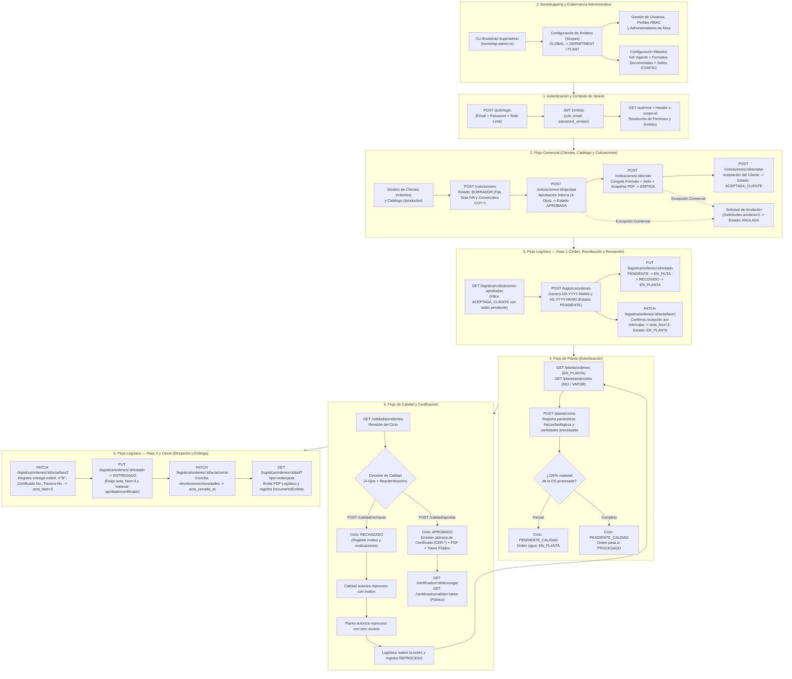
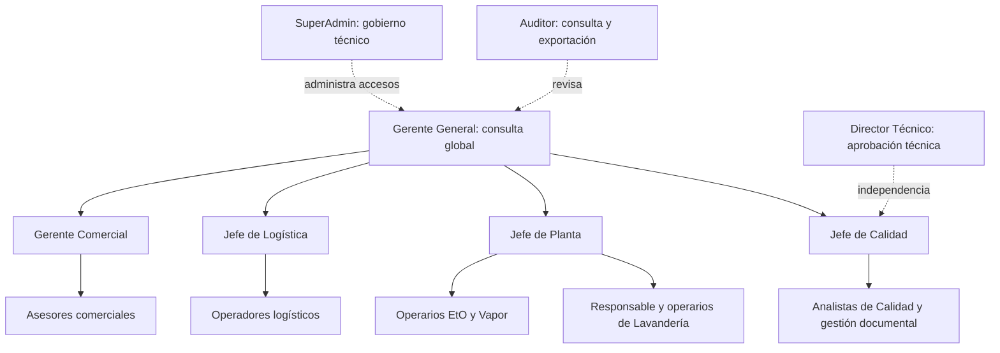

# Arquitectura, contratos y seguridad

> Consolidado el 23 de noviembre de 2026. Se conserva la ruta de origen y el estado original. Las afirmaciones fechadas deben contrastarse con el código o la decisión vigente.

## Índice

- [Auditoría de roles, permisos y vistas]( #doc-arquitectura-roles-permisos)
- [ADR 001: Evidencias y firmas en ciclos de esterilización]( #doc-arquitectura-adr-001-evidencias-y-firmas)
- [ADR-002: Renderizado de PDFs con Playwright y Next.js]( #doc-arquitectura-adr-002-pdf-playwright-nextjs)
- [ADR-003: Consecutivos transaccionales con bloqueo pesimista en base de datos]( #doc-arquitectura-adr-003-consecutivos-transaccionales)
- [ADR-004: Permisos centrales con asignaciones por ámbito]( #doc-arquitectura-adr-004-rbac-con-ambitos)
- [ADR-005: Unificación del catálogo de roles y funciones RBAC]( #doc-arquitectura-adr-005-unificacion-catalogo-roles)
- [Decisiones de arquitectura (ADR)]( #doc-arquitectura-adr-readme)
- [API y contratos observados]( #doc-arquitectura-api-y-contratos)
- [Arquitectura, autenticación y seguridad]( #doc-arquitectura-arquitectura-y-stack)
- [Contexto técnico del frontend]( #doc-arquitectura-contexto-frontend)
- [Contrato central de autorización RBAC]( #doc-arquitectura-contrato-autorizacion-rbac)
- [Estado implementado y límites de autorización]( #doc-arquitectura-estado-implementado)
- [Análisis Integral del Backend Sterinova: Flujo Completo y Procesos Administrativos]( #doc-arquitectura-flujo-completo-sistema)
- [Especificación de responsabilidades por rol — Frontend Sterinova]( #doc-arquitectura-matriz-responsabilidades-frontend)
- [Arquitectura organizacional y matriz de permisos]( #doc-arquitectura-roles-y-permisos)
- [Esquema y migraciones de base de datos]( #doc-base-de-datos-esquema-y-migraciones)
- [Discrepancias documentales comprobadas — 23 de noviembre de 2026]( #doc-discrepancias_documentales)
- [Correspondencia UI–API]( #doc-ui-ux-correspondencia-ui-api)

## Fuentes

<a id="doc-arquitectura-roles-permisos"></a>

**Origen:** docs/arquitectura-roles-permisos.md

## Auditoría de roles, permisos y vistas

> Fecha de revisión: 20 de noviembre de 2026. Alcance: código fuente de `Sterinova-Backend` y `SterinovaFrontend`. Esta auditoría es estática: no consulté una base desplegada, asignaciones reales, usuarios ni respuestas HTTP de un ambiente activo. Los roles disponibles en código no prueban que una migración esté aplicada ni que un usuario tenga una asignación.

### 1. Resumen

- El backend combina JWT, un `AuthorizationGuard` global con política fail-closed, permisos RBAC y ámbitos. No encontré controladores protegidos mediante `@Roles`; las rutas privadas usan `@RequirePermission` o `@RequireSession`.
- No encontré endpoints privados sin política efectiva. Las excepciones públicas son expresas: login, restablecimiento de contraseña con token, health checks y validación pública de certificados con token. Las rutas sin política en controladores marcados `@ScopedPermissions()` se deniegan.
- El frontend no usa el nombre del rol como autorización de interfaz. Obtiene `/auth/me` y compara la lista de permisos para filtrar navegación, permitir vistas y mostrar acciones. Esos controles son de UX; el backend debe conservar la decisión final y el filtro por ámbito/propiedad.
- Hay brechas de correspondencia verificables entre rutas/acciones y el API: activación de clientes usa `PATCH` donde el backend ofrece `PUT`; el envío de cotizaciones llama un endpoint inexistente; la página de roles/ámbitos permite entrar con permisos que no cubren todas sus llamadas; y la ruta de protocolos no tiene un permiso propio en el mapa de acceso de rutas.
- El catálogo reconoce permisos futuros que se siembran inactivos. Un permiso en TypeScript o una concesión de rol no implica que sea efectivo: el evaluador exige que el permiso y la asignación estén activos.

### 2. Modelo de autorización backend

#### 2.1 Fuentes y ejecución

| Elemento | Fuente | Función observada |
|---|---|---|
| Guards globales | `src/app.module.ts` | `ThrottlerGuard`, `JwtAuthGuard` y `AuthorizationGuard` se aplican globalmente. |
| Autorización | `src/rbac/authorization.guard.ts` | Para rutas privadas requiere sesión; rutas `@ScopedPermissions()` requieren metadato explícito `@RequirePermission`. Si falta, responde 403. Sin permiso, ámbito activo o usuario válido, deniega. |
| Permiso de endpoint | `src/rbac/require-permission.decorator.ts` | Publica el código en metadatos y OpenAPI (`x-required-permission`). |
| Sesión autenticada sin acción RBAC | `src/rbac/require-session.decorator.ts` | Solo exige usuario válido y activo; no sustituye un permiso para operaciones de negocio. |
| Concesiones y ámbitos | `src/rbac/authorization-policy.ts`, `src/rbac/rbac-authorization.service.ts` | Compila grants activos por asignación; diferencia `OWN` de `SCOPE`, admite descendientes solo cuando la concesión lo indica y acota `x-scope-id`. Una asignación no toma prestado el ámbito de otra. |
| Catálogo del runtime | `src/rbac/permission-catalog.ts` | Lista identificadores que el runtime reconoce. No activa por sí mismo permisos en la base. |
| Perfiles iniciales | `src/database/migrations/1794096000000-AddScopedRbac.ts` | Define `superadmin`, `admin_area`, `comercial`, `emisor_comercial`, `logistica`, `planta`, `calidad`, `auditor_calidad`, `gestor_documental` y concesiones iniciales. |
| Perfiles funcionales | `src/database/migrations/1794312001000-SeedBackendRoles.ts` | Define otros 14 perfiles; crea los nuevos permisos de fase 1 inactivos. |
| Estado correctivo | `src/database/migrations/1794484800000-RemoveLegacyUserRole.ts`, `src/database/migrations/1794700000000-AddProductCatalog.ts`, `src/database/migrations/1794900000000-EnableGeneralManager.ts` y migraciones posteriores | Activa perfiles/permisos y ajusta grants. El estado real depende de qué migraciones haya aplicado cada ambiente. |

`@Roles`/`RolesGuard` y el enum heredado no son la fuente de acceso de estos controladores. El esquema RBAC es la fuente operativa. `superadmin` se registra como titular PLATFORM único; los perfiles estándar se asignan a ámbitos. Los nombres `Admin`, `Comercial`, etc. no forman una jerarquía de permisos por sí solos.

#### 2.2 Perfiles reconocidos por las migraciones

Los perfiles funcionales creados por la migración de fase 1 se insertan inicialmente inactivos; una migración correctiva los activa. La disponibilidad efectiva debe comprobarse en la base del ambiente.

| Orden de referencia recomendado | Código / nombre | Tipo y alcance indicado en código | Concesiones principales documentadas |
|---:|---|---|---|
| 1 | `superadmin` — Titular de plataforma | PLATFORM, GLOBAL; titular único | Concesiones iniciales activas y posteriores grants explícitos. Administración técnica de roles/ámbitos/asignaciones, más capacidades de negocio concedidas explícitamente. No se hereda por nombre. |
| 2 | `admin_general` — Admin General | STANDARD; global asignable | Perfil legado amplio: la migración lo crea copiando las concesiones del `superadmin` que existían en ese momento, y agrega lectura de protocolos y recepción logística. No es una copia dinámica de futuras concesiones. Debe tratarse como perfil de privilegio crítico. |
| 3 | `gerente_general` — Gerente General | STANDARD; alcance global/descendientes asignables según migración | Lectura global gerencial y operativa, consulta de gerencia/administradores y aprobación de versiones documentales. La migración correctiva reemplaza sus grants; no lo convierte en PLATFORM. |
| 4 | `admin_comercial` — Admin Comercial | STANDARD; área y descendientes | Lectura comercial, gestión delegada de identidades/asignaciones del área, clientes y cotizaciones, aprobación interna, envío, emisión y resolución de anulaciones; conforme grants sembrados y estado activo. |
| 4 | `admin_logistica` — Admin Logística | STANDARD; área y descendientes | Operación logística, autorización de reempaque y administración delegada del área. |
| 4 | `admin_planta` — Admin Planta | STANDARD; área y descendientes | Lectura/registro de ciclos, equipos y administración delegada del área. |
| 4 | `admin_calidad` — Admin Calidad | STANDARD; área y descendientes | Operación de Calidad, gestión de protocolos/desviaciones y administración delegada del área. |
| 4 | `admin_lavanderia` — Admin Lavandería | STANDARD; área y descendientes | Consulta y registro del proceso de lavandería y administración delegada del área. |
| 5 | `asesor_comercial` — Asesor Comercial | STANDARD; grants SCOPE y OWN | Clientes y preparación comercial; editar, enviar, aceptar, emitir y solicitar anulación en los ámbitos/recursos OWN especificados. |
| 5 | `operador_logistica` — Asesor Logística | STANDARD; ámbito asignado | Consultar cotizaciones disponibles, órdenes, crear órdenes, registrar recepción/despacho y cambiar estados, sujeto a permisos activos. |
| 5 | `operario_planta` — Asesor Planta | STANDARD; ámbito asignado | Consultar órdenes/ciclos y registrar ciclos; incluye elaborar certificados según el grant de fase 1. |
| 5 | `analista_calidad` — Asesor Calidad | STANDARD; ámbito asignado | Lectura/decisión ordinaria de Calidad, certificados y operaciones incluidas en `quality`. |
| 5 | `operario_lavanderia` — Asesor Lavandería | STANDARD; ámbito asignado | Consultar órdenes y registrar proceso de lavandería. |
| 5 | `director_tecnico` — Director Técnico | STANDARD; ámbito asignado | Lectura de Calidad, gestión de protocolos, liberaciones autorizadas y aprobaciones técnicas/documentales definidas en el grant. |
| 5 | `gerente_calidad` — Gerente Calidad | STANDARD; ámbito asignado | `qualityRead`: lectura de ciclos, certificados y descarga; el nombre no concede aprobación adicional. |
| 6 | `auditor` — Auditor | STANDARD; grants de lectura y descendientes | Lectura transversal, auditoría y exportaciones comerciales/certificados indicadas en su perfil. Paralelo a la cadena de mando, sin escritura de negocio. |
| 6 | `auditor_calidad` — Auditoría de Calidad | STANDARD; ámbito asignado | Lectura de ciclos, certificados y auditoría. |
| 6 | `gestor_documental` — Gestión documental | STANDARD; ámbito asignado | Consultar/crear/editar/eliminar formatos, versiones y sellos conforme a grants activos. |
| 5 | `emisor_comercial` — Emisión comercial | STANDARD; ámbito asignado | Solo `cotizaciones.emitir`; puede componerse con otros perfiles mediante asignaciones separadas. |
| 5 | `comercial` — Comercial (perfil inicial) | STANDARD; ámbito asignado | Permisos comerciales iniciales y edición/eliminación OWN; emisión se separó en `emisor_comercial`. |
| 5 | `logistica` — Logística (perfil inicial) | STANDARD; ámbito asignado | Permisos logísticos base de lectura, creación y cambio de estado. |
| 5 | `planta` — Planta (perfil inicial) | STANDARD; ámbito asignado | Permisos iniciales de órdenes, ciclos y creación de ciclos. |
| 5 | `calidad` — Calidad (perfil inicial) | STANDARD; ámbito asignado | Permisos iniciales de Calidad y certificados. |
| 5 | `admin_area` — Administración de área | STANDARD; ámbito asignado y descendientes | `usuarios.ver`, `asignaciones.gestionar`, capacidades de cancelación y productos incorporadas por migraciones. Algunas operaciones que sugiere el perfil requieren autorización GLOBAL en el servicio y no son delegables desde un ámbito de área; ver brechas. |

El orden es una propuesta de presentación, no herencia: los perfiles no forman un árbol automático. `admin_general`, `gerente_general`, el auditor y los administradores de área tienen responsabilidades distintas y no deben ordenarse como si cada rango heredara íntegramente al anterior. Los nueve perfiles iniciales pueden coexistir con los funcionales añadidos después; el código no los elimina automáticamente.

#### 2.3 Catálogo de permisos reconocido

Los siguientes códigos aparecen en `PERMISSION_CATALOG`. “Fase 1” identifica permisos que la migración `SeedBackendRoles` introduce como inactivos. La tabla no certifica el estado de la BD de producción.

| Módulo | Permisos reconocidos |
|---|---|
| Accesos/RBAC | `usuarios.ver`, `usuarios.identidad.gestionar`, `asignaciones.gestionar`, `roles.gestionar`, `ambitos.gestionar`, `usuarios.area.invitar` (Fase 1), `usuarios.area.restablecimiento.iniciar` (Fase 1). |
| Comercial — clientes | `clientes.ver`, `clientes.crear`, `clientes.editar`, `clientes.importar`, `clientes.eliminar`, `clientes.activar` (Fase 1), `clientes.inactivar` (Fase 1). |
| Comercial — catálogo | `productos.gestionar` (activado por migración de catálogo; grants para `admin_area` y `superadmin`). |
| Comercial — cotizaciones | `cotizaciones.ver`, `cotizaciones.crear`, `cotizaciones.editar`, `cotizaciones.eliminar`, `cotizaciones.previsualizar`, `cotizaciones.emitir`, `cotizaciones.descargar`, `cotizaciones.aceptar`, `cotizaciones.aprobar_interna` (Fase 1), `cotizaciones.enviar` (Fase 1), `cotizaciones.reasignar` (Fase 1), `cotizaciones.exportar` (Fase 1). |
| Comercial — anulaciones | `solicitudes_anulacion.crear`, `solicitudes_anulacion.aprobar`, `solicitudes_anulacion.ver` (permisos dinámicos de negocio; concedidos explícitamente por migración). |
| Logística | `logistica.cotizaciones_disponibles.ver`, `logistica.ordenes.ver`, `logistica.ordenes.crear`, `logistica.ordenes.cambiar_estado`, `logistica.recepciones.registrar` (Fase 1 y activado), `logistica.reempaque.autorizar` (Fase 1), `logistica.despacho.ejecutar` (Fase 1). |
| Planta | `planta.ordenes.ver`, `planta.ciclos.ver`, `planta.ciclos.crear`, `planta.protocolos.ver` (Fase 1 y activado), `planta.equipos.gestionar` (Fase 1), `planta.equipos.reactivar` (Fase 1), `planta.retroactividad.autorizar` (Fase 1), `planta.reprocesos.registrar` (Fase 1). |
| Calidad | `calidad.ciclos.ver`, `calidad.aprobar`, `calidad.rechazar`, `calidad.protocolos.gestionar` (Fase 1), `calidad.desviaciones.verificar` (Fase 1), `calidad.desviaciones.aprobar` (Fase 1), `calidad.liberacion_condicionada.autorizar` (Fase 1), `calidad.liberacion_desviacion.autorizar` (Fase 1). |
| Certificados | `certificados.ver`, `certificados.descargar`, `certificados.elaborar` (Fase 1), `certificados.verificar` (Fase 1), `certificados.aprobar` (Fase 1), `certificados.exportar` (Fase 1), `certificados.restaurar` (Fase 1), `certificados.anular` (Fase 1). |
| Auditoría | `auditoria.ver`. |
| Documentos y sellos | `formatos.ver`, `formatos.crear`, `formatos.editar`, `formatos.eliminar`, `formatos.versiones.crear`, `formatos.versiones.editar`, `formatos.versiones.publicar`, `formatos.versiones.aprobar` (Fase 1), `formatos.excepcion.autorizar` (Fase 1), `sellos.ver`, `sellos.crear`, `sellos.editar`, `sellos.desactivar`, `sellos.licencias.gestionar` (Fase 1). |
| Finanzas | `tasas_fiscales.gestionar` (activado por migración de IVA). |
| Gerencia | `gerencia.metricas.ver`, `gerencia.administradores.gestionar` (activados por migración gerencial). |
| Lavandería | `lavanderia.ordenes.ver`, `lavanderia.proceso.registrar` (Fase 1). |

La migración de fase 1 inserta una parte de los permisos con `active=0`; las concesiones de perfil no bastan para autorizarlos. Las migraciones correctivas activan solo capacidades implementadas (entre ellas recepción logística, protocolos Planta, catálogo de productos, anulaciones, IVA y gerencia). Varias capacidades futuras no tienen endpoint correspondiente aún.

#### 2.4 Matriz de módulos, acciones y roles

Roles en cada fila significa “el grant está descrito en las migraciones”. La autorización final sigue dependiendo de que rol, asignación, permiso y ámbito estén activos y de la política de propiedad del recurso.

| Módulo / vista / acción | Permiso backend | Roles con grant de referencia |
|---|---|---|
| Inicio: mostrar contexto autenticado | Sesión | Cualquier usuario activo con JWT válido. |
| Consultar usuarios del ámbito | `usuarios.ver` | `superadmin`, `admin_general`, `gerente_general`, `admin_area`, administradores de área, `gerente_calidad`, `auditor`, `auditor_calidad` y perfiles funcionales a los que se conceda explícitamente. |
| Crear/editar/desactivar identidad | `usuarios.identidad.gestionar` | `superadmin`, `admin_general`; `gerente_general` tiene grant para administración delegada, pero el backend también requiere alcance GLOBAL. |
| Consultar/asignar perfiles | `asignaciones.gestionar` | `superadmin`, `admin_general`, `admin_area`, administradores de área; varios servicios vuelven a exigir GLOBAL. |
| Configurar roles y ámbitos | `roles.gestionar`, `ambitos.gestionar` | Principalmente `superadmin` y el legado `admin_general`; no se hereda por cargo. |
| Clientes: listar/detalle | `clientes.ver` | `superadmin`, `admin_general`, `gerente_general`, `admin_comercial`, `asesor_comercial`, `comercial`, `auditor`. |
| Clientes: crear/editar/importar | `clientes.crear`, `clientes.editar`, `clientes.importar` | `superadmin`, `admin_general`, `admin_comercial`, `asesor_comercial`, `comercial`; `admin_comercial` agrega descendientes. |
| Clientes: activar/inactivar | `clientes.activar`, `clientes.inactivar` | Grants de `admin_comercial`/`asesor_comercial`; permisos de fase 1. Actualmente la vista usa PATCH y el backend no declara PATCH de cliente. |
| Catálogo de productos | `productos.gestionar` | `superadmin`, `admin_general`, `admin_area` según concesiones de migración; no está concedido a `admin_comercial` por el seed de fase 1. |
| Cotizaciones: listar/detalle/previsualizar/descargar | `cotizaciones.ver`, `.previsualizar`, `.descargar` | `superadmin`, `admin_general`, `gerente_general`, `admin_comercial`, `asesor_comercial`, `comercial`, `auditor` (descarga/previsualización según perfil). |
| Cotizaciones: crear/editar/eliminar | `cotizaciones.crear`, `.editar`, `.eliminar` | `superadmin`, `admin_general`, `admin_comercial`, `asesor_comercial`, `comercial`; perfiles comerciales aplican SCOPE/OWN diferente. Borrar cotizaciones está expresamente denegado por endpoint. |
| Cotizaciones: aprobación interna | `cotizaciones.aprobar_interna` | `admin_comercial` y grants amplios del legacy `admin_general`/`superadmin`; permiso de fase 1. |
| Cotizaciones: emitir | `cotizaciones.emitir` | `superadmin`, `admin_general`, `admin_comercial`, `asesor_comercial` (OWN), `emisor_comercial`; chequeo adicional de estado del documento. |
| Cotizaciones: enviar al cliente | `cotizaciones.enviar` | Grant de fase 1 para perfiles comerciales; no existe la ruta API `/cotizaciones/:id/enviar` en el controlador actual. |
| Solicitar/resolver anulación | `solicitudes_anulacion.crear`, `.aprobar`, `.ver` | Solicitud: perfiles comerciales autorizados; resolución: `admin_comercial`, `admin_area`, `admin_general`, `superadmin`. El servicio además valida ámbito y separación creador/aprobador donde aplica. |
| Logística: cotizaciones disponibles/órdenes/estados | `logistica.*` base | `superadmin`, `admin_general`, `admin_logistica`, `operador_logistica`, `logistica`; los administradores de área tienen descendientes. |
| Logística: recepción/reempaque/despacho | `logistica.recepciones.registrar`, `.reempaque.autorizar`, `.despacho.ejecutar` | Recepción/despacho incluidos en roles de administración y operación logística; reempaque para `admin_logistica` y perfiles amplios. Recepción está activada; otros permisos de fase 1 pueden seguir inactivos. |
| Planta: órdenes/ciclos/registro de ciclo | `planta.ordenes.ver`, `planta.ciclos.ver`, `.crear` | `superadmin`, `admin_general`, `gerente_general`, `admin_planta`, `operario_planta`, `planta`, `auditor` (lectura donde concedida). |
| Planta: protocolos/equipos/retroactividad/reprocesos | `planta.protocolos.ver`, `planta.equipos.*`, `planta.retroactividad.autorizar`, `planta.reprocesos.registrar` | Lectura de protocolo en roles de lectura/Planta; gestión de equipo para `admin_planta`; retroactividad para `admin_calidad`; capacidades futuras restantes según grants y activación. |
| Calidad: revisar/aprobar/rechazar ciclos | `calidad.ciclos.ver`, `.aprobar`, `.rechazar` | `superadmin`, `admin_general`, `admin_calidad`, `analista_calidad`, `calidad`; lectura de `gerente_calidad`, `director_tecnico`, auditores. |
| Protocolos de calidad / desviaciones / liberación | `calidad.protocolos.gestionar`, `calidad.desviaciones.*`, `calidad.liberacion_*` | Grants para `admin_calidad`, `analista_calidad`, `director_tecnico` según acción; permisos de fase 1, no todos tienen rutas implementadas. |
| Certificados: consultar/descargar | `certificados.ver`, `.descargar` | Calidad, auditorías, `gerente_general`, comerciales y perfiles amplios conforme grants específicos. |
| Certificados: elaborar/verificar/aprobar/exportar/restaurar/anular | `certificados.*` | Capacidad futura, asignaciones diversas según roles de Calidad/Planta/Auditoría; no debe interpretarse como endpoint disponible sin encontrar controlador. |
| Auditoría | `auditoria.ver` | `superadmin`, `admin_general`, `gerente_general`, `auditor`, `auditor_calidad`; sujeto a ámbitos. |
| Formatos/documentos/versiones | `formatos.*` | `gestor_documental` para gestión operativa; `gerente_general` recibe aprobación de versión; `director_tecnico` tiene aprobación según su concesión; perfiles gerenciales amplios tienen lectura. |
| Sellos de certificación | `sellos.*` | `gestor_documental`; perfiles gerenciales amplios con lectura; modificaciones requieren grants explícitos. |
| Tasas fiscales/IVA | `tasas_fiscales.gestionar` | `superadmin` y cualquier otra asignación explícita activa. La vista pide este mismo permiso para lectura y publicación. |
| Métricas de gerencia | `gerencia.metricas.ver` | `gerente_general`, `superadmin`; otros solo por asignación explícita. |
| Administración de áreas | `gerencia.administradores.gestionar` | `gerente_general`, `superadmin`; endpoint dedicado, no equivale a RBAC general. |
| Operación de lavandería | `lavanderia.*` | `admin_lavanderia`, `operario_lavanderia`; los permisos están catalogados como fase 1. |

### 3. Frontend: rutas, navegación y acciones

#### 3.1 Sesión y protección de vistas

`src/app/(erp)/layout.tsx` envuelve las páginas con `SessionProvider`, valida el token con `/auth/me`, redirige al login si no hay sesión y evalúa `canAccessPath`. Las rutas de cotización tienen una regla especial: `/nueva` exige `cotizaciones.crear`; las restantes rutas del subárbol exigen `cotizaciones.ver`. La autorización API no depende de este layout.

`src/lib/session.tsx` mantiene `permissions`, `capabilities`, ámbitos disponibles y ámbito actual desde `/auth/me`. El selector del `Header` puede cambiar el ámbito y volver a cargar la sesión. `src/lib/navigation.ts` filtra el Sidebar y determina el permiso requerido por ruta. `src/lib/dashboard.ts` vuelve a filtrar tarjetas de acceso. En los componentes de negocio, `can()` o comparaciones con `permissions` muestran/ocultan botones y operaciones. No encontré decisiones de autorización basadas en nombres/códigos de perfil en vistas; `profiles` se usa como dato de presentación.

#### 3.2 Inventario de rutas de páginas

| Ruta frontend | Menú | Condición de ruta/acciones observada |
|---|---|---|
| `/login`, `/reset-password` | No; públicas | Flujos de acceso/recuperación. La API aplica login público y recuperación con token. |
| `/` dentro de `(erp)` | Principal, requiere sesión | Dashboard filtra secciones por permisos; el inicio en sí devuelve permitido para sesión válida aunque el usuario no tenga permisos de módulo. |
| `/comercial` | Menú Comercial implícito por enlaces | Accesos del dashboard requieren alguno de `clientes.ver`, `productos.gestionar`, `cotizaciones.ver`. |
| `/comercial/clientes` | `clientes.ver` | Acciones de crear/editar/importar por permisos; activar/inactivar se muestra con permisos dedicados de fase 1. |
| `/comercial/productos` | `productos.gestionar` | CRUD de catálogo condicionado por `productos.gestionar`. |
| `/comercial/cotizaciones` | `cotizaciones.ver` | Crear, editar, previsualizar, aprobar, emitir, enviar, descargar y solicitud de anulación usan checks de permiso en pantalla/acción. |
| `/comercial/cotizaciones/nueva` | Sin enlace propio | Layout requiere `cotizaciones.crear`. |
| `/comercial/cotizaciones/:id/editar` | Sin enlace propio | Layout requiere `cotizaciones.ver`; el formulario/CTA de edición requiere además `cotizaciones.editar`. |
| `/logistica` | `logistica.ordenes.ver` | Acciones de crear órdenes, recepción y cambio de estado verifican permisos específicos. |
| `/planta` | `planta.ordenes.ver` o `planta.ciclos.ver` | Muestra secciones de órdenes/ciclos y creación si `planta.ciclos.crear`. |
| `/planta/ciclo/nuevo` | Sin enlace propio | Ruta requiere `planta.ciclos.crear`. |
| `/calidad` | `calidad.ciclos.ver` o `certificados.ver` | Lista, revisión y certificados por permisos específicos. |
| `/calidad/revisar/:ciclo_id` | Sin enlace propio | Ruta requiere `calidad.ciclos.ver`; botones requieren aprobar/rechazar y descarga. |
| `/calidad/certificados/:id` | Sin enlace propio | Ruta requiere `certificados.ver`; descarga exige `certificados.descargar`. |
| `/calidad/protocolos` | Sin enlace Sidebar | Página requiere `planta.protocolos.ver`; botón de gestión condicional por `calidad.protocolos.gestionar`. |
| `/solicitudes` | `solicitudes_anulacion.ver` | Consulta requiere ver; resolver requiere aprobar. |
| `/usuarios` | `usuarios.ver` | Alta requiere `usuarios.identidad.gestionar` y `asignaciones.gestionar`; gestión de asignaciones requiere el segundo; botones condicionales por permiso. |
| `/administracion/roles-ambitos` | `roles.gestionar` **o** `ambitos.gestionar` | La página obtiene catálogo/asignaciones y ámbitos; ver brechas de permisos de llamadas. |
| `/configuracion/plantillas` y `/configuracion/plantillas/:id/versiones` | `formatos.ver` | Crear/editar/publicar/eliminar usan permisos de acción separados. |
| `/configuracion/sellos` | `sellos.ver` | La vista tiene acciones de modificación, aunque el control fino de permisos en algunos diálogos debe cotejarse con sus llamadas `sellos.*`. |
| `/configuracion/tasas-fiscales` | `tasas_fiscales.gestionar` | Lee/publica con el mismo permiso. |
| `/gerencia`, `/gerencia/detalle` | `gerencia.metricas.ver` | La vista filtra métricas; envía el ámbito actual como filtro cuando no es GLOBAL. |
| `/gerencia/administradores` | `gerencia.administradores.gestionar` | Administra perfiles de área mediante endpoints de gerencia; el catálogo de perfiles se obtiene desde `/users/role-catalog`. |
| `/auditoria` | `auditoria.ver` | Consulta eventos de auditoría. |
| `/internal/pdf/cotizacion`, `/internal/pdf/certificado` | No; flujo interno | No son vistas de usuario del ERP. Dependen del mecanismo interno de render y token PDF, no del menú RBAC. |

El Sidebar tiene secciones Principal, Comercial, Operación, Gestión, Documentos, Gerencia, Auditoría y Administración. La entrada de protocolos no aparece en el menú. Inicio presenta una selección reducida de tarjetas y no incluye todas las entradas del Sidebar.

### 4. Endpoints backend y controles

En la columna “control” se indica el permiso que exige el método. Los controladores marcados `@ScopedPermissions()` aplican además la denegación por defecto a un método sin permiso.

| Área / controlador | Rutas y acciones | Control |
|---|---|---|
| Auth (`auth.controller.ts`) | `GET /auth/me`; `POST /auth/login`; `POST /auth/password/reset` | Sesión; pública con throttling; pública con token de un solo uso y throttling, respectivamente. |
| Salud (`health.controller.ts`) | `GET /health/live`, `GET /health/ready` | Públicas explícitas; liveness/readiness, sin operaciones de negocio. |
| Auditoría | `GET /auditoria` | `auditoria.ver`. |
| Clientes | `POST /clientes`, `POST /clientes/bulk`, `GET /clientes`, `GET /clientes/:id`, `PUT /clientes/:id`, `DELETE /clientes/:id` | `clientes.crear`, `.importar`, `.ver`, `.ver`, `.editar`, `.eliminar`. El servicio aplica contexto del ámbito; eliminación depende de reglas de referencias. |
| Productos | `GET/POST /productos`, `PUT /productos/:id`, `PATCH /productos/:id/estado` | `productos.gestionar`; búsquedas auxiliares `GET /productos/buscar/crear` y `/editar` exigen `cotizaciones.crear` y `.editar`. |
| Cotizaciones | `POST /cotizaciones`, `GET /cotizaciones`, `GET /cotizaciones/exportar`, `GET /cotizaciones/iva-vigente`, `GET /cotizaciones/:id`, `GET /:id/previsualizar`, `POST /:id/emitir`, `GET /:id/descargar`, `POST /:id/aprobar`, `PUT/DELETE /:id/items/:itemId/imagen`, `PUT /:id` | Crear, ver, exportar, crear, ver, previsualizar, emitir, descargar, aprobar interna, editar, editar, editar respectivamente. Todas requieren metadato. `/cotizaciones/:id` DELETE es denegado expresamente y el handler responde Forbidden. No hay ruta `/cotizaciones/:id/enviar`. |
| Anulaciones | `POST /cotizaciones/:id/solicitud-anulacion`, `GET /solicitudes-anulacion/pendientes`, `PATCH /solicitudes-anulacion/:id/resolver` | `solicitudes_anulacion.crear`, `.ver`, `.aprobar`; lógica adicional de ámbito y estado. |
| Logística | Crear orden; editar materiales; registrar fases del acta; listar/consultar orden; cotizaciones aprobadas; PDF; listar documentos emitidos; cambiar estado | `logistica.ordenes.crear`, `logistica.recepciones.registrar`, `logistica.ordenes.ver`, `logistica.cotizaciones_disponibles.ver`, `logistica.ordenes.ver`, `logistica.ordenes.cambiar_estado`. |
| Planta | `GET /planta/protocolos`, `/ordenes`, `/ciclos`; `POST /planta/ciclos` | `planta.protocolos.ver`, `planta.ordenes.ver`, `planta.ciclos.ver`, `planta.ciclos.crear`. |
| Calidad | Consultar pendientes/ciclo; aprobar y rechazar ciclo | `calidad.ciclos.ver`, `.aprobar`, `.rechazar`. |
| Certificados | Listar/detalle/exportar/descargar; `GET /certificados/validar/:token` | `certificados.ver`, `.exportar`, `.descargar`; validación por token es pública explícita. |
| Formatos documentales | Listar/detalle/crear/editar/eliminar; listar versiones del formato; crear/editar/publicar versión | `formatos.ver` para formato y versiones visibles en el ámbito, `.crear`, `.editar`, `.eliminar`, `formatos.versiones.crear`, `.editar`, `.publicar`. |
| Sellos | Listar/imagen/crear/editar/desactivar | `sellos.ver`, `.crear`, `.editar`, `.desactivar`. |
| Tasas fiscales | Consultar y publicar IVA | `tasas_fiscales.gestionar`. |
| Gerencia | Resumen/detalle y catálogo/listado/crear/asignar/quitar administradores | `gerencia.metricas.ver` y `gerencia.administradores.gestionar`. |
| Usuarios | Listar/crear/editar/restablecer contraseña/cambiar estado/eliminar | Listar: `usuarios.ver`; operaciones de identidad y restablecimiento: `usuarios.identidad.gestionar`; delete responde Forbidden. Identidad además requiere global en el servicio. |
| Asignaciones de usuario | Catálogo/asignaciones/crear/quitar | `asignaciones.gestionar`; servicio exige que el contexto contenga ámbito GLOBAL. |
| Ámbitos | Listar/detalle/crear/editar/cerrar | `ambitos.gestionar`. |

No encontré un endpoint de negocio privado que dependa solo de ocultar un botón del frontend. Métodos de borrado de cotización y usuario carecen de permiso concedido y están cerrados de forma explícita. Las rutas públicas citadas no son permisos ausentes: tienen `@Public()` y un contrato de acceso público/token.

### 5. Brechas e inconsistencias

#### 5.1 Brechas de UX o contrato frontend/backend

| Prioridad | Hallazgo | Efecto probable |
|---|---|---|
| Alta | `ClientesPageClient.toggleStatus()` envía `PATCH /clientes/:id`; el backend declara `PUT /clientes/:id` y no declara `PATCH` para clientes. Además, la vista comprueba `clientes.activar/inactivar`, mientras que el endpoint existente protege con `clientes.editar`. | Cuando se muestra Activar/Inactivar, la llamada no encuentra una ruta compatible (404). Si se agrega solo el permiso de acción al usuario, no basta para pasar el guard de `clientes.editar`. |
| Alta | `CotizacionesClient.handleEnviar()` llama `POST /cotizaciones/:id/enviar`; `CotizacionesController` no implementa esa ruta. `cotizaciones.enviar` es un permiso de fase 1 sembrado inactivo, pero la interfaz tiene el botón condicionado a él. | Con grants/migración que lo hagan visible, el botón falla con 404. El permiso está adelantado respecto del API. |
| Alta | La entrada Usuarios aparece con `usuarios.ver`; `UsersPage` hace `Promise.all` incluyendo `/users/role-assignments` y `/users/role-catalog` cuando `asignaciones.gestionar` está presente. `UserRolesService.authorize()` exige que el contexto alcance GLOBAL. | Un `admin_area` asignado a un ámbito departamental puede tener `usuarios.ver` y `asignaciones.gestionar` (la concesión es de área/descendientes), ver la página y aun así recibir 403 en las llamadas RBAC; el `Promise.all` puede impedir que cargue también el listado. |
| Alta | Enlace Roles y ámbitos y `canManage` aceptan `roles.gestionar OR ambitos.gestionar`; al entrar, la página solicita catálogo/asignaciones de usuario además de los ámbitos. El catálogo/asignaciones exige `asignaciones.gestionar`, y no hay controlador de gestión de roles que use `roles.gestionar`. | Un sujeto con solo `ambitos.gestionar` ve la ruta, pero las llamadas de catálogo/asignaciones pueden fallar 403; un sujeto con solo `roles.gestionar` ve una ruta que no tiene API implementada para esa capacidad y también puede fallar. |
| Media | `/calidad/protocolos` no tiene regla propia en `canAccessPath`; cae en prefijo `/calidad`, que exige `calidad.ciclos.ver` o `certificados.ver`. La página y su consulta usan `planta.protocolos.ver`. Tampoco existe enlace de Sidebar a Protocolos. | Un usuario con permiso para protocolos pero sin permisos de ciclos/certificados no llega a la vista; el redirect lo saca aunque el permiso del endpoint esté concedido. |
| Media | `calidad.protocolos.gestionar` solo habilita un botón cuyo `onClick` declara que la navegación de gestión está pendiente. No hay endpoint de administración de protocolos en los controladores revisados. | El botón visible no ejecuta una acción. No es un 403 del API, sino una función incompleta/permisología adelantada. |
| Media | `gerente_general` y `director_tecnico` reciben `formatos.versiones.aprobar`, pero `FormatosDocumentalesController` protege el cambio de estado con `formatos.versiones.publicar`; no encontré un endpoint separado que consuma `.aprobar`. | El grant de aprobación no se traduce por sí solo en una acción API diferenciada; la vista de versiones solo muestra el control de publicación con `.publicar`. Definir si aprobación y publicación son una misma acción o si requieren una etapa/endpoint propio. |
| Media | La ruta de nueva cotización tiene acceso por `cotizaciones.crear`, pero los demás subrutas bajo `/comercial/cotizaciones/` se autorizan como `cotizaciones.ver` en el layout. | El formulario luego filtra edición por `cotizaciones.editar`; los usuarios con solo edición OWN deben tener permiso de lectura para pasar la puerta de ruta y cargar el registro. Confirmar que las asignaciones siempre acompañen edición con lectura. |
| Baja | Dashboard (`lib/dashboard.ts`) no ofrece tarjetas de Gerencia, Auditoría, Solicitudes ni Roles/Ámbitos, aunque Sidebar sí muestra sus enlaces por permisos. | No produce 403; solo hace que algunos módulos no aparezcan como acceso rápido. |

#### 5.2 Riesgos de seguridad / coherencia de autorización

- La navegación está bien basada en permisos y no en nombres de rol, pero `can(permission)` solo evalúa presencia del permiso. La UI no expresa `OWN` versus `SCOPE` para cada recurso; el backend mantiene la protección correcta, pero un botón puede aparecer para una capacidad cuyo recurso concreto no sea accesible y la acción acabar en 403/404 por ámbito/propiedad.
- El control de la página de Usuarios agrupa `usuarios.identidad.gestionar` y `asignaciones.gestionar`, pero el backend además requiere ámbito GLOBAL para ciertas mutaciones. La interfaz no proyecta esa precondición como una capacidad compuesta explícita.
- `roles.gestionar` existe en el catálogo y habilita una entrada del menú, pero no se halló un controlador que lo consuma. La asignación usa `asignaciones.gestionar`; por tanto, mostrar el permiso como “gestionar roles” confunde configuración de catálogo y asignación de perfiles.
- Los permisos de acción `clientes.activar/inactivar` no se alinean con el permiso de endpoint `clientes.editar`, además de la discrepancia HTTP. Si se busca delegación fina, se debe exponer un endpoint de estado con su permiso específico o controlar en el backend el campo `activo` mediante permisos dedicados.
- No hay brecha de backend causada por confiar solamente en el frontend: los endpoints observados tienen protección global o explícita. La observación anterior sobre inactividad se refiere a coherencia y concesión excesiva/granularidad de permisos, no a ausencia total de guard.

### 6. Propuesta para unificar roles y permisos

1. **Permiso como contrato único por acción.** Mantener códigos de acción estables (`clientes.estado.cambiar`, por ejemplo) en una única fuente de catálogo versionada. El backend declara cada endpoint con ese permiso; el frontend genera reglas de ruta y controles de botón a partir del contrato API (`x-required-permission`) o de un manifiesto compartido validado en CI.
2. **Separar capacidad de ámbito.** La sesión debe exponer por permiso capacidades que incluyan ámbitos SCOPE/OWN. La UI oculta/deshabilita acciones sin capacidad para el ámbito actual y el backend vuelve a validar siempre el registro y propietario. `x-scope-id` solo limita; nunca otorga alcance.
3. **Eliminar checks por nombre de rol.** Usar roles como paquetes administrables de permisos, no como condición en componentes/controladores. Mantener perfiles técnicos especiales como `superadmin`/PLATFORM con reglas de titularidad propias y explícitas.
4. **Separar privilegios por responsabilidad.** Mantener en paralelo lectura gerencial/auditoría, administración de identidad, aprobación técnica, edición comercial y operación. No ordenar como herencia automática. Migrar o retirar `admin_general` después de definir su reemplazo, porque es una concesión amplia estática derivada del `superadmin`.
5. **Delegación de usuarios consistente.** Decidir si `admin_area` administra usuarios/asignaciones de su ámbito. Si sí, permitirle llamadas con ámbito y limitar recursos en SQL; si no, retirarle/renombrarle los grants que la UI interpreta como delegables. No conceder una interfaz de administración que acaba en requisito GLOBAL.
6. **Separar menú, ruta y acción.** Cada ruta debe declarar permisos de entrada; cada botón su permiso de acción; cada API la misma acción. Una ruta puede entrar con lectura y esconder mutaciones, pero la vista no debe cargar APIs de administración opcionales en un `Promise.all` que bloquee el contenido de lectura.
7. **Tratar permisos futuros como no disponibles.** No mostrar botones/rutas para permisos sin handler backend. Mantener una lista automatizada de permisos con ruta/controlador y bloquear diferencias en CI, incluidas rutas declaradas por frontend sin operación OpenAPI.
8. **Matriz jerárquica propuesta (sin herencia implícita):**

| Nivel de gobierno/función | Perfiles propuestos | Regla |
|---|---|---|
| Plataforma | `superadmin` | Gobierno del catálogo, ámbitos, asignación técnica y recuperación; titularidad única, auditable. |
| Dirección/consulta transversal | `gerente_general`, `auditor` | Lectura global explícita, con acciones de negocio separadas y sin heredar administración técnica. Auditoría es independiente de la línea gerencial. |
| Administración departamental | `admin_comercial`, `admin_logistica`, `admin_planta`, `admin_calidad`, `admin_lavanderia` | Solo su área y descendientes delegados; administra pertenencias locales si el backend ofrece API de área. No configura roles globales. |
| Supervisión técnica | `director_tecnico`, `gerente_calidad` | Aprobaciones/autoridades técnicas separadas de operación y autoría; no se amplían por similitud de título. |
| Especialistas de proceso | `asesor_comercial`, `operador_logistica`, `operario_planta`, `analista_calidad`, `operario_lavanderia`, `emisor_comercial`, `gestor_documental`, `auditor_calidad` | Permisos de ejecución/lectura OWN o por ámbito con separación de funciones. |
| Compatibilidad heredada | `admin_general`, `admin_area`, `comercial`, `logistica`, `planta`, `calidad`, `emisor_comercial`, `auditor_calidad`, `gestor_documental` | Congelar asignaciones nuevas, mapear usuarios a perfiles canónicos y retirar el legado mediante migración revisada. Algunos códigos se solapan con perfiles funcionales y requieren conciliación antes de eliminarlos. |

### 7. Archivos principales revisados

**Backend:** `src/app.module.ts`, `src/main.ts`, `src/auth/`, `src/rbac/authorization.guard.ts`, `src/rbac/authorization-policy.ts`, `src/rbac/rbac-authorization.service.ts`, `src/rbac/permission-catalog.ts`, `src/database/migrations/1794096000000-AddScopedRbac.ts`, `1794312001000-SeedBackendRoles.ts`, `1794484800000-RemoveLegacyUserRole.ts`, `1794700000000-AddProductCatalog.ts`, `1794900000000-EnableGeneralManager.ts`; controladores de clientes, productos, cotizaciones, logística, planta, calidad, certificados, formatos, usuarios, asignaciones, ámbitos, revocación, gerencia, auditoría y tasas fiscales.

**Frontend:** `src/app/(erp)/layout.tsx`, `src/lib/session.tsx`, `src/lib/navigation.ts`, `src/lib/dashboard.ts`, `src/components/Sidebar.tsx`, `src/components/Header.tsx`; páginas de Comercial, Logística, Planta, Calidad, Usuarios, Roles/Ámbitos, Gerencia, Auditoría, Solicitudes y Configuración.

### 8. Límites del análisis

No conecté a una base de datos ni comprobé el conjunto efectivo de grants, scopes, perfiles activos o cuentas asignadas en producción. Tampoco probé cada combinación desde navegador; las brechas se derivan de rutas, permisos y llamadas declaradas en el código. La matriz describe las migraciones/código versionado al momento de revisión y debe contrastarse con el ledger de migraciones y los grants del ambiente antes de cambios de acceso.

<a id="doc-arquitectura-adr-001-evidencias-y-firmas"></a>

**Origen:** docs/arquitectura/adr/001-evidencias-y-firmas.md

## ADR 001: Evidencias y firmas en ciclos de esterilización

- **Estado:** Propuesta para decisión del negocio
- **Fecha:** 2026-11-06
- **Contexto:** Sterinova registra ciclos y certificados de esterilización, pero hoy no hay entidades para evidencias adjuntas ni firmas de operador/cliente. La aprobación crea un certificado con snapshot y hash del PDF; esto no conserva la tirilla original ni demuestra una firma.

### Decisión propuesta

**Opción B: implementar evidencias y firmas en una fase futura**, condicionada a que Calidad, Operaciones y el responsable regulatorio definan qué evidencia se exige, quién firma, el alcance probatorio y los tiempos de conservación. La necesidad es plausible en un proceso regulado, pero el negocio aún debe confirmar requisitos legales y operativos. La decisión final corresponde al negocio.

No se recomienda Opción A: descartar permanentemente estas capacidades dejaría sin resolver la trazabilidad de evidencia primaria y aceptación del servicio. Tampoco se recomienda Opción C sin requisitos aprobados: diseñar hoy la validez de firmas, consentimiento, almacenamiento y retención sería una decisión regulatoria no sustentada.

### Diseño propuesto para la fase futura

- Tabla `evidencias_ciclo`: `id`, `ciclo_id`, `tipo`, nombre MIME, tamaño, clave de almacenamiento, SHA-256, `subida_por`, `created_at` y metadatos operativos no sensibles. No almacenar binarios en la base relacional.
- Tabla `firmas_ciclo`: `id`, `ciclo_id`, `firmante_tipo` (operador/cliente), `firmante_id` nullable, nombre declarado, método de firma, hash del documento firmado, fecha UTC, identificador de consentimiento y metadatos de verificación. Una imagen de firma manuscrita no debe presentarse como firma criptográfica.
- Almacenamiento inicialmente local solo para desarrollo. Producción deberá usar objeto privado compatible con S3, cifrado en tránsito y reposo, políticas IAM de mínimo privilegio, URLs temporales y retención versionada. La selección del proveedor queda pendiente de decisión de infraestructura.
- Calcular SHA-256 al recibir el archivo y volver a verificarlo al descargar. Guardar la clave opaca, nunca una ruta proporcionada por el usuario. Los hashes detectan cambios, pero por sí solos no prueban autoría ni evitan sustitución del registro.
- Vincular los eventos de carga, verificación y firma a la auditoría transaccional. Definir límites de tipo/tamaño, análisis antimalware, consentimiento, expiración y procedimiento de borrado antes de habilitar cargas.

### Consecuencias

La fase actual no modifica el esquema de ciclos para almacenar evidencias o firmas. Se evita afirmar que el certificado, su snapshot o un sello gráfico equivalen a una firma digital. La fase futura requiere aprobación de negocio/regulatoria e infraestructura antes de migrar datos.

<a id="doc-arquitectura-adr-002-pdf-playwright-nextjs"></a>

**Origen:** docs/arquitectura/adr/002-pdf-playwright-nextjs.md

## ADR-002: Renderizado de PDFs con Playwright y Next.js

- **Estado:** Aceptado (implementado en el repositorio)
- **Fecha:** 2026-11-06

### Contexto

Las cotizaciones y los certificados oficiales necesitan una salida PDF reproducible basada en el snapshot de datos y en la versión del formato documental. El backend ya delega el layout y los recursos visuales a páginas internas del frontend Next.js.

### Decisión

El backend usa Playwright con Chromium headless para abrir las rutas internas de renderizado del frontend (`/internal/pdf/cotizacion` y `/internal/pdf/certificado`), espera fuentes e imágenes y genera PDF tamaño Letter con estilos de impresión. El acceso de render se valida mediante un token firmado asociado al contenido. El backend guarda el PDF con una clave interna y registra su SHA-256 y versión del renderer para validar integridad o regenerar desde el snapshot persistido.

### Consecuencias

- El servicio necesita Chromium instalado y conectividad desde backend a `PDF_RENDER_BASE_URL` o `FRONTEND_INTERNAL_URL`.
- Los cambios de diseño PDF se realizan en el frontend; cambios de URL, token, renderer o formato requieren actualizar las pruebas y la documentación operativa.
- Readiness comprueba la disponibilidad del navegador. Un frontend inaccesible o un secreto de render desalineado impide emitir PDFs.
- No se debe considerar el hash como prueba de autoría ni los sellos visuales como firmas digitales.

### Evidencia en el repositorio

- `src/pdf/pdf-generator.service.ts` implementa Chromium, carga de rutas internas, espera de recursos, PDF, timeout, almacenamiento y hash.
- `src/pdf/pdf-render-token.ts` crea y valida el token de render.
- `docs/manuales/runbook-pdfs.md` describe diagnóstico y operación.

<a id="doc-arquitectura-adr-003-consecutivos-transaccionales"></a>

**Origen:** docs/arquitectura/adr/003-consecutivos-transaccionales.md

## ADR-003: Consecutivos transaccionales con bloqueo pesimista en base de datos

- **Estado:** Aceptado (implementado para cotizaciones y certificados)
- **Fecha:** 2026-11-06

### Contexto

Los números oficiales de cotizaciones y certificados deben ser únicos aunque existan solicitudes simultáneas o más de una instancia del backend. Un contador en memoria no coordina procesos y calcular el máximo de los documentos sin bloqueo permite colisiones.

### Decisión

Persistir el último valor en `secuencias_consecutivos`, dentro de MariaDB. Al asignar un número, la operación corre en una transacción y obtiene el registro de secuencia con bloqueo pesimista de escritura (`pessimistic_write`); incrementa el valor y guarda el documento dentro de la misma transacción. La restricción única del consecutivo en las tablas documentales es una defensa adicional.

La secuencia de cotizaciones se separa por prefijo de servicio. La secuencia de certificados usa `certificado_esterilizacion` y se incrementa durante la aprobación del ciclo. El registro de certificados debe inicializarse mediante migración; si falta, la emisión falla de forma explícita.

### Consecuencias

- La base de datos coordina instancias concurrentes y el rollback revierte tanto el contador como el documento de la transacción.
- Las secuencias son estado persistente; deben incluirse en los respaldos y restaurarse junto con sus documentos.
- Los bloqueos requieren transacciones InnoDB y deben mantenerse acotados para evitar contención.
- Este ADR no afirma que las órdenes de servicio usen esta estrategia: su consecutivo se calcula por separado en `LogisticaService` y debe revisarse antes de escalar concurrencia.

### Evidencia en el repositorio

- `src/cotizaciones/cotizaciones.service.ts` bloquea y avanza secuencias de cotización en transacción.
- `src/calidad/calidad.service.ts` y `src/certificados/certificados.service.ts` comparten la transacción de aprobación y emisión del certificado.
- `src/database/migrations/` crea y evoluciona `secuencias_consecutivos`.

<a id="doc-arquitectura-adr-004-rbac-con-ambitos"></a>

**Origen:** docs/arquitectura/adr/004-rbac-con-ambitos.md

## ADR-004: Permisos centrales con asignaciones por ámbito

- Estado: aceptado; piloto API de Cotizaciones integrado, resto de API y UI pendientes.
- Fecha: 8 de noviembre de 2026.

### Contexto y decisión

Los roles fijos y el bypass global de Admin no representan administradores por área ni usuarios multirrol.
Se incorporan roles configurables, permisos explícitos y asignaciones usuario/rol/ámbito. La jerarquía incluye
departamentos, equipos y plantas. Un permiso no se traslada al ámbito de otra asignación del mismo usuario.
El titular global es único y se referencia separadamente para impedir su asignación por el mecanismo ordinario.
Su autoridad procede de permisos enumerados, no de una condición por nombre de rol.

El [contrato RBAC](./ARQUITECTURA_Y_CONTRATOS.md#doc-arquitectura-contrato-autorizacion-rbac) define matriz inicial, propiedad, restricciones relacionales,
casos de abuso y migración. Sus políticas producen restricciones utilizables en SQL antes de filtrar/paginar.

### Consecuencias

La migración es aditiva y no promueve usuarios ni altera documentos existentes. Su reversión automática se rechaza
para proteger las concesiones futuras. Las semillas de migración están congeladas y no se importan desde ejecución.
Las pruebas separan decisiones de política, metadatos y DDL real en un servidor desechable.

Cotizaciones usa el nuevo guard mediante despacho explícito por controlador y permiso por endpoint;
los otros módulos conservan los guards actuales. Las lecturas comerciales requieren creador y ámbito.
La base local fue respaldada, migrada y conciliada con autorización expresa; la migración general no
contiene IDs de usuarios. Véase el reporte del piloto (antecedente no disponible).
La Fase 1 no se considera completada hasta
integrar carga de asignaciones, conciliación de ámbitos, filtros SQL, proyecciones operativas y frontend por capacidades.
No se habilitará un fallback que conceda acceso por el rol antiguo cuando falle la política nueva.

<a id="doc-arquitectura-adr-005-unificacion-catalogo-roles"></a>

**Origen:** docs/arquitectura/adr/005-unificacion-catalogo-roles.md

## ADR-005: Unificación del catálogo de roles y funciones RBAC

- **Estado:** aceptado
- **Fecha:** 17 de noviembre de 2026
- **Autor:** análisis de backend / ingeniería de requerimientos
- **Supersede:** roles legacy `usuarios.rol` (Admin, Comercial, Logistica, Planta, Calidad), plantillas RBAC iniciales (admin_area, comercial, emisor_comercial, logistica, planta, calidad, auditor_calidad), y rol temporal `legacy_admin_transition`.

### 1. Problema

Coexisten tres capas de roles sin una única fuente de verdad:

1. **Legacy** (`usuarios.rol`): `Admin`, `Comercial`, `Logistica`, `Planta`, `Calidad`. Columna aún presente; migración `RemoveLegacyUserRole1794484800000` aprobada pero no ejecutada.
2. **RBAC inicial** (activos): `superadmin`, `admin_area`, `comercial`, `emisor_comercial`, `logistica`, `planta`, `calidad`, `auditor_calidad`, `gestor_documental`. Piloto solo en Cotizaciones; permisos parciales fuera de ese módulo.
3. **Backend roles** (inactivos, `active=0`): 14 roles de negocio sin asignar a usuarios y sin endpoints migrados en la mayoría de módulos.

Esto genera permisos superpuestos, agujeros de autorización y responsabilidades difusas. No existe una matriz de separación de funciones (SoD) documentada.

### 2. Decisión

Se adopta un **catálogo único de roles RBAC** con clases `STANDARD` y `PLATFORM`, ámbitos (`GLOBAL`, `DEPARTMENT`, `TEAM`, `PLANT`), y permisos explícitos del catálogo (`permission-catalog.ts`). Cada rol tiene funciones y responsabilidades definidas, con restricciones de SoD aplicadas en capa de servicio.

### 3. Catálogo final de roles

#### Roles activos en Fase 1

| Rol | Clase | Ámbito | Función y responsabilidad | Límites (SoD) |
|-----|-------|--------|---------------------------|---------------|
| `superadmin` | PLATFORM | GLOBAL | Titular técnico único. Identidades globales, catálogo de roles, ámbitos, delegación y recuperación técnica. Autoriza captura retroactiva M5. | No sustituye firmas profesionales. No elimina evidencias. |
| `gerente_general` | STANDARD | GLOBAL (elegible) | Consulta global de negocio y trazabilidad; aprobar finalmente versiones documentales conforme M8. | No administrar plataforma por su cargo. |
| `admin_comercial` | STANDARD | DEPARTMENT Comercial | Gerente Comercial; revisar condiciones y aprobar propuestas ajenas; resolver anulaciones; administrar pertenencias del área. | No autoaprobar su propia propuesta; persona distinta del creador. |
| `asesor_comercial` | STANDARD | SCOPE propio / Comercial compartido | Crear borradores, envío autorizado, registro de aceptación, emisión tras aceptación, solicitud de anulación motivada. | Nunca aprueba su propia propuesta; emisión exige aceptación documentada y aprobación vigentes. |
| `admin_logistica` | STANDARD | DEPARTMENT Logística | Jefe de Logística; operación del área, autorización de reempaque, pertenencias; autorización sin OC solo como jefe de área competente. | No liberar producto sin certificado de Calidad aplicable. |
| `operador_logistica` | STANDARD | Ámbito operativo exacto | Recepción, materiales, transporte, diferencias y entrega. | No liberar producto. |
| `admin_calidad` | STANDARD | DEPARTMENT Calidad | Jefe/Director de Calidad; protocolos, desviaciones, vigencias, propiedad documental y aceptación de pruebas. | No recibir automáticamente facultades del Director Técnico. |
| `analista_calidad` | STANDARD | Calidad sobre plantas/procesos delegados | Evaluación, verificación, decisión ordinaria por ciclo; primera aprobación de desviaciones/reprocesos; redacción/revisión documental. | Nunca ser registrador y aprobador del mismo ciclo. |
| `auditor` | STANDARD | GLOBAL (elegible) o ámbitos expresos | Lectura de expedientes y auditoría; exportar cotizaciones/certificados a Excel. | Sin edición, liberación ni administración. |
| `gestor_documental` | STANDARD | Documentos bajo Calidad | Redactar y versionar; publicar/retirar solo versiones aprobadas; gestionar sellos/licencias según delegación. | No autoatribuir aprobación final. |

#### Roles inicialmente inactivos (pendientes de autoridad no definida)

| Rol | Motivo de exclusión | Pendiente de resolver |
|-----|---------------------|----------------------|
| `director_tecnico` | Autoridad de anulación de certificados y liberación condicionada/por desviación no definida | §6 y §13 de `roles-y-permisos.md` |
| `gerente_calidad` | Vía de urgencia médica bloqueada hasta conciliar reglas M6/M7 | M4/M6/M7 pendientes |
| `admin_planta` / `operario_planta` | Retroactividad requiere autorización formal separada | H6 de hoja de ruta integral |
| `admin_lavanderia` / `operario_lavanderia` | Liberación de lavandería y documento de liberación pendientes | Modelo inicialmente como rama de Planta no confirmado |

#### Roles retirados

| Rol retirado | Motivo | Reemplazo |
|--------------|--------|-----------|
| `Admin`, `Comercial`, `Logistica`, `Planta`, `Calidad` (legacy `usuarios.rol`) | Fallback implícito que invalida RBAC con ámbitos | Catálogo RBAC único |
| `admin_area` | Plantilla con permisos parciales; no representa administrador de área especializado | `admin_comercial`, `admin_logistica`, `admin_planta`, `admin_calidad`, `admin_lavanderia` |
| `comercial` | Plantilla RBAC inicial con permisos incompletos fuera de Cotizaciones | `admin_comercial`, `asesor_comercial` |
| `emisor_comercial` | Rol de emisión aislado sin integración completa | `asesor_comercial` (con `cotizaciones.emitir` OWN) |
| `logistica`, `planta`, `calidad`, `auditor_calidad` | Plantillas RBAC iniciales con alcance limitado | Roles especializados del catálogo final |
| `legacy_admin_transition` | Rol temporal de transición; debe retirarse tras conciliación | Ninguno (transferencia explícita de titularidad) |

### 4. Matriz de separación de funciones (SoD)

| Operación | Ejecuta | Revisa / aprueba | Solo consulta | Restricción clave |
|-----------|---------|------------------|---------------|-------------------|
| Crear/invitar usuario del área | Admin del área | Conjunto delegable por SuperAdmin | GG, auditor | Admin de área no gestiona identidad global |
| Identidad global, roles, ámbitos, titularidad | SuperAdmin | Transferencia técnica explícita y auditada | SuperAdmin, auditoría | Nunca desde admin de área |
| Crear cliente | Asesor / admin Comercial | Revisión cliente por cliente | GG, auditor | Lectura compartida en Comercial |
| Aprobar propuesta interna (cotización) | Admin Comercial | Persona distinta del creador | Asesor, GG, auditor | No autoaprobación por multirrol |
| Enviar / emitir cotización | Asesor autorizado | Aprobación interna + aceptación previos | Comercial, GG, auditor | Emisión no es aprobación |
| Anulación de cotización | Asesor solicita | Admin del área resuelve (distinto del solicitante) | GG, auditor | Estado y versión válidos atómicamente |
| Crear orden / recibir material | Operador/admin Logística | Cotización aceptada + OC o autorización jefe | GG, auditor | No liberar sin certificado Calidad |
| Registrar ciclo Planta | Operario Planta | Equipo habilitado, protocolo aprobado por Calidad | Planta, Calidad, GG, auditor | Método contratado inalterable |
| Aprobar/rechazar ciclo | Analista Calidad | Nunca registrador del ciclo | GG, auditor | Dos personas distintas para desviaciones críticas |
| Liberación condicionada/por desviación | Director Técnico | Autorización formal + análisis de riesgo | GG, auditor | No contar como dos aprobadores |
| Elaborar / verificar / aprobar certificado | Planta / analista / DT | Distinto de elaborador y verificador | Calidad, GG, auditor | Doble aprobación por IDs distintos |
| Crear versión formato | Analista/gestor documental | Jefe Calidad propietario | Calidad, GG, auditor | Una versión nueva por cambio |
| Aprobar versión formato | Director Técnico o GG | Actor distinto del creador | Calidad, GG, auditor | Aprobación separada de publicación |

Regla general: una persona no satisface dos aprobaciones independientes. Comparar por ID de usuario, nunca por nombre de rol.

### 5. Consecuencias

- La migración `RemoveLegacyUserRole1794484800000` retira `usuarios.rol`, `rbac_roles.legacy_role`, y la función `rbac_user_legacy_role`. No tiene `down()` automático.
- Los roles retirados dejan de existir; sus asignaciones deben conciliarse al catálogo final antes o durante la migración.
- `admin_general` se crea como rol STANDARD con `global_assignable=1` y permisos heredados de `superadmin` (conforme a la migración existente).
- `superadmin` permanece como única clase PLATFORM con titularidad en `rbac_platform_owner`.
- No existe fallback a nombres de rol legacy ni a `usuarios.rol` en tiempo de ejecución.

### 6. Riesgos y mitigaciones

| Riesgo | Mitigación |
|--------|------------|
| Pérdida de acceso tras retirar `usuarios.rol` | Conciliar asignaciones explícitas antes de ejecutar la migración; mantener al menos un global admin activo |
| Roles inactivos sin permisos claros | Activar solo los roles del catálogo final con funciones documentadas; los demás permanecen inactivos |
| SoD violada por multirrol | Validar por ID de usuario en capa de servicio, no por nombre de rol |
| Rol temporal `legacy_admin_transition` olvidado | Retirar mediante migración correctiva tras conciliación de titularidad |

### 7. Siguientes pasos

1. Ejecutar migración `RemoveLegacyUserRole1794484800000` (con backup y autorización explícita).
2. Retirar `legacy_admin_transition`.
3. Extender `AuthorizationGuard` a todos los módulos.
4. Aplicar filtros SQL por ámbito en módulos restantes.
5. Conciliar titular y asignaciones con script transaccional.
6. Pruebas de integración, build, lint.

<a id="doc-arquitectura-adr-readme"></a>

**Origen:** docs/arquitectura/adr/README.md

## Decisiones de arquitectura (ADR)

Los ADR registran decisiones de diseño, su estado, evidencia y consecuencias. Una propuesta no equivale a una decisión aprobada. Para añadir uno, usa el siguiente número disponible y enlázalo aquí.

| ID | Decisión | Estado |
|---|---|---|
| [ADR-001](./ARQUITECTURA_Y_CONTRATOS.md#doc-arquitectura-adr-001-evidencias-y-firmas) | Evidencias y firmas en ciclos de esterilización | Propuesta para decisión del negocio |
| [ADR-002](./ARQUITECTURA_Y_CONTRATOS.md#doc-arquitectura-adr-002-pdf-playwright-nextjs) | Renderizado de PDFs con Playwright y Next.js | Aceptado; implementado |
| [ADR-003](./ARQUITECTURA_Y_CONTRATOS.md#doc-arquitectura-adr-003-consecutivos-transaccionales) | Consecutivos transaccionales con bloqueo pesimista en base de datos | Aceptado para cotizaciones y certificados |
| [ADR-004](./ARQUITECTURA_Y_CONTRATOS.md#doc-arquitectura-adr-004-rbac-con-ambitos) | Permisos centrales y múltiples roles por ámbito | Aceptado; fundamentos implementados, activación pendiente |

Los documentos de este índice describen el código del repositorio. La disponibilidad y configuración de los ambientes desplegados se valida por separado.

<a id="doc-arquitectura-api-y-contratos"></a>

**Origen:** docs/arquitectura/api-y-contratos.md

## API y contratos observados

> **Estado:** vigente.
> **Verificado contra:** controladores, DTOs, guards y servicios backend el 12 de noviembre de 2026.
> **Alcance:** rutas declaradas, acceso y validación del backend.
> **No cubre:** disponibilidad en despliegue, contrato de red capturado ni comportamiento de una instancia.
> **Fuente canónica de:** inventario de endpoints del backend.

La API REST NestJS no configura prefijo global en `src/main.ts`; las rutas siguientes son relativas a la raíz del host. Las rutas privadas requieren JWT y una política explícita: permiso RBAC con ámbito, o sesión para una ruta que solo exige autenticación. Las rutas sin política se deniegan. `POST /auth/login` y `GET /certificados/validar/:token` son públicas según su declaración. Ningún nombre de perfil ni campo `usuarios.rol` concede acceso.

### Rutas

| Área | Método y ruta | Acceso observado | DTO / propósito |
|---|---|---|---|
| Auth | `POST /auth/login` | Público | `LoginDto`; valida credenciales y entrega JWT. |
| Usuarios | `GET /users`, `POST /users`, `PATCH /users/:id`, `PATCH /users/:id/password/reset`, `PATCH /users/:id/status`, `DELETE /users/:id` | JWT + permiso y ámbito RBAC por operación | DTOs de identidad, restablecimiento de contraseña y estado; las asignaciones de perfiles usan `role_id` y `scope_id`. |
| Clientes | `POST /clientes`, `POST /clientes/bulk`, `GET /clientes`, `GET /clientes/:id`, `PUT /clientes/:id`, `DELETE /clientes/:id` | JWT + permiso y ámbito RBAC por operación | DTO de cliente; `bulk` recibe carga de importación. |
| Cotizaciones | `POST /cotizaciones`, `GET /cotizaciones`, `GET /cotizaciones/:id`, `GET /cotizaciones/:id/previsualizar`, `PUT /cotizaciones/:id`, `DELETE /cotizaciones/:id` | JWT + permiso, ámbito y propiedad RBAC por operación | DTO de creación/actualización; listado sin paginación observada en firma del controlador. |
| Cotizaciones | `POST /cotizaciones/:id/emitir`, `POST /cotizaciones/:id/aceptar` | JWT + permiso y ámbito RBAC; mantiene reglas de negocio | Emite el PDF oficial y cambia el estado a `EMITIDA`; la aceptación del cliente parte de `EMITIDA`. |
| Cotizaciones | `GET /cotizaciones/exportar` | JWT + `cotizaciones.exportar` y ámbito RBAC | Descarga un libro Excel `.xlsx` con columnas explícitas. |
| Cotizaciones | `GET /cotizaciones/:id/descargar` | JWT + permiso y ámbito RBAC por operación | Descarga PDF guardado/regenerado por el servicio. |
| Logística | `POST /logistica/ordenes`, `GET /logistica/ordenes`, `GET /logistica/cotizaciones-aprobadas`, `GET /logistica/ordenes/:id`, `PUT /logistica/ordenes/:id/estado` | JWT + permiso y ámbito RBAC por operación | La entrega exige Acta en Fase 3 y cantidades aprobadas/certificadas; `PROCESADO -> EN_PLANTA` exige ciclo rechazado con autorizaciones previas de Calidad y Planta, sin pendientes de Calidad, y registra `REPROCESO`. El listado indica `reproceso_disponible`. |
| Planta | `GET /planta/ordenes`, `GET /planta/ciclos`, `POST /planta/ciclos`, `PATCH /planta/ciclos/:id/autorizar-reproceso` | JWT + permiso y ámbito RBAC por operación; la autorización exige `planta.reprocesos.registrar` | El saldo excluye ciclos rechazados; `ciclo_correccion_de_id` enlaza el nuevo ciclo con el rechazado autorizado. Admin Planta recibe el permiso de autorización al aplicar la migración correspondiente. |
| Calidad | `GET /calidad/pendientes`, `GET /calidad/reprocesos`, `GET /calidad/ciclos/:id`, `POST /calidad/aprobar`, `POST /calidad/rechazar`, `PATCH /calidad/ciclos/:id/autorizar-reproceso` | JWT + permiso y ámbito RBAC por operación; autorización de reproceso exige `calidad.aprobar` | El rechazo exige motivo. La autorización de reproceso exige motivo, ciclo rechazado y actor distinto del operador. Planta autoriza después con otra persona. |
| Certificados | `GET /certificados`, `GET /certificados/:id`, `GET /certificados/:id/descargar` | JWT + permiso y ámbito RBAC por operación | Consulta/descarga de certificados. |
| Certificados | `PATCH /certificados/:id/anular`, `GET /certificados/exportar` | JWT + `certificados.anular` o `certificados.exportar` y ámbito RBAC | La anulación exige motivo, contraseña y actor distinto del aprobador; el exporte descarga `.xlsx` real. |
| Certificados | `GET /certificados/validar/:token` | Público con token opaco | Valida un certificado mediante token; no equivale a endpoint privado de consulta. |
| Formatos | `GET /formatos-documentales`, `GET /formatos-documentales/:id`, `GET /formatos-documentales/:id/versiones`, `POST /formatos-documentales`, `PUT /formatos-documentales/:id`, `DELETE /formatos-documentales/:id`, `POST /formatos-documentales/:id/versiones`, `PUT /formatos-documentales/:id/versiones/:versionId`, `POST /formatos-documentales/:id/versiones/:versionId/estado` | JWT + permiso y ámbito RBAC por operación | El listado de versiones entrega `id`, `version`, `estado`, `responsable`, `fecha`, `aprobador` y `publicado_por`; las versiones se restringen al ámbito autorizado. Las escrituras registran auditoría selectiva. |
| Sellos | `GET /sellos`, `GET /sellos/:id/imagen`, `POST /sellos`, `PATCH /sellos/:id`, `DELETE /sellos/:id` | JWT + permiso y ámbito RBAC por operación | Gestión/servicio de recursos gráficos de sellos. |

El permiso concreto y sus restricciones se declaran en los controladores y se completan en los servicios que consultan o modifican recursos; las etiquetas visibles del perfil no son parte del contrato de autorización.

### Validación y errores

En Logística, `CreateOrdenDto.fecha_programada` es una fecha civil obligatoria `YYYY-MM-DD`
(OpenAPI `string`, `format: date`). DTO y servicio rechazan fechas inexistentes, horas y zonas
horarias con HTTP 400. Se persiste y devuelve el mismo texto en `ordenes_servicio.fecha_programada`
(`DATE`), sin truncar timestamps ni convertir a UTC. Revisión del 10 de noviembre de 2026:
se conserva el esquema y los datos existentes; no requiere migración.

`src/main.ts` instala `ValidationPipe` global con `whitelist: true`, `forbidNonWhitelisted: true` y `transform: true`; DTOs definen reglas `class-validator`. Servicios usan excepciones NestJS para errores como `400`, `401`, `403`, `404` y `409`. Los códigos exactos por caso, mensajes, cuerpo de respuesta y paginación no están formalizados en un OpenAPI ni probados aquí; confirmar en controlador/servicio antes de depender de ellos como contrato externo.

No se identificó soporte general de idempotency keys. La creación de orden previene duplicar la orden por cotización mediante unicidad/consulta. No se observó política común de paginación o filtros para todos los listados.

### Evidencia principal

Controladores en `src/auth/`, `src/users/`, `src/clientes/`, `src/cotizaciones/`, `src/logistica/`, `src/planta/`, `src/calidad/`, `src/certificados/`, `src/formatos-documentales/` y `src/sellos/`; guards en `src/auth/guards/` y `src/common/guards/`; validación global en `src/main.ts`.

Consulta [arquitectura y seguridad](./ARQUITECTURA_Y_CONTRATOS.md#doc-arquitectura-arquitectura-y-stack), [estado implementado](./ARQUITECTURA_Y_CONTRATOS.md#doc-arquitectura-estado-implementado) e [índice frontend].

<a id="doc-arquitectura-arquitectura-y-stack"></a>

**Origen:** docs/arquitectura/arquitectura-y-stack.md

## Arquitectura, autenticación y seguridad

> **Estado:** vigente.
> **Verificado contra:** código backend y frontend el 12 de noviembre de 2026.
> **Alcance:** arquitectura backend, autenticación, autorización y riesgos de seguridad visibles.
> **No cubre:** configuración efectiva de despliegue ni seguridad de instancias.

### Componentes

- API REST: NestJS 12 y TypeScript; puerto predeterminado 3001, sin prefijo global. La configuración de CORS permite `http://localhost:3000` (`src/main.ts`).
- Persistencia: MariaDB mediante TypeORM 0.3; migraciones explícitas, `synchronize: false` y `migrationsRun: false` (`src/app.module.ts`, `src/database/data-source.ts`).
- Web: Next.js 16.4.5, React 19.3 y TypeScript; el detalle de rutas e integración está en [documentación del frontend].
- PDF: Playwright en el backend renderiza componentes React servidos por páginas internas del frontend. El flujo, QR y hash se documentan en la [runbook PDF](./OPERACION_Y_CALIDAD.md#doc-manuales-runbook-pdfs).
- Caché: `CacheModule` en memoria; el módulo contiene un TODO de Redis, que no está configurado como almacén activo (`src/app.module.ts`).
- Pruebas: hay especificaciones Vitest en `src/`; existen configuraciones separadas para pruebas unitarias e E2E. Esta auditoría no ejecutó pruebas.

### Autenticación y autorización

Las rutas privadas requieren JWT y una política explícita del guard global de autorización. Las políticas RBAC validan permisos persistidos y ámbitos por solicitud; una ruta sin política explícita se deniega. No existe bypass por `usuarios.rol`, nombre visible de perfil o ID de cuenta. `POST /auth/login` y las rutas declaradas públicas usan `@Public()`.

Los perfiles se asignan por `role_id` y `scope_id`; sus permisos determinan las capacidades de la sesión. La respuesta de sesión publica permisos, capacidades, ámbito actual y perfiles descriptivos, no un rol de compatibilidad. La UI usa esos permisos para navegación y acciones; las operaciones sobre recursos también validan sus ámbitos y reglas de negocio.

El bootstrap requiere `ADMIN_NAME`, `ADMIN_EMAIL` y `ADMIN_PASSWORD` de al menos 12 caracteres, configurados en el entorno privado. En una instalación sin asignaciones RBAC, `npm run bootstrap:admin` crea el usuario y asigna `Admin General` mediante `rbac_set_user_roles`. `--if-missing` no modifica una cuenta existente. Para reconfigurar la identidad ya conservada con ID 1, usar `npm run bootstrap:admin -- --reconfigure-id1`: requiere `ADMIN_EMAIL` y `ADMIN_PASSWORD`; si no se define `ADMIN_NAME`, conserva el nombre actual. La operación invalida sesiones previas y verifica una concesión global explícita. Si hay asignaciones existentes y la cuenta ID 1 no es ya administradora global, el script se detiene y requiere que una cuenta autorizada asigne el perfil; no concede privilegios por ID. No se ejecutó el bootstrap ni se modificó una base de datos en esta revisión.

No se observaron credenciales de bootstrap en una ruta HTTP. Las credenciales y secretos deben permanecer en configuración privada del entorno: `JWT_SECRET`, `DB_*`, `PDF_RENDER_SECRET`, `PDF_RENDER_BASE_URL` o `FRONTEND_INTERNAL_URL`. `PDF_RENDER_SECRET` debe tener al menos 32 caracteres y compartirse entre backend y frontend sin prefijo `NEXT_PUBLIC_` (`src/pdf/pdf-render-token.ts`). No se revisaron valores de `.env`.

Las credenciales y secretos deben permanecer en configuración privada del entorno: `JWT_SECRET`, `DB_*`, `PDF_RENDER_SECRET`, `PDF_RENDER_BASE_URL` o `FRONTEND_INTERNAL_URL`. `PDF_RENDER_SECRET` debe tener al menos 32 caracteres y compartirse entre backend y frontend sin prefijo `NEXT_PUBLIC_` (`src/pdf/pdf-render-token.ts`). No se revisaron valores de `.env`.

### Alcance y riesgos de seguridad observables

- La visibilidad de enlaces es solo una ayuda de navegación; la API vuelve a validar el permiso y el ámbito.
- `/certificados/validar/:token` publica datos del certificado aprobado asociados al token aleatorio. Tratar el token como credencial pública de validación.
- Los PDFs se guardan en disco local por defecto (`storage/pdfs`); no se verificó persistencia compartida o respaldos en despliegue.
- El CORS observado solo declara el origen local; no se verificó configuración por ambiente productivo.
- No se encontró configuración de rate limiting ni una canalización de métricas/trazas/logs estructurados; la observación es sobre el código inspeccionado, no sobre servicios externos del despliegue.

> **Discrepancia pendiente (23 de noviembre de 2026):** la frase anterior sobre rate limiting ya no coincide con `src/app.module.ts`, que registra `ThrottlerModule` y `ThrottlerGuard`. Verificar el alcance y actualizar esta sección antes de usarla como descripción vigente de seguridad.

Consulta [inicio local] y [esquema y migraciones](./ARQUITECTURA_Y_CONTRATOS.md#doc-base-de-datos-esquema-y-migraciones).

<a id="doc-arquitectura-contexto-frontend"></a>

**Origen:** docs/arquitectura/contexto-frontend.md

## Contexto técnico del frontend

> **Estado:** captura histórica de noviembre de 2026. Consultar [Fuentes vigentes] para una tarea actual.

Consolidado el 11 de noviembre de 2026 a partir de la inspección del 10 de noviembre. Las observaciones conservan la fecha de su fuente y deben cotejarse con el código al cambiar la implementación.

<a id="auth"></a>

## Autenticación y sesión – SterinovaFrontend

- Fecha: 2026-11-10
- Fuente: `src/app/login/page.tsx`, `src/lib/api.ts`, `src/lib/session.tsx`, `src/app/(erp)/layout.tsx`.
- Estado: ✅ consolidado por inspección estática.

### Login

La pantalla de `/login` ejecuta una petición directa con Axios a:

```ts
`${API_BASE_URL.replace(/\/+$/, "")}/auth/login`;
```

Tras éxito:

```ts
localStorage.setItem("access_token", data.access_token);
localStorage.setItem("user", JSON.stringify(data.user));
router.push("/");
```

### Persistencia del token

La instancia `api` usa interceptor de request:

```ts
const token = window.localStorage.getItem("access_token");
config.headers.Authorization = `Bearer ${token}`;
```

Si no hay token y la ruta no es `/login`, fuerza redirección a la pantalla de login.

### SSO / sesión

Tras una respuesta 401, el frontend:

- elimina `access_token`
- elimina `user`
- muestra una alerta de sesión expirada
- redirige a `/login`

### Validación de sesión

`SessionProvider` dispara `GET /auth/me` en montaje e invocación de focus para refrescar la sesión. Además marca el `x-scope-id` actual si existe.

La respuesta esperada contiene:

- user
- permissions
- capabilities
- current_scope
- available_scopes

La vista de ERP usa `useSession()` para saber si el usuario tiene permiso para la ruta actual y redirigir si no.

### Observaciones

- No existe refresh token implementado en frontend. El flujo actual es token de acceso persistido en `localStorage`.
- No aplica / no existe: cookie HttpOnly, refresh token, silent refresh, logout backend explícito en la app visible.


<a id="cobertura-tests"></a>

## Cobertura y tests – SterinovaFrontend

- Fecha: 2026-11-10
- Fuente: `tests/*.test.mjs`, `e2e/*.spec.ts`, `playwright.config.ts`, `package.json`.
- Estado: ✅ consolidado por inspección estática.

### 1) Tests automáticos de Node

La suite `node --test tests/*.test.mjs` incluye archivos como:

- `tests/accessibility-contracts.test.mjs`
- `tests/api-errors.test.mjs`
- `tests/cotizacion-currency.test.mjs`
- `tests/cotizacion-pdf-content.test.mjs`
- `tests/design-system.test.mjs`
- `tests/iva.test.mjs`
- `tests/operational-forms.test.mjs`
- `tests/pdf-schema-v2.test.mjs`
- `tests/phase3-critical-flows.test.mjs`
- `tests/sidebar-navigation.test.mjs`
- `tests/stored-user.test.mjs`

Estos tests cubren reglas de negocio del frontend, validación de contenido PDF y estructura de navegación.

### 2) Tests E2E de Playwright

En `e2e/` se observan escenarios de flujo de negocio y validación de interfaces:

- `calidad-flow.spec.ts`
- `certificate-materials.spec.ts`
- `comercial-flow.spec.ts`
- `hito4-operational.spec.ts`
- `iva-flow.spec.ts`
- `quote-edit.spec.ts`
- `rbac-quotes.spec.ts`

### 3) Ejecutores definidos

`package.json` define:

- `npm test` -> `node --test tests/*.test.mjs`
- `npm run test:e2e` -> `playwright test`

### 4) Gaps observados

- La base de tests es bastante buena para flujos críticos y validación de contrato/presentación.
- No hay evidencia de pruebas de integración directa con backend para todos los módulos, pero la suite actuall cruza navegación, formato y flujo de negocio del ERP.
- La validación real del entorno debe seguir ejecutándose con el backend en funcionamiento para confirmar full-stack.


<a id="config-nextjs"></a>

## Configuración de Next.js – SterinovaFrontend

- Fecha: 2026-11-10
- Fuente: `next.config.ts`, `tailwind.config.ts`, `tsconfig.json`.
- Estado: ✅ consolidado por inspección.

### Next.js

`next.config.ts` establece:

- `cacheComponents: true`
- `partialPrefetching: true`
- `turbopack.rules['*.css'] = ['@tailwindcss/turbopack']`

Esto indica un setup moderno con renderización por App Router y optimizaciones de prefetch/cache.

### Tailwind

`tailwind.config.ts` define:

- contenido scanning para `src/app`, `src/components`, `src/pages`
- palette propia con tokens `sterinova`, `primary`, `secondary`, `success`, `warning`, `error`, `surface`
- tamaños tipográficos y radii de UI

### TypeScript

`tsconfig.json`:

- `strict: true`
- `moduleResolution: 'bundler'`
- alias `@/*` -> `./src/*`
- `jsx: 'react-jsx'`
- `allowJs: true`

### Producción local vs dev

- `npm run dev` => Next dev server con Turbopack.
- `npm run build` + `npm run start` => producción local.
- La ruta interna PDF (render de backend) usa `process.env.PDF_RENDER_SECRET`, no una sesión de Next.js. Por eso el backend llama a un route interno SSR que debe resolverse en la misma red interna del frontend.

### Nota

La configuración actual no define rewrites/headers especializados para PDF render ni un mecanismo de cookies httpOnly para autenticación. El sistema depende de `localStorage` y de la validación manual de la sesión con `/auth/me`.


<a id="deuda-tecnica"></a>

## Deuda técnica – SterinovaFrontend

- Fecha: 2026-11-10
- Fuente: grep sobre `TODO|FIXME|HACK|XXX` en `src/**` y `package.json`.
- Estado: ✅ consolidado por inspección estática.

### 1) Elementos observados

| Repo     | Archivo:línea                          | Descripción                                                                    | Prioridad | Bloqueador |
| -------- | -------------------------------------- | ------------------------------------------------------------------------------ | --------- | ---------- |
| Frontend | `src/app/(erp)/DashboardClient.tsx:78` | `TODO: Conectar a endpoint /api/metrics cuando esté disponible en el backend.` | Media     | No         |

### 2) Comentarios

- La deuda técnica del frontend es ligera y está centrada en un panel de métricas aún no conectado.
- La arquitectura general no presenta `HACK` estructural ni bloqueos de negocio visibles en la capa UI.
- La integración con sesión, RBAC y PDF ya está con un diseño consistente y separado por módulos.

### 3) Observación

El riesgo principal no es una deuda técnica funcional aguda, sino la evolución futura de métricas y del backend para completar la visión “ERP completo” del dashboard.


<a id="modulos-frontend"></a>

## Módulos frontend y rutas – SterinovaFrontend

- Fecha: 2026-11-10
- Fuente: `src/app/(erp)/**`, `src/lib/navigation.ts`, `src/lib/session.tsx`.
- Estado: ✅ condensado por inspección estática.

### Estructura del ERP

| Ruta real                   | Módulo / propósito         | Componente principal                             |
| --------------------------- | -------------------------- | ------------------------------------------------ |
| `/`                         | Dashboard ERP              | `src/app/(erp)/page.tsx` + `DashboardClient.tsx` |
| `/login`                    | Inicio de sesión           | `src/app/login/page.tsx`                         |
| `/comercial`                | Área comercial             | `src/app/(erp)/comercial/...`                    |
| `/comercial/clientes`       | Gestión de clientes        | `ClientesPageClient.tsx`                         |
| `/comercial/cotizaciones`   | Cotizaciones               | `CotizacionesClient.tsx`                         |
| `/logistica`                | Órdenes y logística        | `src/app/(erp)/logistica/page.tsx`               |
| `/planta`                   | Ordenes/ciclos de planta   | `src/app/(erp)/planta/page.tsx`                  |
| `/calidad`                  | Revisión y certificados    | `src/app/(erp)/calidad/page.tsx`                 |
| `/configuracion/plantillas` | Formatos documentales      | `PlantillasDocumentalesClient.tsx`               |
| `/configuracion/sellos`     | Sellos                     | `src/app/(erp)/configuracion/sellos/page.tsx`    |
| `/usuarios`                 | Administración de usuarios | `src/app/(erp)/usuarios/page.tsx`                |

### Acceso y guardas

El layout ERP usa `AuthorizedErpLayout()` para:

- verificar que exista `access_token` en `localStorage`
- validar sesión con `useSession()`
- redirigir a `/login` cuando el usuario no está autenticado
- comprobar permisos por ruta con `canAccessPath(pathname, user.rol)`

Para cotizaciones, además compara el permiso de negocio con scope actual y usa `cotizaciones.ver` / `cotizaciones.crear`.

### Llamadas API típicas

- `GET /clientes` -> lista clientes
- `POST /cotizaciones` -> crear cotización
- `GET /cotizaciones/:id` -> detalle
- `GET /logistica/ordenes` -> órdenes logísticas
- `GET /planta/ordenes` -> órdenes de planta
- `GET /calidad/pendientes` -> ciclos pendientes de calidad
- `GET /certificados` -> listado de certificados
- `GET /formatos-documentales` -> formatos documentales
- `GET /sellos` -> sellos activos

### Observación importante

La ruta virtual `(erp)` no aparece en la URL real. Es una convención de Next.js App Router para agrupar un layout compartido.


<a id="patrones-frontend"></a>

## Patrones frontend – SterinovaFrontend

- Fecha: 2026-11-10
- Fuente: `src/lib/**`, `src/components/**`, páginas representativas como `cotizaciones` y `calidad`.
- Estado: ✅ consolidado por inspección.

### Data fetching

- El proyecto usa `Axios` centralizado en `src/lib/api.ts`.
- No se observa React Query ni SWR en este repositorio.
- Las páginas de módulo hacen `api.get()`, `api.post()`, `api.put()` y `api.patch()` directamente.
- La session/permiso se obtiene de `useSession()` y el header `x-scope-id` cuando aplica.

### Formularios

- Los formularios están construidos con componentes UI y estado local de React.
- No se observa `react-hook-form` ni `form actions` del App Router.
- Los flujos más complejos usan `useState`, `useEffect` y submit manual.

### Estado global

- No hay Redux, Zustand ni Context global más allá de `SessionProvider` para sesión y permisos.
- `SessionProvider` expone `can(permission)` y `selectScope(id)`.

### Manejo de errores UI

- `src/lib/api-errors.ts` centraliza el mensaje del error API.
- `api` interceptor responde con toast en errores HTTP no 401.
- `ToastProvider` y `toast-events` son el mecanismo estándar de notificación del usuario.

### Loading y Estados vacíos

- No se ve un patrón formal de skeletons en páginas clave.
- El layout y la sesión muestran `Cargando...` cuando aún no hay sesión validada.
- Los componentes de formulario usan `loading` dentro del botón y mensajes inline de error.

### Estructura típica de una página módulo

Un patrón frecuente es:

1. usar `useEffect` para cargar datos desde `api`
2. mantener `loading`, `error` y estado de formulario local
3. invocar endpoints del backend con `api.get/post/put/patch`
4. mostrar UI y toasts
5. limpiar `localStorage`/redirigir al logout si la sesión expira

### Observación

La app se apoya en un estilo de “cliente de página” con componentes responsables de estado y llamadas directas a API; no hay una capa de repositorio ni un patrón de server actions dominante.

<a id="doc-arquitectura-contrato-autorizacion-rbac"></a>

**Origen:** docs/arquitectura/contrato-autorizacion-rbac.md

> **Referencia histórica del piloto, no matriz organizacional definitiva.** El [estado implementado](./ARQUITECTURA_Y_CONTRATOS.md#doc-arquitectura-estado-implementado) describe la autorización vigente; el [diseño objetivo](./ARQUITECTURA_Y_CONTRATOS.md#doc-arquitectura-roles-y-permisos) reconcilia los ocho módulos. Las afirmaciones de ejecución local siguientes corresponden al 8 de noviembre de 2026 y no describen el código actual ni verifican una base desplegada.

## Contrato central de autorización RBAC

Fecha: 8 de noviembre de 2026. Decisiones aprobadas durante la auditoría de Sterinova.

### Estado histórico del piloto (8 de noviembre de 2026)

El piloto RBAC está integrado exclusivamente en Cotizaciones: cargador servidor de concesiones,
`@RequirePermission` por endpoint y filtros SQL por ámbito/creador. Las rutas y métodos HTTP se conservan.
`AuthorizationGuard` despacha los controladores marcados con `@ScopedPermissions()` al nuevo guard;
el resto mantiene `RolesGuard`. Una denegación RBAC nunca se reintenta con el guard antiguo.
Las dos migraciones RBAC y la conciliación autorizada se aplicaron únicamente a la base local de desarrollo.
`synchronize` y `migrationsRun` permanecen desactivados. La Fase 1 completa sigue pendiente:
proyecciones operativas, otros módulos, gestión de accesos y frontend por capacidades.
Véase el reporte del piloto (antecedente no disponible).

### Decisión de acceso

- La entrada es un sujeto autenticado cargado por el servidor, un permiso concreto y el ámbito persistido del recurso.
- Un sujeto contiene su ID/estado y asignaciones activas de rol, cada una con su ámbito y concesiones.
- Cada concesión conserva unidos permiso, ámbito, acceso `OWN`/`SCOPE` e inclusión explícita de descendientes.
- El resultado compilado contiene ámbitos con acceso completo y ámbitos limitados al creador.
- Se deniega por defecto: sesión ausente, usuario/rol/asignación/permiso/ámbito inactivo, permiso desconocido,
  recurso sin ámbito, jerarquía inválida o concesión insuficiente.
- `OWN` exige a la vez pertenencia al ámbito autorizado y coincidencia del ID del creador.
- Los ámbitos hijos no otorgan acceso a su padre ni a sus hermanos. Un ancestro inactivo invalida su rama.
- No se combinan el permiso de una asignación y el ámbito de otra. No existen comodines ni bypass por nombres de rol.
- Los filtros SQL deberán aplicar las mismas restricciones antes de paginar, contar o devolver registros.
  Un cliente HTTP nunca construye el sujeto ni la jerarquía confiable.

### Modelo relacional

| Tabla                        | Responsabilidad                                                                                    |
| ---------------------------- | -------------------------------------------------------------------------------------------------- |
| `rbac_scopes`                | Ámbitos GLOBAL, DEPARTMENT, TEAM y PLANT; padre, clave única y estado. Un único ámbito global.     |
| `rbac_scope_closure`         | Ancestro/descendiente/profundidad con clave compuesta; incluye la relación reflexiva.              |
| `rbac_roles`                 | Roles configurables; clase STANDARD o PLATFORM, sin enum de nombres de rol.                        |
| `rbac_permissions`           | Catálogo de acciones implementadas, módulo, etiqueta y estado.                                     |
| `rbac_role_permissions`      | Rol/permiso, restricción OWN o SCOPE e inclusión de descendientes.                                 |
| `rbac_user_role_assignments` | Usuario/rol/ámbito único; múltiples asignaciones por usuario. Solo roles y ámbitos ordinarios.     |
| `rbac_platform_owner`        | Titular global único; referencia usuario, rol PLATFORM y ámbito GLOBAL mediante claves compuestas. |

Las claves foráneas no eliminan asignaciones en cascada. Un rol PLATFORM no puede asignarse por la tabla ordinaria;
la titularidad global tiene una sola fila posible. El motor evalúa sus permisos explícitos igual que los demás.
Los índices cubren usuario/activo, ámbito/activo/rol, y ambos sentidos del cierre jerárquico.
Los ciclos de jerarquía se rechazan en el motor y deberán prevenirse al gestionar ámbitos; no se usa un CHECK
contra el ID autoincremental, incompatible con MariaDB 10.4.

### Matriz inicial

Las migraciones de esquema crean plantillas sin asignar usuarios. Todas las concesiones salvo las indicadas son SCOPE
en el ámbito exacto. Los permisos son acciones técnicas estables; crear roles nuevos no exige cambiar código.

| Rol inicial         | Permisos                                                                                                  | Alcance                                                                                        |
| ------------------- | --------------------------------------------------------------------------------------------------------- | ---------------------------------------------------------------------------------------------- |
| `superadmin`        | Todos los permisos del catálogo inicial, enumerados expresamente.                                         | GLOBAL y descendientes; solo titular de plataforma.                                            |
| `admin_area`        | `usuarios.ver`, `asignaciones.gestionar`.                                                                 | Ámbito asignado y descendientes. No incluye negocio, identidades globales ni edición de roles. |
| `comercial`         | Clientes: ver/crear/editar/importar. Cotizaciones: ver/crear/editar/eliminar/previsualizar/descargar/aceptar. | Cotizaciones: ver/editar/eliminar/previsualizar/descargar/aceptar requiere OWN dentro del ámbito exacto. Crear usa el ámbito autorizado. |
| `emisor_comercial`  | `cotizaciones.emitir`.                                                                                    | Ámbito exacto; puede combinarse con otros roles.                                               |
| `logistica`         | Ver cotizaciones disponibles operativas y ver/crear/cambiar estado de órdenes.                            | Ámbito operativo exacto; sin permiso de consulta comercial.                                    |
| `planta`            | Ver órdenes y ciclos; crear ciclos.                                                                       | Ámbito operativo exacto.                                                                       |
| `calidad`           | Ver ciclos, aprobar/rechazar; ver/descargar certificados.                                                 | Ámbito operativo exacto.                                                                       |
| `auditor_calidad`   | Ver ciclos, certificados y auditoría.                                                                     | Ámbito exacto; sin mutaciones.                                                                 |
| `gestor_documental` | Ver/crear/editar/eliminar formatos, crear/editar/publicar versiones y ver/crear/editar/desactivar sellos. | Ámbito exacto.                                                                                 |

Los permisos `roles.gestionar`, `ambitos.gestionar` y `usuarios.identidad.gestionar` quedan inicialmente solo
en el rol de plataforma. `admin_area` no puede asignarse permisos que no le hayan sido delegados, roles PLATFORM
ni ámbitos ajenos. La API de gestión deberá comprobar esa delegación: el evaluador de lectura de recursos no
autoriza por sí solo a conceder roles. Desactivar una pertenencia no equivale a desactivar globalmente al usuario.

### Migración y activación

#### Solicitudes de anulación (Módulo 1)

La migración `AddCancellationPermissions1794225604000` agrega los permisos
`solicitudes_anulacion.crear`, `solicitudes_anulacion.aprobar` y
`solicitudes_anulacion.ver`, con `is_dynamic = true`. Otorga los tres a
`superadmin` y `admin_area` mediante concesiones explícitas; no introduce herencia
entre roles. `comercial` recibe únicamente `crear`, con acceso OWN.

Los endpoints requieren JWT y el permiso de cada operación:

| Método | Ruta | Permiso |
| --- | --- | --- |
| POST | `/cotizaciones/:id/solicitud-anulacion` | `solicitudes_anulacion.crear` |
| GET | `/solicitudes-anulacion/pendientes` | `solicitudes_anulacion.ver` |
| PATCH | `/solicitudes-anulacion/:id/resolver` | `solicitudes_anulacion.aprobar` |

El creador y el aprobador se toman del JWT, nunca del body. La creación acepta
`motivo`; la resolución acepta `estado` (APROBADA o RECHAZADA) y `observacion`.
Resolver y consultar pendientes requieren además una asignación activa de
`admin_area` en el ámbito exacto de la cotización, o ser el titular SuperAdmin de
plataforma. Se comprueban ámbitos y ancestros activos. `x-scope-id` limita el
ámbito seleccionado y nunca amplía el acceso. Asignar un permiso a otro rol no
elimina esta restricción de negocio.

La aprobación actualiza solicitud y cotización en una transacción con bloqueos;
la cotización queda ANULADA y no puede emitirse. El rechazo conserva su estado.
Una solicitud resuelta no admite una segunda resolución. Solo se solicita la
anulación de cotizaciones APROBADAS o EMITIDAS.

`AddScopedRbac1794096000000` agrega únicamente las siete tablas RBAC, el ámbito global, su cierre reflexivo y la matriz inicial.
No modifica tablas de negocio, no migra el enum `usuarios.rol`, no crea usuarios ni convierte Admin en SuperAdmin.
Las semillas están congeladas dentro de la migración; el código de ejecución no importa migraciones.
La migración rechaza un esquema RBAC preexistente antes de emitir DDL, para no mezclar instalaciones parciales.
MariaDB confirma DDL implícitamente: se usa `transaction = false`; si un DDL falla, revisar el esquema antes de reintentar.
`down()` se rechaza expresamente para evitar eliminar concesiones o estructura organizativa ya utilizadas.
La recuperación se hará mediante respaldo consistente o migración correctiva, nunca borrado automático de permisos.

Antes de activar: identificar explícitamente al titular por ID, asignar ámbitos a usuarios y registros,
probar acceso cruzado/ID directo y revocación, y conservar un procedimiento de recuperación.
Los registros históricos sin ámbito conocido no reciben acceso global implícito.

`ScopeQuotePilot1794096001000` añade `cotizaciones.scope_id` nullable, clave foránea e índice compuesto
por ámbito/creador/ID, y restringe las lecturas comerciales a OWN. No atribuye registros históricos.
La conciliación local se ejecuta por separado mediante `src/scripts/migrate-local-rbac-pilot.ts` con un JSON
explícito, fuera de Git. Comprueba base local, identidad del titular y roles; aplica asignaciones y atribuciones
en una transacción auditada e idempotente. No contiene IDs de usuarios de desarrollo en la lógica.

### Contrato HTTP del piloto

- Cada endpoint declara una acción: ver, crear, editar, eliminar, previsualizar, emitir o descargar.
  El permiso `cotizaciones.aceptar` sigue en el catálogo; no se inventa un endpoint en este hito.
- Las concesiones vigentes se consultan por solicitud; el nombre de rol del JWT no concede acceso al piloto.
- Listado, detalle, edición, eliminación, previsualización, emisión y descarga filtran en SQL.
  Un ID fuera del ámbito/propiedad devuelve 404; ausencia de concesión devuelve 403; sin sesión devuelve 401.
- El creador se obtiene de la sesión. El ámbito de creación se deriva del recurso, sin selector de área:
  la cotización se crea en el ámbito del cliente elegido, la orden en el de su cotización y el ciclo en el
  de su orden; clientes y productos se crean en el ámbito DEPARTMENT autorizado (único elegible o único
  DEPARTMENT entre varios). `x-scope-id` es solo un filtro opcional que acota y nunca amplía; si el recurso
  no determina un ámbito elegible, la creación se rechaza. GLOBAL no es un ámbito de creación de documentos.
- SuperAdmin conserva lectura global por concesiones explícitas. Emisor Comercial puede emitir dentro de
  su ámbito exacto; esa concesión no amplía sus permisos OWN de consulta comercial.
- Los demás módulos conservan su modelo anterior, incluidos sus riesgos conocidos. Este piloto no corrige
  todavía proyecciones operativas ni reglas completas del ciclo de vida de documentos.

### Fronteras y casos de abuso

No confiar en rol, ámbito activo ni ID de creador recibidos del navegador. Obtener el ámbito del recurso de su
registro persistido. Probar usuario multirrol que intenta trasladar un permiso a otro equipo, Admin de otra área,
rol renombrado, concesión desactivada, creador fuera de ámbito y titular global sin permiso explícito.
Los datos operativos serán proyecciones permitidas por tarea; un permiso de Planta no autoriza datos financieros.

### Verificación

Las pruebas de política ejercitan decisiones con sujetos/ámbitos en memoria. Las pruebas del esquema verifican
metadatos TypeORM, semillas, preflight y límites de la migración sin conectar a la base de trabajo.
La integración real está separada: `npm run test:rbac:schema` requiere un servidor desechable en loopback,
`RBAC_TEST_DISPOSABLE_SERVER=1`, `RBAC_TEST_PORT` distinto de 3306 y `RBAC_TEST_PASSWORD` temporal.
No importa el DataSource de la aplicación, no carga `.env` ni usa credenciales `DB_*`.
Cada ejecución crea y elimina solamente su base aleatoria `sterinova_rbac_test_<hex>`.

En Windows, `powershell -NoProfile -File scripts/test-rbac-schema.ps1 -MariaDbBin <directorio-bin-MariaDB>`
inicializa un datadir exclusivo bajo `tmp/`, selecciona un puerto libre, genera contraseña temporal y detiene
esa instancia al terminar. No instala servicios, no usa el datadir habitual y restaura sus variables de entorno.
Al pasar las pruebas limpia únicamente ese datadir después de validar su ruta; en caso de fallo conserva sus logs.
El test comprueba el DDL real, inserciones con TypeORM, múltiples roles/ámbitos, rechazo de escalación,
unicidad de titular/global y preservación de datos de negocio. La compatibilidad con otras versiones
de MariaDB debe verificarse en el ambiente aislado correspondiente.

Opciones del helper: `-BackupFile <dump.sql>` verifica SHA-256 y restauración antes de ejecutar la cadena;
`-RunApplicationE2E` ejecuta además el flujo HTTP completo en otra base aleatoria de esa misma instancia.
Los PDFs se simulan en las pruebas HTTP: estas verifican autorización, no el render visual de Chromium.

<a id="doc-arquitectura-estado-implementado"></a>

**Origen:** docs/arquitectura/estado-implementado.md

## Estado implementado y límites de autorización

Inspección estática: 12 de noviembre de 2026. Este documento sustituye los índices de fases como punto de entrada al diagnóstico; no sustituye los contratos detallados de API ni afirma estado de una base desplegada. Diseño organizacional objetivo en [roles y permisos](./ARQUITECTURA_Y_CONTRATOS.md#doc-arquitectura-roles-y-permisos); requisitos en [reglas maestras](./REQUISITOS_Y_REGLAS.md#doc-negocio-reglas-maestras).

### Identidad y autorización

`User` ya no mapea `usuarios.rol`; `cargo` sigue siendo descriptivo. El guard global `AuthorizationGuard` solo admite rutas públicas, políticas explícitas de sesión o permisos. `PermissionGuard` carga concesiones persistidas; no existe fallback a `RolesGuard`, al nombre del perfil ni al ID del usuario. La migración correctiva `RemoveLegacyUserRole1794484800000` retira la columna y su compatibilidad SQL sin editar migraciones históricas.

La migración debe aplicarse por separado y no se ejecutó en esta entrega; por tanto, este estado del código no acredita que una base existente ya haya retirado la columna o conserve las asignaciones requeridas. Los endpoints de negocio validan recursos y condiciones además del permiso de ruta. Las respuestas públicas de certificados siguen teniendo una proyección independiente y no son concesiones internas.

### Modelo RBAC observado

Fuentes: `src/rbac/entities/*.ts`, `authorization-policy.ts`, `rbac-authorization.service.ts`, `permission-catalog.ts`, `src/database/migrations/1794096000000-AddScopedRbac.ts` y `src/rbac/local-pilot-data-migration.ts`.

| Componente | Comportamiento |
|---|---|
| rbac_scopes y rbac_scope_closure | GLOBAL único, DEPARTMENT/TEAM/PLANT, jerarquía activa y descendientes explícitos |
| rbac_roles y rbac_role_permissions | Roles STANDARD/PLATFORM; acciones explícitas, OWN/SCOPE e inclusión de descendientes |
| rbac_user_role_assignments | Múltiples roles y ámbitos por usuario; CHECK impide STANDARD en GLOBAL y roles PLATFORM por esta tabla |
| rbac_platform_owner | Única fila id=1, usuario titular, rol PLATFORM y ámbito GLOBAL |
| Cargador de sujeto | Recarga usuario activo, perfiles y asignaciones/concesiones desde servidor; incorpora titularidad en la misma consulta |
| Evaluador | Denegación ante inactividad/inconsistencia; no mezcla permiso y ámbito de asignaciones diferentes |
| Sesión | Perfiles descriptivos, permissions, capabilities, current_scope y available_scopes; cabecera x-scope-id reduce contexto autorizado |

La semilla define superadmin, admin_area, comercial, emisor_comercial, logistica, planta, calidad, auditor_calidad y gestor_documental. Son plantillas, no evidencia de usuarios productivos asignados. El SuperAdmin real es quien esté registrado como titular en rbac_platform_owner; su identidad concreta no se conoce sin consultar el ambiente. El script de conciliación exige ID y correo esperados y rechaza sustituir una titularidad distinta. No se consultó la base ni se ejecutó ese script.

La semilla comercial contiene lectura SCOPE, pero la migración posterior del piloto restringe concesiones a OWN. Leer solo la semilla inicial produce una matriz efectiva incorrecta. El contrato del piloto describe esa restricción, anterior a los requisitos de visibilidad compartida.

La aprobación de anulaciones requiere el permiso persistido y un ámbito no global exacto; no se habilita mediante un nombre o código visible de perfil. La operación también mantiene la separación de funciones y restricciones de negocio antes de resolver la solicitud.

### Protección operativa integrada en logística

El módulo de logística ya incorpora controles de negocio adicionales para evitar errores operativos no triviales:

- validación estricta de `fecha_programada` en formato civil `YYYY-MM-DD` sin hora ni zona horaria,
- bloqueo de transiciones de estado fuera del flujo permitido (`PENDIENTE -> EN_RUTA -> RECOGIDO -> EN_PLANTA -> PROCESADO`, con cancelación solo en pasos no concluidos),
- detección de materiales duplicados dentro de la misma orden (misma referencia, descripción y lote),
- y eliminación del límite artificial de 200 filas por material para permitir cargas dinámicas reales sin forzar un tamaño fijo.

Estas protecciones se aplican en la capa de servicio y en la validación de DTO para que el frontend reciba errores claros y de negocio, no solo errores de persistencia.

### Síntesis funcional frente a negocio

Hay módulos de autenticación/usuarios, clientes, cotizaciones, logística, planta, calidad, certificados, formatos/sellos, auditoría y tasas fiscales. Existen PDF con snapshot, almacenamiento/hash y flujo de Calidad. Su existencia no demuestra los ocho módulos de negocio completos.

Las reglas nuevas exigen clientes sin borrado, cotizaciones multiservicio y separación aprobación/envío/aceptación/emisión; órdenes parciales, ciclos multiórdenes, Lavandería propia, protocolos/equipos, doble aprobación, firmas diferenciadas y control documental por funciones. Estos requisitos no deben darse por implementados por disponer de rutas genéricas.

El runbook PDF describe recuperación técnica actual. El requisito nuevo exige COPIA RESTAURADA y auditoría al reconstruir: debe alinearse en implementación posterior; la regeneración actual no acredita por sí sola cumplimiento del M7. Igual distinción aplica a los cinco años de conservación y las sesiones de diez horas.

### Consulta de detalle

- [Contrato técnico del piloto](./ARQUITECTURA_Y_CONTRATOS.md#doc-arquitectura-contrato-autorizacion-rbac).
- [API y contratos](./ARQUITECTURA_Y_CONTRATOS.md#doc-arquitectura-api-y-contratos) y [OpenAPI](./ARQUITECTURA_Y_CONTRATOS.md).
- [Arquitectura y stack](./ARQUITECTURA_Y_CONTRATOS.md#doc-arquitectura-arquitectura-y-stack).
- [Esquema y migraciones](./ARQUITECTURA_Y_CONTRATOS.md#doc-base-de-datos-esquema-y-migraciones).
- Archivo de contexto del 10 de noviembre (antecedente no disponible): inventarios detallados con su fecha y limitaciones, no política vigente.
- Archivo del estado funcional anterior (antecedente no disponible).

La verificación de esta entrega incluyó pruebas y builds de backend y frontend. No se ejecutó ninguna migración ni se modificó una base de datos; los resultados concretos se informan en la entrega.

<a id="doc-arquitectura-flujo-completo-sistema"></a>

**Origen:** docs/arquitectura/flujo-completo-sistema.md

## Análisis Integral del Backend Sterinova: Flujo Completo y Procesos Administrativos

Este documento presenta la radiografía técnica completa del backend de **Sterinova** ([app.module.ts](../src/app.module.ts), [main.ts](../src/main.ts)), detallando el flujo extremo a extremo desde el arranque/login hasta el cierre logístico y validación pública del certificado, junto con la clasificación y validación de los procesos **administrativos**, **comerciales**, **operativos** y **transversales**.

---

### 1. Mapa General del Flujo del Sistema (End-to-End)



---

### 2. Arquitectura de Seguridad, Login y RBAC por Ámbitos

Toda petición HTTP atraviesa tres guardias globales registrados en [app.module.ts](../src/app.module.ts):
1. **`ThrottlerGuard`**: Límite global de 100 req/min (y 5 req/min en rutas críticas como `/auth/login`, `/auth/password/reset` y `/certificados/validar/:token`).
2. **`JwtAuthGuard`** ([jwt.strategy.ts](../src/auth/jwt.strategy.ts)): Valida el Bearer Token JWT y comprueba en base de datos que:
   - El usuario exista y tenga `activo = true`.
   - El `password_version` del JWT coincida exactamente con `usuario.password_version` (invalidación inmediata de sesiones ante cambio/reset de contraseña).
3. **`AuthorizationGuard` / `PermissionGuard`** ([authorization.guard.ts](../src/rbac/authorization.guard.ts)):
   - **Fail-closed**: Ninguna ruta funciona sin política explícita (`@Public()`, `@RequireSession()` o `@ScopedPermissions()` + `@RequirePermission('<codigo>')`).
   - Compila la política del usuario ([authorization-policy.ts](../src/rbac/authorization-policy.ts)) cruzando sus asignaciones activas (`rbac_user_role_assignments` y `rbac_platform_owner`) con la jerarquía de ámbitos (`rbac_scopes`: `GLOBAL` -> `DEPARTMENT` / `PLANT`).
   - Soporta acceso a nivel de ámbito completo (**`SCOPE`**, con o sin descendientes) o restringido a recursos propios (**`OWN`**, donde `creador_id === userId` o `operador_id === userId`).
   - Si el cliente envía el encabezado **`x-scope-id`**, el guardia valida que el usuario tenga permiso en ese ámbito y **acota** la operación exclusivamente a dicho ámbito.

#### Flujo de Inicio de Sesión y Recuperación ([auth.controller.ts](../src/auth/auth.controller.ts))
- **`POST /auth/login`**: Valida credenciales con `bcrypt`. Registra siempre auditoría (`LOGIN_EXITOSO` o `LOGIN_FALLIDO` con IP y User-Agent). Devuelve `{ access_token, user }`.
- **`GET /auth/me`**: Construye la sesión activa con los perfiles asignados, lista de permisos efectivos, capacidades desglosadas por `scope_ids` / `own_scope_ids`, `available_scopes` y `current_scope`.
- **Restablecimiento de Contraseña** ([password-reset.service.ts](../src/users/password-reset.service.ts)):
  - **Sin autoservicio público**: Un administrador autorizado inicia el flujo en `PATCH /users/:id/password/reset`, generando un token aleatorio de 32 bytes (almacenado como hash SHA-256 con TTL de 15 minutos). La cuenta `id = 1` (Superadmin inicial) está bloqueada para reset vía HTTP y exige procedimiento CLI protegido.
  - El usuario completa el cambio en `POST /auth/password/reset` (público, con token de un solo uso), lo que incrementa `password_version` e invalida cualquier JWT anterior.

---

### 3. Validación y Clasificación de Procesos Administrativos

A continuación se validan todos los procesos que son de naturaleza **administrativa y de gobierno del sistema**, diferenciándolos de la operación diaria y detallando sus reglas de control interno:

#### 3.1. Bootstrapping y Titularidad de Plataforma (CLI)
- **Archivo**: [bootstrap-admin.ts](../src/scripts/bootstrap-admin.ts)
- **Propósito**: Crear el primer usuario `superadmin` en una base de datos limpia o reconfigurar la cuenta protegida `ID 1` (`--reconfigure-id1`).
- **Validaciones de Seguridad**:
  - No existe endpoint HTTP público de registro inicial.
  - Exige `ADMIN_EMAIL`, `ADMIN_PASSWORD` (mínimo 12 caracteres, hash bcrypt costo 12) y `ADMIN_NAME` desde variables de entorno.
  - Falla de forma segura si ya existen usuarios o asignaciones RBAC previas (en modo normal), evitando escalamiento de privilegios en despliegues subsecuentes (`--if-missing`).

#### 3.2. Administración de Estructura Organizativa (Ámbitos / Scopes)
- **Módulo**: [ambitos.controller.ts](../src/rbac/ambitos/ambitos.controller.ts), [ambito.service.ts](../src/rbac/ambitos/ambito.service.ts)
- **Permiso Requerido**: `ambitos.gestionar` (con autorización en el ámbito `GLOBAL` ID 1).
- **Operaciones y Reglas**:
  - `GET /ambitos` y `GET /ambitos/:id`: Consulta de la estructura organizativa activa.
  - `POST /ambitos`: Creación de áreas (`DEPARTMENT`) o plantas (`PLANT`). Valida código único, prohíbe crear otro nodo `GLOBAL` raíz y exige `parentId` activo para cualquier ámbito no global.
  - `PATCH /ambitos/:id`: Actualización de nombre y tipo (prohíbe alterar el tipo del ámbito `GLOBAL`).
  - `PATCH /ambitos/:id/cerrar`: Cierre lógico (`active = false`) con motivo auditado. **Regla de integridad**: Bloquea el cierre del ámbito `GLOBAL` raíz y bloquea el cierre de cualquier ámbito que aún tenga asignaciones de usuario activas (`rbac_user_role_assignments`).

#### 3.3. Administración Global de Usuarios y Asignaciones RBAC
- **Módulo**: [users.controller.ts](../src/users/users.controller.ts), [user-roles.controller.ts](../src/users/user-roles.controller.ts), [users.service.ts](../src/users/users.service.ts), [user-roles.service.ts](../src/users/user-roles.service.ts)
- **Permisos Requeridos**: `usuarios.ver`, `usuarios.identidad.gestionar` (exige ámbito `GLOBAL`), `asignaciones.gestionar` (exige ámbito `GLOBAL`).
- **Operaciones y Reglas**:
  - **Creación Atómica (`POST /users`)**: Crea el usuario inicialmente inactivo, inserta su asignación de perfil y ámbito (`role_id`, `scope_id`), y lo activa dentro de la misma transacción.
  - **Inmutabilidad de Identidad (`PATCH /users/:id`)**: Permite editar nombre, apellido, cargo, celular y email de contacto, pero **prohíbe modificar el `email` de login**.
  - **Prohibición de Eliminación Física (`DELETE /users/:id`)**: Siempre lanza `403 Forbidden`. Las cuentas nunca se borran para preservar la trazabilidad histórica.
  - **Control de Estado (`PATCH /users/:id/status`)**:
    - Un usuario no puede desactivarse a sí mismo.
    - Las cuentas protegidas (`rbac_platform_owner` o con asignación en ámbito `GLOBAL`) no pueden ser modificadas ni desactivadas por esta vía.
    - Verifica mediante `rbac_is_global_admin` que siempre quede al menos un administrador global activo.
  - **Gestión de Perfiles (`GET/POST/DELETE /users/:id/role-assignments`)**: Ejecuta el procedimiento almacenado transaccional `CALL rbac_set_user_roles(userId, rolesJson, actorId, rbacVersion)` con control de concurrencia optimista (`rbac_version`).

#### 3.4. Gobernanza Gerencial: Métricas y Delegación de Administradores de Área
- **Módulo**: [gerencia.controller.ts](../src/gerencia/gerencia.controller.ts), [gerencia-administradores.controller.ts](../src/gerencia/gerencia-administradores.controller.ts)
- **Procesos Validados**:
  1. **Tablero y Detalle Gerencial (`gerencia.metricas.ver`)**:
     - `GET /gerencia/resumen` y `GET /gerencia/detalle`: Calcula en una transacción `REPEATABLE READ` (con verificación de zona horaria `America/Bogota`) 8 indicadores diarios (`cotizaciones_creadas`, `cotizaciones_emitidas`, `ordenes_creadas`, `ciclos_realizados`, `ciclos_aprobados`, `ciclos_rechazados`, `certificados_emitidos`, `entregas`) y 4 bolsas de pendientes actuales (`cotizaciones_borrador`, `cotizaciones_por_emitir`, `ordenes_abiertas`, `calidad_por_revisar`), filtrando estrictamente por los ámbitos autorizados.
  2. **Gestión de Administradores de Área (`gerencia.administradores.gestionar`)**:
     - Permite a la Gerencia (`GLOBAL`) crear cuentas o asignar/retirar exclusivamente perfiles de jefatura de área (`admin_comercial`, `admin_logistica`, `admin_planta`, `admin_calidad`, `admin_lavanderia`) sobre ámbitos de tipo `DEPARTMENT` o `PLANT` (restringiendo `PLANT` a `admin_planta` y `admin_lavanderia`).
     - Sincroniza concurrencia con `rbac_user_sync_lock` y audita cada alta o retiro sin eliminar la cuenta ni afectar otras áreas asignadas al usuario.

#### 3.5. Administración de Tasas Fiscales (IVA Versionado)
- **Módulo**: [tasas-fiscales.controller.ts](../src/tasas-fiscales/tasas-fiscales.controller.ts), [tasas-fiscales.service.ts](../src/tasas-fiscales/tasas-fiscales.service.ts)
- **Permiso Requerido**: `tasas_fiscales.gestionar` (exige ámbito `GLOBAL`).
- **Operaciones y Reglas**:
  - `GET /tasas-fiscales/iva`: Historial de versiones publicadas de IVA.
  - `POST /tasas-fiscales/iva`: Publica una nueva versión de tasa de IVA. Bloquea con `FOR UPDATE` la última versión, **prohíbe vigencias retroactivas** (`vigente_desde < now_utc`) o anteriores/iguales a la última versión vigente, incrementa el número de versión y registra auditoría.

#### 3.6. Administración de Formatos Documentales y Versiones
- **Módulo**: [formatos-documentales.controller.ts](../src/formatos-documentales/formatos-documentales.controller.ts), [formatos-documentales.service.ts](../src/formatos-documentales/formatos-documentales.service.ts)
- **Permisos Requeridos**: `formatos.ver`, `formatos.crear`, `formatos.editar`, `formatos.eliminar`, `formatos.versiones.crear`, `formatos.versiones.editar`, `formatos.versiones.publicar`.
- **Operaciones y Reglas**:
  - Administra las plantillas de `COTIZACION` (por `tipo_servicio` y opcionalmente personalizadas por `cliente_id`), `ORDEN_SERVICIO`, `ACTA_SERVICIO` y `CERTIFICADO_ESTERILIZACION`.
  - **Flujo de estados de versión** ([format-version-workflow.ts](../src/formatos-documentales/format-version-workflow.ts)):
    `BORRADOR` -> `EN_REVISION` -> `APROBADA` -> `PUBLICADA` -> `OBSOLETA` (con retrocesos permitidos `EN_REVISION -> BORRADOR` y `APROBADA -> EN_REVISION`).
  - Solo las versiones en `BORRADOR` pueden editarse.
  - Al pasar una versión a `PUBLICADA`, automáticamente desmarca (`es_vigente = false`) la versión anterior del mismo formato y marca la nueva como `es_vigente = true`.
  - No se puede pasar a `OBSOLETA` una versión que sea la vigente actual o tenga asignaciones activas a clientes, ni se puede eliminar (`DELETE`) un formato referenciado por cotizaciones, órdenes o certificados.

#### 3.7. Administración de Sellos de Certificación (ICONTEC / IQNet)
- **Módulo**: [sellos.controller.ts](../src/sellos/sellos.controller.ts), [sellos.service.ts](../src/sellos/sellos.service.ts), [sello-snapshot.service.ts](../src/sellos/sello-snapshot.service.ts)
- **Permisos Requeridos**: `sellos.ver`, `sellos.crear`, `sellos.editar`, `sellos.desactivar`.
- **Operaciones y Reglas**:
  - Valida por *magic bytes* que la imagen subida sea PNG, JPG o WEBP real (máx. 5 MB) y coincida con el MIME declarado.
  - Define a qué tipos de documento aplica cada sello (`aplica_a`, ej. `COTIZACION:INDUSTRIAL_ETO`).
  - Al emitir una cotización, `SelloSnapshotService.freezeApplicable` **congela** una copia inmutable del binario en `storage/sellos/versiones/<sha256>.<ext>` y crea una versión en `sellos_certificacion_versiones`, garantizando que futuros cambios de licencia o imagen no alteren documentos históricos.

#### 3.8. Administración de Catálogos Maestros Comerciales y Logísticos
- **Clientes** ([clientes.controller.ts](../src/clientes/clientes.controller.ts)): Creación individual (`clientes.crear`), importación masiva con deduplicación por NIT (`POST /clientes/bulk`, `clientes.importar`) y edición (`clientes.editar`). **Regla M2**: `DELETE /clientes/:id` está prohibido permanentemente (`403 Forbidden`) para proteger el historial.
- **Catálogo de Productos y Servicios** ([productos.controller.ts](../src/productos/productos.controller.ts)): Separado en segmentos `PRODUCTO` (insumos con categoría `EMPAQUES`, `MONITOREO`, `EQUIPOS`, `GENERAL`, código, referencia, presentación, marca e importación masiva por Excel `.xlsx` en `POST /productos/importar-excel`) y `SERVICIO` (servicios de esterilización/lavandería sin campos de insumo). Permite activación/inactivación (`PATCH /productos/:id/estado`) sin borrado físico.
- **Conductores Logísticos** ([conductores.controller.ts](../src/logistica/conductores.controller.ts)): Alta, edición y activación/inactivación de conductores y placas de vehículo por ámbito (`/logistica/conductores`).

#### 3.9. Gobernanza Comercial: Aprobación Interna y Solicitudes de Anulación
- **Aprobación Interna de Cotización (`POST /cotizaciones/:id/aprobar`)**:
  - Permiso: `cotizaciones.aprobar_interna`.
  - **Segregación de funciones (4-Ojos)**: El creador del borrador (`creador_id`) **nunca** puede aprobar su propia cotización (`403 Forbidden`).
  - Verifica que las 6 condiciones comerciales obligatorias estén diligenciadas (`TIEMPO DE DESPACHO`, `TRANSPORTE`, `FORMA DE PAGO`, `VALIDEZ DE LA OFERTA`, `EL PRECIO INCLUYE`, `EL PRECIO NO INCLUYE`) y valida la versión optimista del borrador.
- **Flujo de Solicitud y Resolución de Anulación** ([solicitud-anulacion.controller.ts](../src/cotizaciones/solicitud-anulacion.controller.ts), [solicitud-anulacion.service.ts](../src/cotizaciones/solicitud-anulacion.service.ts)):
  - Las cotizaciones **no se pueden eliminar** (`DELETE /cotizaciones/:id` lanza `403 Forbidden`).
  - `POST /cotizaciones/:id/solicitud-anulacion` (`solicitudes_anulacion.crear`): Crea una solicitud `PENDIENTE` sobre una cotización `APROBADA` o `EMITIDA`.
  - `GET /solicitudes-anulacion/pendientes` (`solicitudes_anulacion.ver`): Lista solicitudes pendientes en los ámbitos administrados.
  - `PATCH /solicitudes-anulacion/:id/resolver` (`solicitudes_anulacion.aprobar`):
    - **Segregación de funciones**: El solicitante no puede resolver su propia solicitud (`request.creador_id !== aprobadorId`).
    - **Bloqueo por órdenes activas**: Si se aprueba la anulación, verifica que la cotización no tenga ninguna `OrdenServicio` en estado distinto de `CANCELADO`. Si existen órdenes activas o entregadas, rechaza con `409 Conflict` exigiendo cancelar las órdenes primero.

#### 3.10. Auditoría Transversal e Infraestructura
- **Consulta de Auditoría** ([auditoria.controller.ts](../src/auditoria/auditoria.controller.ts)): `GET /auditoria` (`auditoria.ver`) expone la bitácora paginada filtrable por `entidad`, `usuario_id` y rango de fechas (`desde`, `hasta`), acotada a los ámbitos del consultante (o global si incluye el ámbito `1`).
- **Health Checks** ([health.controller.ts](../src/health/health.controller.ts)): `GET /health/live` (liveness) y `GET /health/ready` (verifica ping a MariaDB, acceso al almacenamiento de archivos `StorageService` y conexión activa con el navegador Chromium de Playwright).

---

### 4. Detalle Paso a Paso del Flujo Operativo Completo

#### Etapa 1: Gestión Comercial y Cotización ([cotizaciones.service.ts](../src/cotizaciones/cotizaciones.service.ts))
1. **Consulta de IVA y Catálogo**: El asesor consulta la tasa vigente (`GET /cotizaciones/iva-vigente`) y busca ítems activos (`GET /productos/buscar/crear`).
2. **Creación de Borrador (`POST /cotizaciones`)**:
   - Se deriva el `scope_id` desde el cliente seleccionado.
   - Si el cliente envió `iva_version_esperada_id` y la tasa fiscal cambió en el servidor, aborta con `409 Conflict` para evitar cotizar con un impuesto desactualizado.
   - Asigna consecutivo transaccional (`secuencias_consecutivos` con bloqueo pesimista `pessimistic_write`) según el formato canónico del servicio:
     - `INDUSTRIAL_ETO` / `FARMACEUTICO` -> `COT-CEMFA-NNN`
     - `FABRICANTE` -> `COT-CMED-NNN`
     - `INSTITUCIONAL_ETO` / `INSTITUCIONAL_VAPOR` -> `COT-CME-NNN`
     - `LAVANDERIA` -> `COT-LAV-NNN`
     - `INSUMOS` -> `COT-CMI-NNN`
   - Calcula `subtotal` (ítems + `valor_transporte` si aplica), `iva` y `total`. Nace en estado **`Borrador`** (`version = 1`).
3. **Edición e Imágenes en Borrador (`PUT /cotizaciones/:id`, `PUT/DELETE /cotizaciones/:id/items/:itemId/imagen`)**:
   - Solo permitido mientras `estado === 'Borrador'` y `fecha_emision === null`.
   - En cotizaciones de `INSUMOS`, permite adjuntar imágenes por ítem; cualquier modificación de imagen incrementa `version` y limpia firmas de aprobación previas.
4. **Previsualización (`GET /cotizaciones/:id/previsualizar`)**:
   - Resuelve la plantilla documental vigente (`FormatoResolverService.resolveCotizacion`) y los sellos aplicables en modo preview, devolviendo el JSON de snapshot completo.
5. **Aprobación Interna (`POST /cotizaciones/:id/aprobar`)**:
   - Un aprobador distinto al creador valida las condiciones comerciales y pasa la cotización a **`APROBADA`**, registrando `aprobador_interno_id` y `aprobado_internamente_at`.
6. **Emisión Oficial (`POST /cotizaciones/:id/emitir`)**:
   - Exige que la cotización esté `APROBADA` internamente y no esté `ANULADA`.
   - Congela la versión del formato documental, congela los sellos ICONTEC aplicables, incorpora las firmas (`realizo` y `aprobo`), construye el `snapshot_datos` (`schema_version: 2`), renderiza el PDF con Playwright contra la ruta interna `/internal/pdf/cotizacion` del frontend, almacena el archivo en `storage/cotizaciones/<consecutivo>.pdf` con su hash SHA-256 (`hash_pdf`), fija `fecha_emision` y cambia el estado a `EMITIDA`.
7. **Aceptación del Cliente (`POST /cotizaciones/:id/aceptar`)**:
   - Solo sobre cotizaciones con `estado === 'EMITIDA'` y `fecha_emision !== null`.
   - Cambia el estado a **`ACEPTADA_CLIENTE`** y registra `aceptacion_registrada_por_id` y `aceptacion_registrada_at`. **Este estado es la llave obligatoria para habilitar Logística.**

---

#### Etapa 2: Logística — Creación de Orden, Ruta y Recepción ([logistica.service.ts](../src/logistica/logistica.service.ts))
1. **Consulta de Expedientes Disponibles (`GET /logistica/cotizaciones-aprobadas`)**:
   - Devuelve únicamente cotizaciones en estado **`ACEPTADA_CLIENTE`** que aún tengan **saldo de unidades pendiente por asignar** (descontando cantidades asignadas en órdenes no canceladas). Una misma cotización puede dividirse en múltiples órdenes (entregas parciales o sedes).
2. **Creación de Orden de Servicio (`POST /logistica/ordenes`)**:
   - Exige `cotizacion_id` en estado `ACEPTADA_CLIENTE`, `fecha_programada` civil (`YYYY-MM-DD`) y `orden_compra_cliente` obligatoria.
   - Valida que las cantidades solicitadas por ítem no superen el saldo pendiente de la cotización (`assertSaldoDisponible`).
   - Fija las versiones vigentes de formato para Orden (`ORDEN_SERVICIO`) y Acta (`ACTA_SERVICIO`), y asigna dos consecutivos anuales con bloqueo pesimista:
     - Orden de Servicio: **`OS-YYYY-NNNN`** (4 dígitos)
     - Acta de Servicio: **`AS-YYYY-NNNN`** (4 dígitos)
   - Registra los materiales (`ordenes_servicio_materiales`), audita si hay discrepancias frente a la cantidad cotizada y crea la orden en estado **`PENDIENTE`** (`acta_fase = 1`).
3. **Avance de Estado y Eventos de Ruta (`PUT /logistica/ordenes/:id/estado`)**:
   - Máquina de estados controlada por Logística:
     - `PENDIENTE` -> `EN_RUTA` | `EN_PLANTA` | `CANCELADO`
     - `EN_RUTA` -> `RECOGIDO` (genera evento `RECOGIDA` con conteo por material) | `CANCELADO`
     - `RECOGIDO` -> `EN_PLANTA` (genera evento `RECEPCION_PLANTA` exigiendo `recibido_por`) | `CANCELADO`
     - `EN_PLANTA` -> `CANCELADO`
   - *Nota*: Logística no puede asignar manualmente el estado `PROCESADO`; ese estado lo controla exclusivamente Planta.
4. **Confirmación de Recepción en Acta — Fase 1 (`PATCH /logistica/ordenes/:id/acta/fase1`)**:
   - Permiso: `logistica.recepciones.registrar`.
   - Mientras `acta_fase === 1`, registra por cada línea de material el `lote`, `cantidad_recibida` y `cajas_recibidas`, además del conductor de recolección, fecha/hora de recolección, quién entrega por el cliente y quién recibe en Sterinova.
   - Avanza `acta_fase = 2` (bloqueando futuras ediciones de recepción/materiales) y pasa automáticamente la orden a estado **`EN_PLANTA`**.

---

#### Etapa 3: Planta de Esterilización ([planta.service.ts](../src/planta/planta.service.ts))
1. **Bandeja Operativa sin Precios (`GET /planta/ordenes` y `GET /planta/protocolos`)**:
   - Lista las órdenes en estado **`EN_PLANTA`** usando una proyección operativa (`proyeccion-operativa.ts`) que **oculta los precios unitarios y totales comerciales** de la cotización.
   - Consulta la última versión del protocolo técnico (`protocolos_esterilizacion_versiones`) según el método (`ETO` o `VAPOR`).
2. **Registro de Ciclo de Esterilización (`POST /planta/ciclos`)**:
   - Permiso: `planta.ciclos.crear`.
   - Validaciones estrictas:
     - La orden debe estar en estado `EN_PLANTA` y tener materiales recibidos.
     - `fecha_esterilizacion` no puede estar en el futuro (zona horaria `America/Bogota`).
     - El `metodo` (`ETO` o `VAPOR`) debe coincidir con el de la orden/cotización y con el protocolo técnico.
     - Todos los parámetros marcados como `aplicable: true` en el protocolo (`temperatura`, `humedad`, `presion`, `tiempo_exposicion`, `tiempo_aireacion`, `tiempo_secado`, `control_biologico`, `control_quimico`) deben venir informados; prohíbe presión negativa en `VAPOR`.
      - Verifica el saldo por material de la orden (`ciclos_materiales_procesados`) excluyendo ciclos `RECHAZADO`: una orden puede procesarse en **uno o varios ciclos parciales**, sin exceder la cantidad recibida de cada material. El reproceso se enlaza con el ciclo rechazado que aún no tiene corrección y exige autorización previa de Calidad y Planta por personas distintas; si hay varios candidatos, se indica el ID de origen.
   - Crea el `CicloEsterilizacion` en estado **`PENDIENTE_CALIDAD`** y registra un evento `PROCESAMIENTO` en la orden.
   - **Transición automática de la Orden**:
      - Si la suma acumulada de ciclos no rechazados en `ciclos_materiales_procesados` cubre el 100% de las cantidades de todos los materiales de la orden, la orden pasa automáticamente a estado **`PROCESADO`**.
     - Si aún queda saldo de material por esterilizar en otro lote/ciclo, la orden permanece en **`EN_PLANTA`**.
3. **Reproceso tras rechazo**: Calidad registra primero motivo y autorización en `PATCH /calidad/ciclos/:id/autorizar-reproceso` (`calidad.aprobar`); Planta registra la segunda autorización en `PATCH /planta/ciclos/:id/autorizar-reproceso` (`planta.reprocesos.registrar`) con una persona distinta. `PUT /logistica/ordenes/:id/estado` permite `PROCESADO -> EN_PLANTA` solo si el ciclo rechazado tiene ambas autorizaciones, no existe corrección previa de ese ciclo y no queda ninguno `PENDIENTE_CALIDAD`; registra `REPROCESO`. El nuevo ciclo conserva la referencia al rechazado. Las migraciones `1796200000000`, `1796500000000` y `1796600000000` habilitan eventos repetidos, persistencia y permiso de Admin Planta. No se han ejecutado en esta sesión.

---

#### Etapa 4: Control de Calidad y Emisión del Certificado ([calidad.service.ts](../src/calidad/calidad.service.ts), [certificados.service.ts](../src/certificados/certificados.service.ts))
1. **Revisión de Ciclos Pendientes (`GET /calidad/pendientes` y `GET /calidad/ciclos/:id`)**:
   - Lista los ciclos en estado **`PENDIENTE_CALIDAD`** ordenados por antigüedad (`fecha_proceso ASC`).
2. **Decisión de Calidad (Segregación de Funciones + Firma Electrónica)**:
   - **Caso A — Rechazo (`POST /calidad/rechazar`, `calidad.rechazar`)**:
     - Exige `motivo` no vacío y valida las evaluaciones de parámetros contra el protocolo del ciclo.
     - Guarda las evaluaciones en `ciclos_parametros_evaluaciones`, cambia el ciclo a **`RECHAZADO`** y audita el rechazo con IP y cargo.
   - **Caso B — Aprobación y Certificación Atómica (`POST /calidad/aprobar`, `calidad.aprobar`)**:
     - **Reautenticación obligatoria**: Verifica la contraseña actual del analista/director de calidad (`authService.verifyPassword`). Si falla, registra intento fallido en auditoría y lanza `403 Forbidden`.
     - **Segregación de funciones (4-Ojos)**: El operador de planta que registró el ciclo (`cycle.operador_id`) **no puede aprobar su propio ciclo** (`403 Forbidden`).
     - **Emisión atómica del Certificado (`CertificadosService.emitirDesdeCiclo`)**:
       1. Toma el siguiente consecutivo de `certificado_esterilizacion` con bloqueo pesimista.
       2. Calcula `fecha_vencimiento` a partir de `fecha_esterilizacion` y valida todas las evaluaciones técnicas contra el protocolo.
       3. Genera un `token_publico` criptográfico de 32 bytes (`base64url`) para verificación externa.
       4. Resuelve la versión publicada del formato `CERTIFICADO_ESTERILIZACION` (o el asignado al cliente).
       5. Construye el `snapshot_datos` inmutable (`schema_version: 2`), renderiza el PDF mediante Playwright (`/internal/pdf/certificado`), lo guarda en `storage/certificados/<consecutivo>.pdf` con su `hash_pdf` SHA-256 y persiste el `CertificadoEsterilizacion` en estado **`Aprobado`**.
       6. Marca el ciclo como **`APROBADO`** y registra doble evento en auditoría (`APROBAR` sobre `ciclo` y `EMITIR` sobre `certificado`). Si falla cualquier paso, elimina el archivo PDF generado y revierte la transacción.
3. **Descarga y Validación Pública del Certificado ([certificados.controller.ts](../src/certificados/certificados.controller.ts))**:
   - `GET /certificados/:id/descargar` (`certificados.descargar`): Verifica la integridad SHA-256 del PDF en disco (o lo regenera desde el `snapshot_datos` si cambió la versión del motor o falta el archivo), entrega el PDF y registra auditoría `DESCARGAR`.
   - `GET /certificados/validar/:token` (`@Public()`, rate-limited a 5 req/min): Permite a cualquier tercero o cliente validar un certificado con su token QR/público, calculando dinámicamente su estado (`Vigente`, `Vencido` o `Anulado`) y retornando consecutivo, equipo, fechas y razón social del cliente.
   - La fecha de vencimiento pública se evalúa con el día civil de `America/Bogota`.
4. **Anulación administrativa (`PATCH /certificados/:id/anular`, `certificados.anular`)**: requiere motivo, contraseña vigente y un actor distinto de quien aprobó el ciclo. Conserva el PDF, hash y token público; registra actor, fecha y motivo con auditoría transaccional. El permiso permanece reservado sin asignación de rol hasta que se defina su autoridad.

---

#### Etapa 5: Logística — Despacho, Fase 2, Cierre del Acta y Documentos Emitidos ([logistica.service.ts](../src/logistica/logistica.service.ts))
1. **Paso de la Orden a `ENTREGADO` (`PUT /logistica/ordenes/:id/estado`)**:
   - Solo permitido desde estado **`PROCESADO`**.
   - Exige `acta_fase = 3`: la entrega debe estar asentada en Fase 2 antes de registrar el estado. El cierre final del Acta (`acta_cerrada_at`) puede ocurrir después.
   - **Candado de Calidad**: Si la orden requiere esterilización, exige que las cantidades completas estén cubiertas por ciclos `APROBADO` con certificados en estado `Aprobado`. Conserva los ciclos `RECHAZADO` como historia sin contarlos como material liberado. Bloquea ciclos pendientes y certificados anulados con `409 Conflict`.
   - Valida que las cantidades entregadas en el evento `ENTREGA_CLIENTE` no superen las recibidas ni difieran de Fase 2 del Acta; verifica también cajas informadas y receptor del cliente.
2. **Registro de Entrega en Acta — Fase 2 (`PATCH /logistica/ordenes/:id/acta/fase2`)**:
   - Permiso: `logistica.despacho.ejecutar`.
   - Exige que la Fase 1 esté confirmada (`acta_fase === 2`) y que la orden aún no esté `ENTREGADO`.
   - Por cada línea de material valida que `cantidad_entregada <= cantidad_recibida`, guarda `cantidad_entregada`, `cajas_entregadas`, `visto_bueno` y marca de devolución; registra conductor de entrega, fecha/hora de entrega, `recibido_por_cliente`, `certificado_no`, `factura_no` y avanza a `acta_fase = 3`.
3. **Cierre Definitivo del Acta — Fase 3 (`PATCH /logistica/ordenes/:id/acta/cerrar`)**:
   - Permiso: `logistica.despacho.ejecutar`.
   - Exige `acta_fase === 3` y que no esté cerrada.
   - Calcula automáticamente por línea `cantidad_devuelta = max(0, cantidad_recibida - cantidad_entregada)`.
   - Si existe cualquier diferencia entre lo recibido y lo entregado (o devolución marcada), **exige obligatoriamente** informar `novedad_tipo` (Entrega parcial o Devolución/Rechazo) y `novedad_motivo`.
   - Sella la orden con `acta_cerrada_at = new Date()`, bloqueando cualquier edición posterior del Acta.
4. **Generación de PDFs Logísticos (`GET /logistica/ordenes/:id/pdf?tipo=orden|acta`)**:
   - Construye el snapshot con los valores reales (en el Acta liquida el subtotal sobre `cantidad_entregada * valor_unitario`), renderiza el HTML institucional con Chromium/Playwright, guarda el PDF en `storage/logistica/<consecutivo>-<tipo>.pdf` con su hash SHA-256 y registra la emisión formal en `documentos_emitidos` y `documentos_eventos` (`EMISION`).

---

### 5. Resumen de Estados de las Entidades Principales

| Entidad | Estados Posibles | Reglas Clave de Transición e Integridad |
| :--- | :--- | :--- |
| **Cotización** (`cotizaciones`) | `Borrador` -> `APROBADA` -> `EMITIDA` -> `ACEPTADA_CLIENTE` / `ANULADA` | • Edición solo en `Borrador` sin `fecha_emision`.<br>• Aprobación interna exige 4-ojos (`creador_id !== aprobador_interno_id`).<br>• Anulación exige solicitud resuelta por un tercero y **cero órdenes de servicio activas**. |
| **Solicitud de Anulación** (`solicitudes_anulacion`) | `PENDIENTE` -> `APROBADA` \| `RECHAZADA` | • Solo sobre cotizaciones `APROBADA` o `EMITIDA`.<br>• El solicitante no puede resolver su propia solicitud. |
| **Orden de Servicio** (`ordenes_servicio`) | `PENDIENTE` -> `EN_RUTA` -> `RECOGIDO` -> `EN_PLANTA` -> `PROCESADO` -> `ENTREGADO` \| `CANCELADO`; `PROCESADO` -> `EN_PLANTA` por reproceso | • Solo nace desde cotización `ACEPTADA_CLIENTE` con saldo disponible.<br>• El reproceso requiere ciclo rechazado sin corrección previa, dos aprobaciones documentadas y ningún pendiente.<br>• `ENTREGADO` exige `acta_fase = 3` y cantidades aprobadas y certificadas. |
| **Acta de Servicio** (en `ordenes_servicio`) | `acta_fase = 1` (Creada) -> `acta_fase = 2` (Fase 1 Recepción confirmada) -> `acta_fase = 3` (Fase 2 Entrega registrada) -> `acta_cerrada_at != null` (Cerrada) | • Fase 1 mueve la orden a `EN_PLANTA` y bloquea edición de materiales.<br>• Fase 2 valida `cantidad_entregada <= cantidad_recibida`.<br>• Cierre calcula devoluciones y exige motivo si hay diferencias. |
| **Ciclo de Esterilización** (`ciclos_esterilizacion`) | `PENDIENTE_CALIDAD` -> `APROBADO` \| `RECHAZADO` | • Solo se crea sobre órdenes `EN_PLANTA` validando protocolo técnico.<br>• Aprobación exige contraseña del revisor, 4-ojos (`operador_id !== aprobadorId`) y emite el Certificado en la misma transacción. |
| **Certificado** (`certificados_esterilizacion`) | Persistido: `Aprobado` \| `Anulado`<br>Calculado público: `Vigente` \| `Vencido` \| `Anulado` | • 1 a 1 con ciclo aprobado.<br>• Anular exige motivo, contraseña y separación del aprobador; el token y PDF permanecen históricos.<br>• Un certificado anulado bloquea la entrega. |
| **Versión de Formato** (`formato_versiones`) | `BORRADOR` -> `EN_REVISION` -> `APROBADA` -> `PUBLICADA` -> `OBSOLETA` | • Solo se edita en `BORRADOR`.<br>• Al publicar, pasa a `es_vigente = true` y desmarca la versión anterior. |

### 6. Exportación, fechas y nombres de estado

- `GET /cotizaciones/exportar` y `GET /certificados/exportar` conservan sus permisos y ámbitos RBAC. Entregan libros `.xlsx` reales con columnas explícitas; no serializan objetos JSON dentro de un archivo con extensión Excel.
- La validación pública de vencimiento y las fechas operativas que usan “hoy” comparten la fecha civil de `America/Bogota`.
- `Borrador` en cotizaciones y `BORRADOR` en versiones de formatos son valores de enums independientes. No se migró el valor persistido de cotizaciones. `EN_REVISION` y `ENVIADA` permanecen en el enum de cotizaciones, pero el servicio actual no los asigna.
- Para el paquete de código local se usa `scripts/package-source.ps1`, que excluye `.env`, `storage/` y archivos `.rar`. El incidente del paquete anterior se documenta en `docs/manuales/incidentes/2026-11-23-paquete-pruebas-compartido.md`.

<a id="doc-arquitectura-matriz-responsabilidades-frontend"></a>

**Origen:** docs/arquitectura/matriz-responsabilidades-frontend.md

## Especificación de responsabilidades por rol — Frontend Sterinova

**Fecha:** 17 de noviembre de 2026  
**Versión:** 1.0  
**Estado:** Aprobado para entrega al equipo frontend  
**Fuente:** ADR-005 (`docs/arquitectura/adr/005-unificacion-catalogo-roles.md`) y estado de base de datos verificado

Este documento define qué ve y qué puede hacer cada rol en el frontend de Sterinova. Úselo como referencia única para construir menús, botones, vistas y validaciones de autorización por perfil.

---

### 1. Principios de autorización

| Principio | Descripción |
|-----------|-------------|
| **Denegar por defecto** | Cualquier acción no enumerada en este documento se oculta o devuelve 403. No existen comodines ni bypass por nombre de rol. |
| **Separación de funciones (SoD)** | Una persona no puede ser creador y aprobador del mismo recurso. Comparar siempre por `usuario_id`, nunca por nombre de rol. |
| **Ámbito (scope)** | Cada usuario tiene uno o más ámbitos autorizados. El encabezado `x-scope-id` reduce el contexto; nunca lo amplía. Un asesor comercial solo ve sus propias cotizaciones (OWN) o las de su ámbito compartido. |
| **Sin precios para operaciones** | Logística y Planta reciben datos operativos necesarios, **sin precios** (`subtotal`, `iva`, `total`, `valor_unitario`, `valor_total`) por mera pertenencia a un ciclo u orden. |
| **Roles inactivos** | Los roles con `active=0` en la base de datos no se pueden asignar a usuarios. El frontend no debe ofrecerlos como opción de asignación. |

---

### 2. Catálogo de roles y estado

#### Roles activos (asignables en frontend)

| Código | Nombre visible | Clase | Ámbito típico | Estado |
|--------|---------------|-------|---------------|--------|
| `superadmin` | Titular de plataforma | PLATFORM | GLOBAL | Activo |
| `gerente_general` | Gerente General | STANDARD | GLOBAL (elegible) | Activo |
| `admin_comercial` | Admin Comercial | STANDARD | DEPARTMENT Comercial | Activo |
| `asesor_comercial` | Asesor Comercial | STANDARD | SCOPE propio / Comercial compartido | Activo |
| `admin_logistica` | Admin Logística | STANDARD | DEPARTMENT Logística | Activo |
| `operador_logistica` | Operador Logística | STANDARD | Ámbito operativo exacto | Activo |
| `admin_calidad` | Admin Calidad | STANDARD | DEPARTMENT Calidad | Activo |
| `analista_calidad` | Analista Calidad | STANDARD | Calidad sobre plantas/procesos delegados | Activo |
| `auditor` | Auditor | STANDARD | GLOBAL o ámbitos expresos | Activo |
| `gestor_documental` | Gestor Documental | STANDARD | Documentos bajo Calidad | Activo |

#### Roles INACTIVOS (no asignables, pendientes de autoridad de negocio)

| Código | Nombre visible | Motivo de inactivación |
|--------|---------------|------------------------|
| `admin_planta` | Admin Planta | Retroactividad sin autoridad formal definida |
| `operario_planta` | Operario Planta | Mismo motivo |
| `director_tecnico` | Director Técnico | Anulación de certificados y liberación sin autoridad definida |
| `gerente_calidad` | Gerente Calidad | Vía de urgencia médica bloqueada (reglas M6/M7 pendientes) |
| `admin_lavanderia` | Admin Lavandería | Liberación de lavandería sin documento definido |
| `operario_lavanderia` | Operario Lavandería | Mismo motivo |
| `admin_general` | Admin General | Rol de migración temporal; viola SoD (clon de superadmin). Desactivado. |

> **Regla para el frontend:** El catálogo de roles (`GET /users/role-catalog`) filtra por `active=1`. Los roles inactivos se muestran solo como referencia informativa, nunca como opción de asignación.

---

### 3. Matriz detallada de responsabilidades por rol

#### 3.1 superadmin — Titular de plataforma

**Ámbito:** GLOBAL (único titular en `rbac_platform_owner`)

**Módulos visibles:** Todos

**Acciones permitidas:**
- Gestionar identidades globales (`usuarios.identidad.gestionar`)
- Configurar roles y sus permisos (`roles.gestionar`)
- Configurar estructura organizativa / ámbitos (`ambitos.gestionar`)
- Gestionar asignaciones delegadas (`asignaciones.gestionar`)
- Consultar usuarios del ámbito (`usuarios.ver`)
- Publicar versiones de tasas fiscales (`tasas_fiscales.gestionar`)
- Ver métricas gerenciales (`gerencia.metricas.ver`)
- Gestionar administradores de áreas (`gerencia.administradores.gestionar`)
- Todas las lecturas del negocio (módulos operativos)

**Límites (SoD):**
- No sustituye firmas profesionales
- No elimina evidencias
- No es un bypass de criterios de calidad

---

#### 3.2 gerente_general — Gerente General

**Ámbito:** GLOBAL (elegible, asignación STANDARD explícita)

**Módulos visibles:** Todos (lectura global de negocio y trazabilidad)

**Acciones permitidas:**
- Consultar todos los módulos y trazabilidad del negocio
- Aprobar finalmente versiones documentales conforme M8
- Ver métricas gerenciales
- Ver auditoría
- Gestionar identidades globales (`usuarios.identidad.gestionar`)
- Gestionar asignaciones delegadas (`asignaciones.gestionar`)

**Límites (SoD):**
- No administrar plataforma por su cargo
- No es titular de plataforma (no hereda privilegios de superadmin)

---

#### 3.3 admin_comercial — Admin Comercial

**Ámbito:** DEPARTMENT Comercial

**Módulos visibles:** Clientes, Cotizaciones, Usuarios del área

**Acciones permitidas:**
- Crear, editar, importar, activar/inactivar clientes
- Crear cotizaciones (borrador)
- Aprobar propuesta interna de cotización (persona distinta del creador)
- Enviar cotización al cliente
- Emitir cotización (tras aceptación y aprobación interna)
- Descargar cotizaciones
- Crear y resolver solicitudes de anulación
- Ver solicitudes de anulación pendientes
- Invitar usuarios del área y gestionar sus asignaciones delegadas
- Ver usuarios del ámbito

**Límites (SoD):**
- Nunca aprueba su propia propuesta (la persona distinta del creador debe aprobar)
- No gestiona identidad global (solo pertenencias del área)

---

#### 3.4 asesor_comercial — Asesor Comercial

**Ámbito:** SCOPE propio / Comercial compartido

**Módulos visibles:** Clientes, Cotizaciones propias

**Acciones permitidas:**
- Crear clientes en su ámbito autorizado
- Editar clientes (solo los de su ámbito/propiedad)
- Crear borradores de cotización
- Editar borradores de cotización (solo los suyos, OWN)
- Previsualizar cotizaciones
- Descargar cotizaciones
- Enviar cotización (tras aprobación interna y aceptación del cliente)
- Emitir cotización (tras aceptación documentada y aprobación vigentes)
- Registrar aceptación del cliente
- Solicitar anulación de cotización (con motivo)
- Ver solicitudes de anulación (solo las suyas)

**Límites (SoD):**
- Nunca aprueba su propia propuesta
- La emisión no equivale a aprobación; exige aceptación documentada + aprobación interna vigentes
- Escritura solo OWN (dentro de su ámbito autorizado)

---

#### 3.5 admin_logistica — Admin Logística

**Ámbito:** DEPARTMENT Logística

**Módulos visibles:** Órdenes de servicio, Cotizaciones disponibles, Recepciones, Despacho

**Acciones permitidas:**
- Crear órdenes logísticas (exige cotización ACEPTADA y OC o autorización del jefe de área)
- Cambiar estado de órdenes (flujo permitido: PENDIENTE → EN_RUTA → RECOGIDO → EN_PLANTA → PROCESADO)
- Recibir materiales y registrar recepciones
- Autorizar reempaque (solo como jefe de área competente)
- Ejecutar despacho
- Ver cotizaciones disponibles con saldo pendiente
- Invitar usuarios del área y gestionar sus asignaciones delegadas
- Ver usuarios del ámbito

**Límites (SoD):**
- No liberar producto sin certificado de Calidad aplicable
- Cambiar estado no autoriza saltos arbitrarios en el flujo

---

#### 3.6 operador_logistica — Operador Logística

**Ámbito:** Ámbito operativo exacto

**Módulos visibles:** Órdenes, Recepciones, Despacho

**Acciones permitidas:**
- Recepción de materiales
- Registro de recepciones
- Transporte y entrega
- Registro de diferencias con motivo/evidencia

**Límites (SoD):**
- No liberar producto

---

#### 3.7 admin_calidad — Admin Calidad

**Ámbito:** DEPARTMENT Calidad

**Módulos visibles:** Ciclos, Certificados, Protocolos, Desviaciones, Formatos (versiones)

**Acciones permitidas:**
- Ver ciclos de esterilización
- Aprobar ciclos de Calidad
- Rechazar ciclos de Calidad
- Gestionar protocolos de Calidad
- Verificar desviaciones
- Aprobar desviaciones
- Gestionar liberación condicionada / por desviación (con Director Técnico)
- Ver y descargar certificados
- Crear y editar versiones de formato
- Ver formatos documentales
- Invitar usuarios del área y gestionar sus asignaciones delegadas
- Ver usuarios del ámbito

**Límites (SoD):**
- Nunca es registrador y aprobador del mismo ciclo
- No recibe automáticamente las facultades del Director Técnico
- La liberación excepcional requiere autorización formal del Director Técnico

---

#### 3.8 analista_calidad — Analista Calidad

**Ámbito:** Calidad sobre plantas/procesos delegados

**Módulos visibles:** Ciclos, Certificados, Formatos (versiones borrador)

**Acciones permitidas:**
- Ver ciclos para Calidad
- Aprobar ciclos de Calidad (decisión ordinaria)
- Rechazar ciclos de Calidad
- Verificar desviaciones (primera aprobación)
- Ver y descargar certificados
- Ver formatos documentales
- Crear y editar versiones de formato (borrador)

**Límites (SoD):**
- Nunca es registrador y aprobador del mismo ciclo
- Las desviaciones críticas requieren dos actores distintos (no duplicar aprobador por multirrol)

---

#### 3.9 auditor — Auditor

**Ámbito:** GLOBAL (elegible) o ámbitos expresos

**Módulos visibles:** Todos (lectura), Auditoría

**Acciones permitidas:**
- Lectura de expedientes y auditoría
- Exportar cotizaciones y certificados a Excel (mismo filtro que lectura, columnas autorizadas)
- Ver eventos de auditoría

**Límites (SoD):**
- Sin edición, liberación ni administración
- Exportación con idénticos filtros/columnas autorizadas y evento de exportación

---

#### 3.10 gestor_documental — Gestor Documental

**Ámbito:** Documentos bajo Calidad

**Módulos visibles:** Formatos documentales, Versiones de formato, Sellos de certificación

**Acciones permitidas:**
- Crear formatos documentales
- Editar formatos documentales
- Ver formatos documentales
- Crear versiones de formato (borrador)
- Editar versiones borrador
- Publicar/retirar versiones (solo versiones aprobadas)
- Ver sellos de certificación
- Crear sellos de certificación
- Editar sellos de certificación
- Desactivar sellos de certificación

**Límites (SoD):**
- No autoatribuir aprobación final (aprobación es del Director Técnico o Gerente General)
- Publicar/retirar solo versiones ya aprobadas

---

### 4. Matriz de acciones por pantalla (uso en frontend)

Esta tabla indica qué botones y acciones mostrar en cada pantalla según el rol.

| Pantalla | admin_comercial | asesor_comercial | admin_logistica | operador_logistica | admin_calidad | analista_calidad | auditor | gestor_documental | gerente_general | superadmin |
|----------|----------------|------------------|-----------------|--------------------|---------------|------------------|---------|-------------------|-----------------|------------|
| **Clientes** | Crear, Editar, Ver, Activar/Inactivar | Crear, Editar (OWN), Ver | — | — | — | — | Ver | — | Ver | Ver |
| **Cotizaciones** | Crear, Editar, Aprobar interna, Enviar, Emitir, Descargar, Ver, Anular | Crear, Editar (OWN), Enviar, Emitir, Descargar, Ver, Solicitar anulación | Ver disponibles | — | Ver | Ver | Ver | — | Ver | Ver |
| **Órdenes de servicio** | — | — | Crear, Cambiar estado, Ver | Ver, Cambiar estado | Ver | Ver | Ver | — | Ver | Ver |
| **Recepción de materiales** | — | — | Registrar recepción | Registrar recepción | — | — | — | — | — | — |
| **Despacho** | — | — | Ejecutar despacho | — | — | — | — | — | — | — |
| **Ciclos de esterilización** | — | — | — | — | Aprobar, Rechazar, Ver | Aprobar, Rechazar, Ver | Ver | — | Ver | Ver |
| **Protocolos de Calidad** | — | — | — | — | Gestionar, Ver | Ver | Ver | — | Ver | Ver |
| **Certificados** | — | — | — | — | Ver, Descargar | Ver, Descargar | Ver, Descargar, Exportar Excel | — | Ver | Ver |
| **Formatos documentales** | — | — | — | — | Ver, Crear, Editar | Ver, Crear, Editar | Ver | Crear, Editar, Publicar, Retirar, Ver | Ver | Ver |
| **Versiones de formato** | — | — | — | — | Crear, Editar, Publicar | Crear, Editar | Ver | Crear, Editar, Publicar, Retirar | Ver | Ver |
| **Sellos de certificación** | — | — | — | — | — | — | Ver | Crear, Editar, Desactivar, Ver | Ver | Ver |
| **Auditoría** | — | — | — | — | — | — | Ver, Exportar Excel | — | Ver | Ver |
| **Usuarios del área** | Invitar, gestionar asignaciones | — | Invitar, gestionar asignaciones | — | Invitar, gestionar asignaciones | — | Ver | — | Gestionar identidades globales | Gestionar identidades globales |
| **Roles y ámbitos** | — | — | — | — | — | — | — | — | — | Configurar roles, ámbitos, titularidad |
| **Tasas fiscales / IVA** | — | — | — | — | — | — | — | — | — | Publicar versiones |

> **Nota:** Las celdas vacías (—) significan que el rol no tiene acción en esa pantalla; el frontend debe ocultar el menú/botón o devolver 403 si se intenta acceder directamente.

---

### 5. Reglas de UI/UX para el frontend

#### 5.1 Menú de navegación
Mostrar solo los módulos para los que el rol tenga al menos una acción permitida. Si un rol solo tiene lectura en un módulo, mostrar el módulo en modo solo-lectura.

#### 5.2 Botones de aprobación (SoD)
- **Cotización — Aprobar interna:** Deshabilitar si `usuario_id === creador_id`.
- **Ciclo — Aprobar/Rechazar:** Deshabilitar si `usuario_id === operador_id` (registrador del ciclo).
- **Desviación crítica:** Requerir dos actores con `usuario_id` distintos.

#### 5.3 Ámbito (scope)
- El endpoint `/auth/me` devuelve `available_scopes` y `current_scope`.
- El frontend debe permitir al usuario seleccionar un ámbito de `available_scopes` mediante el encabezado `x-scope-id`.
- Al listar recursos, enviar `x-scope-id` para reducir el contexto. Nunca ampliar el acceso más allá de lo autorizado.
- Si el usuario tiene un solo ámbito disponible, preseleccionarlo automáticamente.

#### 5.4 Campos financieros
- **No mostrar** `subtotal`, `iva`, `total`, `valor_unitario`, `valor_total` en pantallas de Logística y Planta.
- Los PDFs de orden y acta generados desde el backend ya no incluyen estos campos (ver PUNTO 6 implementado).
- Solo Comercial y Gerencia ven importes de cotización.

#### 5.5 Estados de cotización
Flujo válido: `BORRADOR → EN_REVISIÓN → APROBADA_INTERNA → ENVIADA → ACEPTADA_CLIENTE → EMITIDA → ANULADA`

- `BORRADOR`: solo creador y admin_comercial pueden editar.
- `APROBADA_INTERNA`: requiere aprobación interna por persona distinta del creador.
- `EMITIDA`: solo después de aceptación del cliente y aprobación interna.
- `ANULADA`: no se puede emitir ni editar.

#### 5.6 Roles inactivos en catálogo
El endpoint `GET /users/role-catalog` devuelve roles filtrados por `active=1`. El frontend debe:
- Mostrar solo roles activos en el selector de asignación de usuarios.
- Los roles inactivos (`admin_planta`, `director_tecnico`, etc.) no son opciones válidas.

---

### 6. Mapeo de permisos del backend a acciones del frontend

| Permiso backend | Acción frontend | Roles que lo ven |
|-----------------|-----------------|------------------|
| `usuarios.ver` | Ver lista de usuarios | admin_comercial, admin_logistica, admin_calidad, admin_lavanderia, auditor, gestor_documental, gerente_general, superadmin |
| `usuarios.identidad.gestionar` | Crear/editar identidad global, contraseña, estado | gerente_general, superadmin |
| `asignaciones.gestionar` | Gestionar asignaciones de usuarios del área | admin_comercial, admin_logistica, admin_calidad, admin_lavanderia, gerente_general, superadmin |
| `roles.gestionar` | Configurar roles y permisos | superadmin |
| `ambitos.gestionar` | Configurar estructura organizativa | superadmin |
| `clientes.ver/crear/editar/importar/activar/inactivar` | CRUD de clientes | admin_comercial, asesor_comercial, gerente_general, auditor |
| `cotizaciones.ver/crear/editar/previsualizar/descargar/aceptar` | Ver, crear, editar, previsualizar, descargar, aceptar cotizaciones | admin_comercial, asesor_comercial, gerente_general, auditor |
| `cotizaciones.aprobar_interna` | Aprobar propuesta interna | admin_comercial |
| `cotizaciones.enviar` | Enviar cotización al cliente | admin_comercial, asesor_comercial |
| `cotizaciones.emitir` | Emitir cotización | admin_comercial, asesor_comercial |
| `cotizaciones.reasignar` | Reasignar cotización | admin_comercial |
| `cotizaciones.exportar` | Exportar cotizaciones a Excel | auditor |
| `solicitudes_anulacion.crear/ver/aprobar` | Solicitar, ver, resolver anulaciones | admin_comercial, asesor_comercial (crear/ver), admin_comercial (aprobar) |
| `logistica.ordenes.ver/crear/cambiar_estado` | Ver, crear, cambiar estado de órdenes | admin_logistica, operador_logistica, gerente_general, auditor |
| `logistica.cotizaciones_disponibles.ver` | Ver cotizaciones disponibles | admin_logistica, operador_logistica, gerente_general, auditor |
| `logistica.recepciones.registrar` | Registrar recepciones | admin_logistica, operador_logistica |
| `logistica.reempaque.autorizar` | Autorizar reempaque | admin_logistica |
| `logistica.despacho.ejecutar` | Ejecutar despacho | admin_logistica |
| `planta.ordenes.ver` | Ver órdenes de Planta | admin_planta (inactivo), operario_planta (inactivo), gerente_general, auditor |
| `planta.ciclos.ver/crear` | Ver, crear ciclos | admin_planta (inactivo), operario_planta (inactivo), gerente_general, auditor |
| `planta.protocolos.ver` | Ver protocolos | admin_planta (inactivo), operario_planta (inactivo), gerente_general, auditor |
| `calidad.ciclos.ver` | Ver ciclos para Calidad | admin_calidad, analista_calidad, director_tecnico (inactivo), gerente_calidad (inactivo), auditor |
| `calidad.aprobar/rechazar` | Aprobar/rechazar ciclos | admin_calidad, analista_calidad |
| `calidad.protocolos.gestionar` | Gestionar protocolos | admin_calidad, director_tecnico (inactivo) |
| `calidad.desviaciones.verificar/aprobar` | Verificar/aprobar desviaciones | analista_calidad, admin_calidad |
| `calidad.liberacion_condicionada.autorizar` | Autorizar liberación condicionada | director_tecnico (inactivo) |
| `calidad.liberacion_desviacion.autorizar` | Autorizar liberación por desviación | director_tecnico (inactivo) |
| `certificados.ver/descargar` | Ver, descargar certificados | admin_calidad, analista_calidad, director_tecnico (inactivo), gerente_calidad (inactivo), auditor, gestor_documental |
| `certificados.elaborar/verificar/aprobar/exportar/restaurar` | Operaciones de certificado | admin_calidad, analista_calidad, director_tecnico (inactivo) |
| `certificados.anular` | Anular certificado | Sin rol asignado (pendiente de autoridad) |
| `formatos.ver/crear/editar/eliminar` | CRUD de formatos | gestor_documental, admin_calidad, analista_calidad, gerente_general, auditor |
| `formatos.versiones.crear/editar/publicar/aprobar` | Versiones de formato | gestor_documental, admin_calidad, analista_calidad, director_tecnico (inactivo), gerente_general |
| `formatos.excepcion.autorizar` | Autorizar excepción de versión | Sin rol asignado |
| `sellos.ver/crear/editar/desactivar` | CRUD de sellos | gestor_documental, gerente_general, auditor |
| `sellos.licencias.gestionar` | Gestionar licencias de sellos | Sin rol asignado |
| `auditoria.ver` | Ver eventos de auditoría | admin_calidad, auditor, gerente_general, superadmin |
| `tasas_fiscales.gestionar` | Publicar tasas fiscales | superadmin |
| `gerencia.metricas.ver` | Ver métricas gerenciales | gerente_general, superadmin |
| `gerencia.administradores.gestionar` | Gestionar administradores de áreas | superadmin |
| `lavanderia.ordenes.ver/proceso.registrar` | Órdenes y proceso de lavandería | admin_lavanderia (inactivo), operario_lavanderia (inactivo) |

---

### 7. Ejemplo de respuesta de `/auth/me`

El frontend debe consumir este endpoint para conocer los permisos y ámbitos del usuario autenticado:

```json
{
  "user": {
    "id": 4,
    "nombre": "María",
    "apellido": "García",
    "email": "maria@sterinova.local",
    "cargo": "Asesora Comercial",
    "celular": "3001234567",
    "email_contacto": "maria.contacto@sterinova.local",
    "profiles": [
      { "id": 12, "code": "asesor_comercial", "name": "Asesor Comercial" }
    ]
  },
  "permissions": ["clientes.ver", "clientes.crear", "clientes.editar", "cotizaciones.ver", "cotizaciones.crear", "cotizaciones.editar", "cotizaciones.previsualizar", "cotizaciones.descargar", "cotizaciones.enviar", "cotizaciones.emitir", "cotizaciones.aceptar", "solicitudes_anulacion.crear", "solicitudes_anulacion.ver"],
  "capabilities": [
    {
      "permission": "cotizaciones.crear",
      "scope_ids": [2],
      "own_scope_ids": []
    },
    {
      "permission": "cotizaciones.editar",
      "scope_ids": [],
      "own_scope_ids": [2]
    },
    {
      "permission": "cotizaciones.emitir",
      "scope_ids": [],
      "own_scope_ids": [2]
    }
  ],
  "current_scope": { "id": 2, "code": "comercial", "name": "Comercial", "kind": "DEPARTMENT" },
  "available_scopes": [
    { "id": 2, "code": "comercial", "name": "Comercial", "kind": "DEPARTMENT" }
  ]
}
```

**Campos clave para el frontend:**
- `profiles`: perfiles activos del usuario (para mostrar en UI).
- `permissions`: lista plana de permisos que el usuario tiene en al menos un ámbito.
- `capabilities`: permiso + `scope_ids` (SCOPE) + `own_scope_ids` (OWN). Usar para decidir qué botones mostrar y con qué ámbito.
- `current_scope`: ámbito seleccionado actualmente.
- `available_scopes`: ámbitos entre los que el usuario puede elegir (encabezado `x-scope-id`).

---

### 8. Notas de implementación para el frontend

1. **No confiar en el rol del JWT para autorización.** El backend valida permisos y ámbitos persistidos en cada request. El frontend solo debe usar la información de `/auth/me` para mostrar u ocultar elementos de UI.
2. **Siempre enviar `x-scope-id`** cuando el usuario haya seleccionado un ámbito. Si no hay selección y hay varios ámbitos disponibles, pedir al usuario que elija antes de mostrar datos.
3. **Manejar 403 como "acción no autorizada"** y 404 como "recurso no encontrado o fuera de ámbito" (el backend devuelve 404 para recursos fuera de ámbito para no filtrar existencia).
4. **Validar SoD en cliente como UX, no como seguridad.** La validación real está en el backend. El frontend puede deshabilitar botones de aprobación si `usuario_id === creador_id` para evitar errores innecesarios.
5. **Los roles inactivos no se envían al selector de asignación.** Si el backend devuelve `active=0` para un rol, no ofrecerlo como opción.
6. **Sin precios para Logística/Planta.** No solicitar ni mostrar campos de importe en pantallas de operaciones logísticas o de planta.

---

### 9. Pendientes de decisión de negocio (no implementar hasta resolver)

| Ítem | Roles afectados | Qué se necesita |
|------|----------------|-----------------|
| Activar `director_tecnico` | Director Técnico | Definir autoridad de anulación de certificados y liberación condicionada |
| Activar `gerente_calidad` | Gerente Calidad | Conciliar reglas de urgencia médica (M6/M7) |
| Activar `admin_planta` / `operario_planta` | Planta | Definir modelo de equipos, protocolos y retroactividad |
| Activar `admin_lavanderia` / `operario_lavanderia` | Lavandería | Definir documento de liberación de lavandería |
| Retirar o redefinir `admin_general` | Admin General | Actualmente desactivado; viola SoD |

---

**Fin de la especificación.** Este archivo puede entregarse al agente del frontend como referencia única de responsabilidades por rol.

<a id="doc-arquitectura-roles-y-permisos"></a>

**Origen:** docs/arquitectura/roles-y-permisos.md

## Arquitectura organizacional y matriz de permisos

> Ampliación técnica backend: [secciones 8–13](#doc-arquitectura-roles-y-permisos). Roadmap asociado: plan por fases (antecedente no disponible). La matriz organizacional sigue siendo diseño objetivo; no sustituye las concesiones RBAC efectivamente persistidas.

Fecha: 12 de noviembre de 2026. Estado: diseño organizacional documental; el runtime ya usa permisos y ámbitos, mientras que la migración correctiva de esquema debe aplicarse por separado. Este documento no acredita concesiones de usuarios ni estado de despliegue o conformidad ISO. Fuente funcional: [reglas maestras](./REQUISITOS_Y_REGLAS.md#doc-negocio-reglas-maestras). Evidencia técnica: [estado implementado](./ARQUITECTURA_Y_CONTRATOS.md#doc-arquitectura-estado-implementado).

### 1. Decisión y jerarquía

La jerarquía organizacional asigna responsabilidad; no implica heredar todas las acciones de un subordinado. Separar visibilidad, administración técnica, ejecución, revisión y autorización excepcional. Los códigos siguientes son identificadores propuestos salvo donde se indique existencia actual.



El Director Técnico es una autoridad funcional diferenciada. Su posición laboral exacta respecto de Gerencia no está documentada; el diagrama no inventa esa dependencia. Gerente de Calidad y Jefe/Director de Calidad conservan sus facultades específicas hasta que exista equivalencia formal. No se fusionan por similitud de nombres.

| Perfil objetivo | Ámbito | Responsabilidad y límite |
|---|---|---|
| `gerente_general` | GLOBAL, descendientes explícitos | Consultar todos los módulos y trazabilidad del negocio; aprobar finalmente versiones documentales conforme M8. No administrar plataforma por su cargo. |
| `superadmin` | GLOBAL, clase PLATFORM | Titular técnico único; identidades globales, catálogo de roles, ámbitos, delegación y recuperación técnica. Autoriza captura retroactiva conforme M5. No sustituye firmas profesionales ni elimina evidencias. |
| `admin_comercial` | DEPARTMENT Comercial y equipos delegados | Gerente Comercial; revisar condiciones y aprobar propuestas ajenas; resolver anulaciones y administrar pertenencias del área. |
| `admin_logistica` | DEPARTMENT Logística | Jefe de Logística; operación del área, autorización de reempaque, pertenencias; autorización sin OC solo cuando actúe como jefe de área competente. |
| `admin_planta` | DEPARTMENT Planta, plantas delegadas | Jefe de Planta; supervisión y equipos/calibración. No aprobar calidad de sus ciclos. |
| `admin_calidad` | DEPARTMENT Calidad y procesos delegados | Jefe/Director de Calidad; protocolos, desviaciones, vigencias, propiedad documental y aceptación de pruebas. No recibe automáticamente las facultades del Director Técnico. |
| `gerente_calidad` | Procesos autorizados de Calidad | Autorizar urgencia médica documentada (M4); activación de esta vía bloqueada hasta conciliar M6/M7. Puede acumularse con otro perfil solo por designación expresa. |
| `director_tecnico` | Procesos autorizados de Calidad y documentos | Aprobado del certificado, definición de protocolos y criterios junto con la autoridad del Jefe de Calidad, liberación condicionada/por desviación y aprobación final documental. No puede contar como dos aprobadores. |
| `asesor_comercial` | Comercial: lectura SCOPE; escritura bajo responsabilidad | Clientes compartidos, preparación, envío autorizado, registro de aceptación, emisión posterior y solicitud de anulación motivada. |
| `operador_logistica` | Logística | Recepción, materiales, transporte, diferencias y entrega; no liberar producto. |
| `operario_planta` | PLANT asignada o ámbito operativo explícito | Registrar proceso y evidencia EtO/Vapor, seleccionar materiales trazables; no cambiar método contratado ni liberar su ciclo. |
| `analista_calidad` | Calidad sobre plantas/procesos delegados | Evaluación, verificación, decisión ordinaria por ciclo y primera aprobación de desviaciones/reprocesos; redacción/revisión documental. |
| `gestor_documental` | Documentos bajo Calidad | Redactar y versionar, publicar/retirar solo versiones aprobadas, gestionar sellos/licencias según delegación. No autoatribuir aprobación final. |
| `auditor` | Ámbitos expresamente autorizados, potencialmente global | Lectura de expedientes y auditoría; exportar cotizaciones/certificados a Excel. Sin edición, liberación ni administración. |
| `admin_lavanderia`, `operario_lavanderia` | Rama operativa de Lavandería | Supervisión y ejecución de Recepción → Lavado → Secado → Doblado/Empaque → Liberación; autoridad y documento de liberación aún pendientes. |

Los administradores especializados son composiciones configurables de la función `admin_area` y capacidades de su proceso; no exigen un enum nuevo por cargo. Lavandería se modela inicialmente como rama de Planta, propuesta organizacional que evita inventar un departamento confirmado. Finanzas y gestión de Productos aparecen como dependencias del negocio: no se definen sus roles completos sin reglas de esos dominios.

### 2. Ámbitos y evaluación

- Una raíz GLOBAL representa la empresa. DEPARTMENT representa áreas; TEAM y PLANT solo se crean cuando existan equipos o plantas reales. Una tabla de cierre expresa descendencia, no herencia de roles.
- Cada asignación conserva usuario, rol, ámbito y concesiones activas. Un permiso de una asignación no puede combinarse con el ámbito de otra. Descendientes requieren autorización expresa; hermanos y padres no se incluyen automáticamente.
- Denegar por defecto permisos desconocidos, rutas sin política, recursos sin ámbito y ramas inactivas. El servidor obtiene identidad, responsabilidad y ámbito persistidos; `x-scope-id` solo reduce el contexto.
- OWN significa creador dentro del ámbito autorizado. No basta para una reasignación: el diseño futuro debe representar responsable vigente, motivo, autorizador y historial, sin modificar autoría histórica. Mientras no exista ese modelo, las excepciones no amplían escritura por suposición.
- Decisión documental: lectura comercial compartida dentro de Comercial (SCOPE); no lectura empresarial global del asesor. La expresión «todos» permite elegir clientes compartidos, pero no confirma acceso a otras áreas. Escritura propia/responsable, supervisión por jefe.
- Registrar permisos y filtros en listados, detalle, conteos, exportaciones, archivos y proyecciones. Planta/Logística reciben datos operativos necesarios, sin precios por mera pertenencia a un ciclo multicliente.
- Gerencia y auditoría global requieren asignaciones STANDARD globales. El esquema actual las prohíbe: en una futura fase se deberá habilitar explícitamente esta combinación y restringir sus concesiones. No usar PLATFORM ni duplicar la titularidad técnica para sortearlo.

### 3. Matriz funcional definitiva de referencia

Toda concesión está condicionada por ámbito, estado del expediente y separación de personas. «No» significa que ese perfil no recibe esa acción por defecto. Cualquier acción no enumerada se deniega. Los permisos nuevos de la siguiente sección todavía no existen en el catálogo.

| Módulo / actuación | Ejecuta | Revisa o autoriza | Consulta |
|---|---|---|---|
| M1 Crear/invitar usuario del área y asignar funciones delegadas | Admin del área | Conjunto delegable controlado por SuperAdmin | Admin del área; GG y auditor con datos personales mínimos |
| M1 Desactivar pertenencia del área | Admin del área | No desactivar identidad global ni otras pertenencias | Admin, GG, auditor |
| M1 Identidad global, roles, ámbitos y titularidad | SuperAdmin | Transferencia técnica explícita y auditada; jamás desde un admin de área | SuperAdmin; auditoría autorizada |
| M2 Consultar, crear, editar, importar y activar/inactivar cliente | Asesor y admin Comercial | Revisión cliente por cliente y resolución de conflictos; no se inventa aprobación adicional para toda edición | Comercial compartido; GG y auditor |
| M2 Eliminar cliente | Nadie | Prohibido por trazabilidad M2, aunque exista endpoint legado | Histórico conservado |
| M3 Borrador, ítems, descuentos y seis condiciones | Asesor responsable; admin autorizado | Jefe Comercial valida condiciones; IVA fuera de negociación | Comercial SCOPE; GG y auditor |
| M3 Aprobar propuesta para enviar al cliente | Admin Comercial | Persona distinta del creador, también si este tiene varios roles | Asesor, GG, auditor |
| M3 Enviar, registrar aceptación/alternativa y emitir | Asesor autorizado | Aprobación interna y aceptación precedentes; preservar cada actuación | Comercial; proyección operativa para siguiente área |
| M3 Anulación | Asesor solicita con motivo; admin del área resuelve | No autoaprobar; conservar original y reemplazo | Comercial, GG, auditor |
| M3 Editar emitida | Nadie | Anular/reemplazar mediante procedimiento, sin sobrescribir | Histórico conservado |
| M4 Crear orden y recibir material | Operador/admin Logística | Cotización aceptada; OC o autorización del jefe de área competente | Logística; Planta/Calidad mediante proyección; GG/auditor |
| M4 Rechazar empaque/material y registrar diferencias | Logística, con motivo/evidencia | Reempaque: Jefe Logística o Calidad autorizado; cambio posterior bloqueado: desviación aprobada por Jefe Calidad | Áreas del expediente |
| M4 Despachar y registrar POD | Logística | Liberación y certificado aplicables; procesado no equivale a liberado | Áreas del expediente, GG/auditor |
| M5 Registrar ciclos, parámetros reales, fallos y evidencias | Operario Planta | Equipo habilitado; protocolo seleccionado/aprobado por Calidad; método contratado inalterable | Planta y Calidad, GG/auditor |
| M5 Administrar/reactivar equipo | Jefe Planta o Calidad delegado | Certificado de calibración requerido para reactivar; no basta cargar archivo | Planta/Calidad |
| M5 Registro retroactivo | Operario autorizado captura | SuperAdmin o Calidad autorizado; motivo, fecha real y fecha de registro | Planta/Calidad, GG/auditor |
| M5 Lavandería | Operario Lavandería | Supervisor; liberación y documento pendientes, sin heredar EtO/Vapor | Áreas necesarias, GG/auditor |
| M6 Aprobar/rechazar ciclo y excluir material | Analista Calidad autorizado | Nunca registrador del ciclo; BI aplicable negativo para liberación ordinaria | Calidad, operativo mínimo; GG/auditor |
| M6 Desviación crítica o reproceso | Analista + Jefe/Director Calidad | Dos personas distintas; no duplicar aprobador por multirrol | Calidad, GG/auditor |
| M6 Cambiar NO_CUMPLE, corrección de materiales y vigencia excepcional | Calidad registra; Jefe de Calidad autoriza | Desviación motivada cuando corresponda; conservar medición y versión originales | Calidad, GG/auditor |
| M6 Definir protocolos y criterios | Jefe de Calidad o Director Técnico | Versiones inmutables; Calidad selecciona/aprueba la aplicable | Calidad y Planta según tarea, GG/auditor |
| M6 Liberación condicionada/por desviación | Director Técnico | Autorización formal; análisis de riesgo y marca visible en desviación; doble aprobación adicional cuando aplique | Calidad, GG/auditor |
| M7 Certificado por orden | Planta elabora; analista/coordinador verifica; Director Técnico aprueba | Todos los ciclos incluidos aprobados; no certificar materiales rechazados; no liberar ante fallo PDF | Calidad, GG/auditor; otras áreas solo proyección autorizada |
| M7 Anulación y reemplazo | Rol específico aún no asignado | Autorizador no definido en respuestas: denegado hasta resolver; no se copia autoridad comercial | Calidad, GG/auditor |
| M7 Restauración | Operador técnico autorizado, propuesta de diseño | Snapshot histórico, marca COPIA RESTAURADA, hash propio y auditoría; no reactiva anulado | Calidad y auditoría |
| M8 Crear/revisar formato | Analista/gestor documental | Jefe Calidad propietario; una versión nueva para cualquier cambio | Calidad, GG/auditor |
| M8 Aprobar versión | Director Técnico o Gerente General | Aprobación separada de publicación y fecha de vigencia | Calidad, GG/auditor |
| M8 Publicar/retirar, licencias, sellos y excepción de versión | Calidad delegado | Versión aprobada y vigencia; licencia suspendida bloquea nuevas emisiones; excepción anterior sujeta a resolución | Calidad, GG/auditor |
| Transversal exportar Excel cotizaciones/certificados | Auditor | Mismo filtro que lectura; columnas autorizadas y evento de exportación | Auditor autorizado |

La consulta global de Gerencia abarca el negocio y su trazabilidad; nunca expone contraseñas, hashes de contraseña, secretos o tokens internos. La consulta pública por QR es una proyección separada: estado, cliente, consecutivo y fechas autorizadas; no concede un rol interno ni acceso a materiales o precios.

### 4. Catálogo técnico: existente frente a propuesto

| Familia | Permisos existentes reutilizables | Capacidades nuevas propuestas |
|---|---|---|
| Accesos | usuarios.ver, usuarios.identidad.gestionar, asignaciones.gestionar, roles.gestionar, ambitos.gestionar | usuarios.area.invitar, usuarios.area.restablecimiento.iniciar; delegación acotada y revocación de pertenencia |
| Clientes | clientes.ver/crear/editar/importar | clientes.activar, clientes.inactivar; retirar concesión clientes.eliminar de perfiles objetivo |
| Comercial | cotizaciones.ver/crear/editar/previsualizar/emitir/descargar/aceptar; solicitudes_anulacion.crear/ver/aprobar | cotizaciones.aprobar_interna, cotizaciones.enviar, cotizaciones.reasignar, cotizaciones.exportar |
| Logística | logistica.cotizaciones_disponibles.ver, logistica.ordenes.ver/crear/cambiar_estado | logistica.recepciones.registrar, logistica.reempaque.autorizar, logistica.despacho.ejecutar |
| Planta | planta.ordenes.ver, planta.ciclos.ver/crear | planta.equipos.gestionar/reactivar, planta.retroactividad.autorizar, planta.reprocesos.registrar |
| Lavandería | Ninguna familia específica | lavanderia.ordenes.ver, lavanderia.proceso.registrar; liberar pendiente de autoridad/documento |
| Calidad | calidad.ciclos.ver, calidad.aprobar/rechazar | calidad.protocolos.gestionar, calidad.desviaciones.verificar/aprobar, calidad.liberacion_condicionada.autorizar, calidad.liberacion_desviacion.autorizar |
| Certificados | certificados.ver/descargar | certificados.elaborar/verificar/aprobar/exportar/restaurar; certificados.anular reservado sin asignación hasta definir autoridad |
| Documentos | formatos y versiones; sellos CRUD y desactivar | formatos.versiones.aprobar, formatos.excepcion.autorizar, sellos.licencias.gestionar; separar publicación de aprobación |
| Auditoría | auditoria.ver | exportación auditada y lectura transversal por ámbito |

Los identificadores con barras abrevian acciones distintas; no son comodines ni códigos literales del catálogo. Crear un rol es configuración; agregar una acción requiere capacidad servidor, política, datos y pruebas futuras. is_dynamic no permite ejecutar acciones no implementadas.

### 5. Separación de funciones y auditoría

1. Comparar personas por ID, nunca solo nombres de rol. El creador comercial no aprueba su propuesta; el registrador de Planta no aprueba su ciclo. Una persona no satisface dos aprobaciones independientes.
2. El asesor emite después de aceptación; emitir no aprueba ni prueba aceptación. Descargar una propuesta no inicia operación.
3. Los administradores solo conceden el subconjunto delegable y ámbitos permitidos, sin escalarse, editar roles globales ni asignar PLATFORM. La desactivación local conserva las demás pertenencias.
4. SuperAdmin posee superioridad de administración técnica y la autorización retroactiva expresa del M5; no un bypass de criterios de calidad. El catálogo inicial sí le concede acciones de negocio: esa amplitud deberá revisarse al implementar esta separación.
5. Documentar actor, función ejercida, ámbito, recurso/versión, instante, IP cuando corresponda, motivo, resultado y correlación. Confirmar las firmas según el mecanismo aprobado; jamás guardar la contraseña de confirmación.
6. Conservar originales, snapshots, versiones, evidencia y decisiones. Retención mínima de cinco años es requisito del negocio M7; evento inicial y políticas adicionales pendientes. No atribuir ese plazo a una cláusula ISO sin verificación.
7. Requisito de sesión de diez horas y recuperación de avance no equivalen a sesión vigente indefinidamente ni a confirmar una operación durante una desconexión. Pruebas futuras deben cubrir revocación, repetición e idempotencia.

### 6. Brechas y secuencia futura, sin ejecución en esta fase

| Situación actual | Trabajo documentalmente requerido |
|---|---|
| El runtime ya no usa los cinco roles legacy ni `RolesGuard`; la migración correctiva aún debe aplicarse a las bases existentes | Verificar migración y asignaciones explícitas en el ambiente autorizado; no mapear Admin automáticamente a SuperAdmin o Gerente General |
| superadmin PLATFORM único y admin_area genérico existen | Restringir concesiones técnicas/funcionales y completar gestión delegada; verificar titular en ambiente autorizado |
| No gerente_general; STANDARD no admite GLOBAL | Diseñar cambio controlado del esquema/evaluador para lectura global ordinaria y auditoría global sin usar titularidad de plataforma |
| comercial/emisor_comercial existen; piloto limita a OWN | Reconciliar lectura SCOPE, responsabilidad y separación aprobación/aceptación/emisión; mantener restricción efectiva hasta implementar |
| logistica/planta/calidad existen como plantillas; rutas legacy | Especializar operativos y admins, aplicar filtros de ámbito y separar firmas/autorizaciones; los nuevos códigos de admins deberán conservar una asignación admin_area autorizada o reemplazar explícitamente la restricción por código de la anulación |
| auditor_calidad existe; auditor transversal no | Añadir acceso comercial, exportaciones Excel y filtros; catálogo por sí solo no protege endpoints legacy |
| gestor_documental existe; rol Admin controla formatos/sellos | Separar redacción, aprobación DT/GG, publicación y aceptación Jefe Calidad |
| No roles ni proceso operativo específico Lavandería | Implementar admin/operario y flujo propio; resolver liberación antes de concederla |

Roles nuevos o especializaciones pendientes: gerente_general; admin_comercial, admin_logistica, admin_planta y admin_calidad; director_tecnico; gerente_calidad con autoridad diferenciada; asesor_comercial (especialización de comercial + emisión); operador_logistica; operario_planta; analista_calidad; auditor transversal; admin_lavanderia y operario_lavanderia. Los perfiles operativos genéricos ya existen parcialmente: no se presentan como ausencia total. SuperAdmin, admin_area, emisor_comercial, auditor_calidad y gestor_documental tienen semilla; falta su alineación y/o aplicación integral, no inventar su creación pendiente.

Antes de implementar: resolver autoridad de anulación de certificados, equivalencias de cargos, liberación urgente/condicionada, despacho Lavandería/Insumos, certificados multiciclo, alcance de rollback PDF, responsabilidad tras reasignación y aprobaciones multiservicio. Estos puntos permanecen denegados o con flujo ordinario; no se otorga una excepción por silencio.

Criterios de aceptación de la fase futura: pruebas de acceso cruzado por ID/exportación/archivo; multirrol sin autoaprobación; dos aprobadores con IDs distintos; revocación; inclusión explícita de descendientes; STANDARD global sin privilegios PLATFORM; delegación sin escalación; instantánea y archivos históricos intactos; liberación bloqueada ante evidencia, firma, formato o PDF faltante. No se ejecutaron estas pruebas de implementación en la fase documental.

### 7. Fundamento externo y límites

Consulta web: 10 de noviembre de 2026. Las fuentes respaldan principios; no prescriben los nombres de cargos de Sterinova ni una jerarquía empresarial obligatoria.

- [NIST: modelo RBAC y jerarquías](https://csrc.nist.gov/projects/role-based-access-control/faqs): sustenta asignaciones a roles, jerarquías y restricciones. Aplicación local: separar estructura organizacional de acumulación automática de privilegios.
- [NIST: separación de funciones](https://csrc.nist.gov/glossary/term/separation_of_duty): distingue restricciones estáticas y dinámicas. Aplicación local: independencia por persona y expediente, incluso con múltiples roles.
- [ISO: ISO 13485, sistemas de calidad para dispositivos médicos](https://www.iso.org/iso-13485-medical-devices.html): marco de calidad y requisitos regulatorios. La página pública no permite auditar cláusulas completas; no se afirma certificación ni que ISO exija estos cargos concretos. La correspondencia detallada debe validarse con la norma licenciada y el alcance real del sistema de calidad.
- [CDC: prácticas de esterilización](https://www.cdc.gov/infection-control/hcp/disinfection-sterilization/sterilizing-practices.html): resalta control del proceso, monitoreo y personal preparado. Aplicación local: registrar evidencia y separar procesamiento de liberación según las reglas del negocio.

El diseño combina RBAC por capacidades con condiciones de ámbito, estado y autoría. Los controles particulares de firmas, cinco años, urgencias y Director Técnico proceden de los ocho módulos, no de una supuesta matriz de cargos ISO. CDC es referencia técnica; no se convierte por ello en obligación jurídica colombiana.


### 8. Contrato técnico backend y lectura de la matriz

Inventario revisado contra todos los controladores del backend el 10/11/2026: **64 operaciones HTTP**. Las rutas son las declaradas en Nest; no se agrega un prefijo ficticio. Esta matriz expresa el objetivo, no permisos efectivos de la Fase 1. Cada rol enumerado necesita asignación activa, concesión activa, ámbito autorizado y condiciones de la sección 10. Cualquier rol no enumerado queda denegado para esa operación. Los cargos no heredan capacidades por jerarquía.

La Fase 1 crea perfiles nuevos **inactivos**, sin asignarlos a usuarios. Los permisos futuros se siembran inactivos y no se agregan al catálogo ejecutable. SuperAdmin y gestor_documental ya existen: no se recrean ni se reducen sus concesiones actuales en esta fase. El objetivo de la tabla se aplicará gradualmente en fases posteriores.

### 9. Matriz exhaustiva por endpoint actual

| Método | Ruta actual | Permiso objetivo | Roles objetivo | Estado de autorización |
|---|---|---|---|---|
| GET | `/auditoria` | auditoria.ver | gerente_general, auditor, superadmin | legacy; migrar |
| GET | `/auth/me` | SESION | cualquier usuario activo autenticado | sesión/público explícito |
| POST | `/auth/login` | PUBLICO | sin rol interno | sesión/público explícito |
| GET | `/calidad/pendientes` | calidad.ciclos.ver | gerente_general, admin_calidad, analista_calidad, director_tecnico, gerente_calidad, auditor | legacy; migrar |
| GET | `/calidad/ciclos/:id` | calidad.ciclos.ver | gerente_general, admin_calidad, analista_calidad, director_tecnico, gerente_calidad, auditor | legacy; migrar |
| POST | `/calidad/aprobar` | calidad.aprobar | admin_calidad, analista_calidad | legacy; migrar |
| POST | `/calidad/rechazar` | calidad.rechazar | admin_calidad, analista_calidad | legacy; migrar |
| GET | `/certificados` | certificados.ver | gerente_general, admin_calidad, analista_calidad, director_tecnico, gerente_calidad, auditor | legacy; migrar |
| GET | `/certificados/validar/:token` | PUBLICO | sin rol interno | legacy; migrar |
| GET | `/certificados/:id` | certificados.ver | gerente_general, admin_calidad, analista_calidad, director_tecnico, gerente_calidad, auditor | legacy; migrar |
| GET | `/certificados/:id/descargar` | certificados.descargar | gerente_general, admin_calidad, analista_calidad, director_tecnico, gerente_calidad, auditor | legacy; migrar |
| POST | `/clientes` | clientes.crear | admin_comercial, asesor_comercial | legacy; migrar |
| POST | `/clientes/bulk` | clientes.importar | admin_comercial, asesor_comercial | legacy; migrar |
| GET | `/clientes` | clientes.ver | gerente_general, admin_comercial, asesor_comercial, auditor | legacy; migrar |
| GET | `/clientes/:id` | clientes.ver | gerente_general, admin_comercial, asesor_comercial, auditor | legacy; migrar |
| PUT | `/clientes/:id` | clientes.editar | admin_comercial, asesor_comercial | legacy; migrar |
| DELETE | `/clientes/:id` | DENEGADO | ninguno | legacy; migrar |
| POST | `/cotizaciones` | cotizaciones.crear | admin_comercial, asesor_comercial | RBAC actual; revisar condición específica |
| GET | `/cotizaciones` | cotizaciones.ver | gerente_general, admin_comercial, asesor_comercial, auditor | RBAC actual; revisar condición específica |
| GET | `/cotizaciones/iva-vigente` | cotizaciones.crear | admin_comercial, asesor_comercial | RBAC actual; revisar condición específica |
| GET | `/cotizaciones/:id` | cotizaciones.ver | gerente_general, admin_comercial, asesor_comercial, auditor | RBAC actual; revisar condición específica |
| GET | `/cotizaciones/:id/previsualizar` | cotizaciones.previsualizar | gerente_general, admin_comercial, asesor_comercial, auditor | RBAC actual; revisar condición específica |
| POST | `/cotizaciones/:id/emitir` | cotizaciones.emitir | admin_comercial, asesor_comercial | RBAC actual; revisar condición específica |
| GET | `/cotizaciones/:id/descargar` | cotizaciones.descargar | gerente_general, admin_comercial, asesor_comercial, auditor | RBAC actual; revisar condición específica |
| POST | `/cotizaciones/:id/aprobar` | cotizaciones.aprobar_interna | admin_comercial | RBAC actual; revisar condición específica |
| PUT | `/cotizaciones/:id` | cotizaciones.editar | admin_comercial, asesor_comercial | RBAC actual; revisar condición específica |
| DELETE | `/cotizaciones/:id` | DENEGADO | ninguno | RBAC actual; revisar condición específica |
| POST | `/cotizaciones/:id/solicitud-anulacion` | solicitudes_anulacion.crear | admin_comercial, asesor_comercial | RBAC actual; revisar condición específica |
| GET | `/solicitudes-anulacion/pendientes` | solicitudes_anulacion.ver | gerente_general, admin_comercial, asesor_comercial, auditor | RBAC actual; revisar condición específica |
| PATCH | `/solicitudes-anulacion/:id/resolver` | solicitudes_anulacion.aprobar | admin_comercial | RBAC actual; revisar condición específica |
| GET | `/formatos-documentales` | formatos.ver | gerente_general, admin_calidad, analista_calidad, director_tecnico, auditor, gestor_documental | legacy; migrar |
| GET | `/formatos-documentales/:id` | formatos.ver | gerente_general, admin_calidad, analista_calidad, director_tecnico, auditor, gestor_documental | legacy; migrar |
| GET | `/formatos-documentales/:id/versiones` | formatos.ver | usuarios con permiso y ámbito vigente | RBAC actual; versiones limitadas al ámbito |
| POST | `/formatos-documentales` | formatos.crear | gestor_documental | legacy; migrar |
| PUT | `/formatos-documentales/:id` | formatos.editar | gestor_documental | legacy; migrar |
| DELETE | `/formatos-documentales/:id` | DENEGADO | ninguno | legacy; migrar |
| POST | `/formatos-documentales/:id/versiones` | formatos.versiones.crear | admin_calidad, analista_calidad, gestor_documental | legacy; migrar |
| PUT | `/formatos-documentales/:id/versiones/:versionId` | formatos.versiones.editar | admin_calidad, analista_calidad, gestor_documental | legacy; migrar |
| POST | `/formatos-documentales/:id/versiones/:versionId/estado` | formatos.versiones.publicar | gestor_documental | legacy; migrar |
| GET | `/health/live` | PUBLICO | sin rol interno | sesión/público explícito |
| GET | `/health/ready` | PUBLICO | sin rol interno | sesión/público explícito |
| POST | `/logistica/ordenes` | logistica.ordenes.crear | admin_logistica, operador_logistica | legacy; migrar |
| PATCH | `/logistica/ordenes/:id/materiales` | logistica.recepciones.registrar | admin_logistica, operador_logistica | legacy; migrar |
| GET | `/logistica/ordenes` | logistica.ordenes.ver | gerente_general, admin_logistica, operador_logistica, auditor | legacy; migrar |
| GET | `/logistica/cotizaciones-aprobadas` | logistica.cotizaciones_disponibles.ver | gerente_general, admin_logistica, operador_logistica, auditor | legacy; migrar |
| GET | `/logistica/ordenes/:id` | logistica.ordenes.ver | gerente_general, admin_logistica, operador_logistica, auditor | legacy; migrar |
| PUT | `/logistica/ordenes/:id/estado` | logistica.ordenes.cambiar_estado | admin_logistica, operador_logistica | legacy; migrar |
| GET | `/planta/protocolos` | planta.protocolos.ver | gerente_general, admin_planta, operario_planta, auditor | legacy; migrar |
| GET | `/planta/ordenes` | planta.ordenes.ver | gerente_general, admin_planta, operario_planta, auditor | legacy; migrar |
| GET | `/planta/ciclos` | planta.ciclos.ver | gerente_general, admin_planta, operario_planta, auditor | legacy; migrar |
| POST | `/planta/ciclos` | planta.ciclos.crear | admin_planta, operario_planta | legacy; migrar |
| GET | `/sellos` | sellos.ver | gerente_general, auditor, gestor_documental | legacy; migrar |
| GET | `/sellos/:id/imagen` | sellos.ver | gerente_general, auditor, gestor_documental | legacy; migrar |
| POST | `/sellos` | sellos.crear | gestor_documental | legacy; migrar |
| PATCH | `/sellos/:id` | sellos.editar | gestor_documental | legacy; migrar |
| DELETE | `/sellos/:id` | sellos.desactivar | gestor_documental | legacy; migrar |
| GET | `/tasas-fiscales/iva` | tasas_fiscales.gestionar | superadmin | RBAC actual; revisar condición específica |
| POST | `/tasas-fiscales/iva` | tasas_fiscales.gestionar | superadmin | RBAC actual; revisar condición específica |
| GET | `/users` | usuarios.ver | gerente_general, admin_comercial, admin_logistica, admin_planta, admin_calidad, auditor, admin_lavanderia, superadmin | legacy; migrar |
| POST | `/users` | usuarios.identidad.gestionar | superadmin | legacy; migrar |
| PATCH | `/users/:id` | usuarios.identidad.gestionar | superadmin | legacy; migrar |
| PATCH | `/users/:id/password/reset` | usuarios.identidad.gestionar | superadmin | RBAC actual; restablecimiento de un solo uso |
| PATCH | `/users/:id/status` | usuarios.identidad.gestionar | superadmin | legacy; migrar |
| DELETE | `/users/:id` | DENEGADO | ninguno | legacy; migrar |

Los permisos técnicos roles.gestionar, ambitos.gestionar y asignaciones.gestionar no implican que exista un CRUD HTTP para ellos. No inventar endpoints actuales. `GET /` fue retirado. GET /auth/me devuelve únicamente identidad pública y capacidades propias.

#### Capacidades futuras y rutas propuestas, aún inexistentes

| Operación propuesta | Permiso | Roles | Condición |
|---|---|---|---|
| POST /cotizaciones/:id/aceptacion | cotizaciones.aceptar | asesor_comercial OWN, admin_comercial SCOPE | aceptación del cliente con evidencia; no equivale a aprobación interna |
| POST /cotizaciones/:id/enviar | cotizaciones.enviar | asesor_comercial OWN, admin_comercial SCOPE | versión aprobada internamente y no alterada |
| POST /formatos-documentales/:id/versiones/:versionId/aprobar | formatos.versiones.aprobar | director_tecnico, gerente_general | actor distinto del creador; aprobación separada de publicación |
| POST /certificados/:id/verificar | certificados.verificar | analista_calidad, admin_calidad | distinto del elaborador |
| POST /certificados/:id/aprobar | certificados.aprobar | director_tecnico | distinto de elaborador/verificador; ciclos aplicables aprobados |
| POST /users/area/invitaciones | usuarios.area.invitar | administradores de área | pertenencia local; no identidad global ni PLATFORM |
| PATCH /users/:id/asignaciones/:asignacionId/status | asignaciones.gestionar | administrador del área delegada | revoca pertenencia local, nunca identidad completa |

Emisión inicial/elaboración de certificados, exportaciones, reasignación, protocolos, equipos y lavandería requieren contratos propios antes de habilitarse. No reutilizar una operación con semántica distinta para simularlos. La anulación de certificados y liberación de lavandería carecen de autoridad definida: denegadas incluso para SuperAdmin.

### 10. Condiciones de negocio por familia

- Usuarios: POST/PATCH globales solo SuperAdmin; nunca hashes en respuesta. Admin de área usa gestión local futura y un subconjunto delegable, sin escalamiento ni autoconcesión. DELETE de identidad queda sin concesión objetivo; conservar evidencia.
- Clientes: lectura compartida en Comercial; creación/importación en un ámbito autorizado. PUT no cambia ámbito ni autoría por payload. Activación/inactivación necesita capacidad diferenciada, no eliminación física.
- Comercial: PUT solo borrador; aprobación interna usa cotizaciones.aprobar_interna en lugar del actual cotizaciones.editar. Versión aprobada queda vinculada a su decisión; editar invalida aprobación antes de reenviar. Emisión exige aceptación documentada y aprobación vigentes. No hay eliminación objetivo de cotizaciones: conservar/anular según estado. Asesor escribe OWN; responsabilidad delegada futura necesita historial explícito.
- Anulación: solicitud motivada; resolución por persona distinta del solicitante y del creador que no pueda autoautorizar su expediente. Estado y versión se validan atómicamente. Reemplazar la restricción actual por código admin_area/superadmin por capacidad delegada cuando se migre; no conceder esa equivalencia desde la semilla.
- Logística: crear orden exige cotización aceptada y OC o autorización competente; materiales conservan método contratado y evidencia. PUT estado requiere permiso adicional logistica.despacho.ejecutar cuando implique despacho, más liberación/certificado aplicables; cambiar_estado no autoriza saltos arbitrarios. Reempaque requiere autorización propia. Las proyecciones excluyen precios.
- Planta: operador_id deriva de la identidad autenticada. Ámbito de planta explícito, equipo/protocolo habilitados y método contratado. Registrar no libera ni certifica. Retroactividad requiere autorización formal separada; no se habilita solo por la nueva columna scope_id.
- Calidad: registrar mediciones no cambia sus originales; aprobar/rechazar exige ámbito y SoD por operador_id. Desviaciones críticas requieren dos actores distintos. DT autoriza liberaciones excepcionales con evidencia; gerente_calidad no recibe vía de urgencia hasta conciliar reglas.
- Certificados: GET/descarga autorizan expediente y versión antes de acceder al PDF. QR público devuelve proyección mínima. La aprobación actual de ciclo no equivale a firma final DT; separar flujo futuro y preservar certificados históricos. Fallo de PDF no libera producto.
- Documentos: PUT de versión solo borrador; aprobación DT/GG y publicación por gestor delegado son operaciones distintas. POST estado no puede aprobar por el permiso publicar. DELETE formato queda denegado; retiro conserva versiones. Sellos DELETE significa desactivar, nunca borrar evidencia.
- Gerencia/auditor: lectura global requiere asignación STANDARD explícita y descendencia; minimización de datos personales. Auditor exporta con idénticos filtros/columnas autorizadas y evento. SuperAdmin no sustituye firmas profesionales. IVA sigue con autoridad técnica legacy durante Fase 1; revisar autoridad fiscal en fase posterior sin inferirla por cargo comercial.

### 11. Ámbitos por etapa y consultas TypeORM

Decisión aprobada: cada etapa tiene ámbito operativo propio. Cotizacion.scope_id identifica Comercial; OrdenServicio.scope_id Logística; CicloEsterilizacion.scope_id Planta. Calidad recibe concesiones explícitas sobre plantas/procesos autorizados; pertenecer al departamento Calidad no da acceso implícito a todas las plantas. El vínculo ciclo → orden → cotización transporta trazabilidad, no permisos comerciales.

Cliente.scope_id representa su área comercial compartida; versiones documentales tienen ámbito propietario. El certificado se autoriza por ciclo/orden relacionados, sin duplicar scope_id con posibilidad de desincronización. En Fase 1 los campos nuevos son nullable; no se asigna el ámbito comercial a órdenes o ciclos por inferencia. La conciliación futura debe identificar ámbitos reales; registros sin ámbito quedan denegados al migrar su módulo.

Patrón SQL parametrizado, generado desde PermissionContext.policy y con paréntesis Brackets:

```sql
WHERE (r.scope_id IN (:...scopeIds)
   OR (r.scope_id IN (:...ownScopeIds) AND r.creador_id = :userId))
  AND r.id = :id
```

Omitir ramas vacías; si ambas están vacías, denegar sin consultar. No interpolar IDs ni construir IN (). El usuario procede de JWT/BD, no del DTO. Usar operador_id para autoría del ciclo; OWN no se extiende a otro ámbito. No combinar permiso de una asignación y ámbito de otra. x-scope-id reduce las ramas de la política, nunca las amplía. Revisar resourceScopeIds en fase 2 para que la selección también reduzca candidatos de creación.

Para rutas de certificados y Calidad aplicar EXISTS/joins contra ámbitos explícitos del ciclo. Las órdenes disponibles en Planta requieren vínculo de asignación operativa autorizado antes de exponerlas; no basta con la FK comercial ni con asignar el departamento padre. Introducir ese vínculo en la migración del módulo, con su autorización y auditoría. Excluir columnas comerciales en SELECT y DTO; no cargar entidades completas para borrarlas después de responder.

Usar el mismo predicado en detalle, listados, conteos, paginación, archivos, exportaciones y escrituras. Resolver detalle fuera de ámbito como 404; permiso ausente como 403; sesión inválida como 401. Las escrituras incorporan estado/versión y ámbito en la transacción. Catálogos GLOBAL y gestión de identidad usan políticas específicas, no un filtro de pertenencia comercial inventado.

GLOBAL STANDARD queda controlado con roles.global_assignable y asignaciones.role_global_assignable, FK compuesta y CHECK. Solo gerente_general y auditor nuevos se siembran elegibles; ambos permanecen inactivos. Los roles elegibles requieren que cada asignación copie el valor correcto incluso en un ámbito local. Solo migraciones/configuración técnica controlada pueden cambiar elegibilidad. PLATFORM conserva su tabla singleton y no se admite en asignaciones ordinarias.

### 12. SoD, integridad y auditoría

La SoD se ejecutará en servicios, dentro de transacciones: cargar recurso autorizado con bloqueo o validar versión en UPDATE; comparar IDs; validar estado; persistir decisión y evento conjuntamente. Autoaprobación produce ForbiddenException; conflicto concurrente o versión obsoleta produce ConflictException. Ni multirrol, ni cambio de cargo, ni titularidad PLATFORM evitan la comparación de personas.

Campos existentes reutilizados: cotizaciones.creador_id, ciclos.operador_id/revisado_por/revisado_en, solicitudes_anulacion.creador_id/aprobador_id y certificados.aprobador_id/aprobado_at. La aprobación interna comercial agrega aprobador_interno_id y aprobado_internamente_at; aceptación registra actor/instante aparte. No interpretar APROBADA histórico como una firma nueva.

Las FK e índices protegen referencias. No crear triggers de autorización. Los triggers históricos de inmutabilidad existentes permanecen; esta decisión no los elimina. La Fase 1 agrega metadatos, no aplica aún la SoD ni cambia generación de certificados. En fases posteriores registrar función ejercida, ámbito, recurso/versión, motivo, resultado, correlación e IP cuando corresponda; no almacenar contraseñas de confirmación.

| Entidad | Adición Fase 1 | Tratamiento histórico |
|---|---|---|
| roles/asignaciones | elegibilidad GLOBAL controlada | false por defecto; ninguna nueva asignación |
| clientes | scope_id, creador_id | NULL sin inferencias |
| órdenes | scope_id, creador_id | NULL; conciliación por operación |
| ciclos | scope_id | operador/revisor existentes se conservan |
| cotizaciones | aprobador_interno_id, aprobado_internamente_at, aceptacion_registrada_por_id, aceptacion_registrada_at | NULL; no inventar aprobaciones |
| certificados | elaborado_por_id/elaborado_at, verificado_por_id/verificado_at | aprobador existente intacto |
| versiones formato | scope_id, creador_id, aprobador_id/aprobado_at, publicado_por_id/publicado_at | responsable textual conservado |
| auditoría | scope_id | eventos históricos permanecen sin inferencia |

Todas las columnas nuevas de actor/ámbito tienen FK RESTRICT e índice; fechas son DATETIME(6) nullable. Su persistencia por servicios se implementará al migrar el módulo, no ahora. Capturar una nueva transición nunca debe asignar retroactivamente actores a documentos antiguos.

### 13. Validación, transición y límites de activación

Por endpoint escribir primero prueba de denegación que falle por acceso indebido; implementar permiso/filtro/SoD y verificar acceso permitido. Si el comportamiento ya deniega, mantener esa prueba y producir RED sobre la capacidad nueva pendiente. Matriz parametrizada por método, ruta, rol, ámbito, autoría y estado; no afirmar que todo rol antiguo pasa hoy.

Fase 1 valida DDL real, FK/CHECK, metadatos TypeORM, cadena vacía y actualización desde esquema previo, perfiles inactivos, permisos futuros inactivos, cero asignaciones nuevas y conservación de concesiones legacy. No ejecuta migraciones contra base de trabajo. Semilla versionada mediante TypeORM: una segunda ejecución normal no repite inserciones ni restablece configuraciones; invocación directa repetida falla ante colisiones. Rollback destructivo automático bloqueado: usar respaldo o migración correctiva.

Las fases 2–4 implementarán aplicación por rutas, backfill autorizado, nuevas transiciones, proyecciones y cierre legacy. Permanecen pendientes autoridad de anulación de certificados, liberación de lavandería y urgencia médica. Ninguna semilla las habilita. El alcance de certificado por orden exige diseño/migración propia frente al modelo actual por ciclo.

<a id="doc-base-de-datos-esquema-y-migraciones"></a>

**Origen:** docs/base-de-datos/esquema-y-migraciones.md

## Esquema y migraciones de base de datos

> **Estado:** vigente.
> **Verificado contra:** entidades, DataSource y migraciones del repositorio el 6 de noviembre de 2026.
> **Alcance:** esquema declarado en código, entidades registradas y migraciones.
> **No cubre:** estado aplicado, integridad ni datos de una instancia MariaDB.

### Configuración

TypeORM usa MariaDB, registra las entidades de `src/database/entities.ts`, mantiene `synchronize: false` y `migrationsRun: false`. El DataSource del CLI está en `src/database/data-source.ts`, registra las migraciones en orden y usa la tabla `typeorm_migrations`. Por tanto, la existencia de una migración en el código no demuestra que haya sido aplicada a una base concreta.

```powershell
npm run migration:show
npm run migration:run
```

`InitialSchema` crea el esquema en una base vacía y contempla reconocer/registrar un baseline de tablas compatibles. Las migraciones posteriores tienen validaciones de compatibilidad y pueden detenerse si detectan datos que requieren conciliación. Antes de aplicar DDL a datos existentes: hacer respaldo, revisar `migration:show` y analizar cada migración.

### Entidades registradas

Las tablas siguientes corresponden a `@Entity` en `src/`. Los nombres de campos y restricciones declarados en entidades/migraciones son la referencia del repositorio.

| Tabla | Uso y campos relevantes | Relaciones / reglas observadas |
|---|---|---|
| `usuarios` | Cuenta, email, hash, rol y estado/datos de contacto definidos por migraciones recientes. | Roles `Admin`, `Comercial`, `Logistica`, `Planta`, `Calidad`. No documentar como esquema exacto solo desde la entidad: migraciones recientes amplían/cambian columnas. |
| `clientes` | Datos comerciales, NIT único; campos `cargo` y `ciudad` añadidos por migración. | Cotizaciones referencian clientes con `RESTRICT`; asignaciones de formatos también restringen borrado. |
| `cotizaciones` | Consecutivo único, tipo de servicio, estado, importes, condiciones, snapshot y metadatos PDF. | Cliente `RESTRICT`; creador `SET NULL`; versión de formato `RESTRICT`; relación con ítems. |
| `cotizacion_items` | Descripción, cantidad, precio y total de línea. | Ítems se eliminan en cascada junto con cotización según entidad. |
| `ordenes_servicio` | Consecutivo, fecha, estado, conductor, vehículo y observaciones. | `cotizacion_id` único; cotización `RESTRICT`. |
| `ciclos_esterilizacion` | Orden, equipo, método, operador, parámetros, resultado y estado de revisión. | Orden y operador con restricciones de borrado; revisión registra revisor, fecha y motivo de rechazo. |
| `certificados_esterilizacion` | Consecutivo, token público, ciclo, aprobador, snapshot, versión de formato y metadatos PDF. | Ciclo único y `RESTRICT`; aprobador `RESTRICT`; orden nullable con `SET NULL`; trigger protege los datos aprobados. |
| `secuencias_consecutivos` | Contador por nombre para certificados y prefijos de cotización. | Actualización transaccional y bloqueo pesimista desde los servicios que emiten consecutivos. |
| `auditoria` | Usuario opcional, entidad/registro, acción, detalle JSON y fecha. | Usuario `SET NULL`. La entidad existe y el servicio se usa en emisión de cotización y operaciones de formatos; no equivale a historial integral de todas las operaciones. |
| `formatos_documentales` | Catálogo de formatos por clave, código y tipo de documento. | Tiene versiones y asignaciones por cliente. |
| `formato_versiones` | Versionado, fecha, responsable, renderer y configuración JSON. | Referenciada por documentos emitidos y asignaciones; borrado restringido. |
| `formato_asignaciones_cliente` | Asociación de cliente con formato y versión activa. | Cliente, formato y versión con `RESTRICT`; índice único por cliente/formato. |
| `sellos_certificacion` | Sello de certificación, ruta/archivo, activo y orden. | La API permite administrar y servir imágenes; no representa una firma manuscrita o firma digital del cliente. |

No se encontraron entidades dedicadas a archivos de evidencia de ciclos ni firmas digitales. Sí existen auditoría selectiva, versiones de formato, snapshots de documentos y el token público de validación.

### Migraciones registradas en el código

El DataSource lista estas once clases, en este orden:

| Migración | Cambio principal que declara |
|---|---|
| `1730750400000-InitialSchema` | Esquema inicial de usuarios, clientes, cotizaciones, órdenes, ciclos y certificados; maneja creación/baseline. |
| `1730750401000-AddQualityCertificates` | Amplía rol y datos de Calidad; asocia certificados a ciclos, crea `secuencias_consecutivos` con base histórica `55387` e instala trigger de inmutabilidad. |
| `1730750402000-AddCertificateValidationToken` | Agrega token público único y migra certificados existentes; recrea el trigger de inmutabilidad. |
| `1793750400000-AddDocumentFormatVersioning` | Crea formatos, versiones y asignaciones; adapta documentos/snapshots y trigger. |
| `1793754000000-ResetCertificateSequenceToThreeDigits` | Rechaza reiniciar si hay certificados; establece consecutivo de tres caracteres y reinicia la secuencia a cero. `down()` no revierte el cambio. |
| `1793757600000-ExtendDocumentSequences` | Amplía el consecutivo de certificado, recalcula mínimos desde certificados existentes y crea/actualiza contadores de prefijos de cotización. |
| `1793813200000-AddClienteDocumentFields` | Agrega `cargo` y `ciudad` a clientes. |
| `1793813300000-CreateAuditoria` | Crea la tabla `auditoria`. |
| `1793813400000-AddTemplateResponsible` | Agrega responsable requerido a versiones de formato y rellena registros existentes. |
| `1793813500000-AddPdfRendererVersion` | Agrega `pdf_renderer_version` a cotizaciones y certificados; actualiza trigger para permitir cambio de metadatos del PDF preservando campos de negocio aprobados. |
| `1793813600000-AddUsersAndCertificationSeals` | Actualiza datos de usuarios/cotizaciones y crea la tabla `sellos_certificacion`. |

Los archivos `*.spec.ts` dentro de `src/database/migrations` son pruebas de migraciones, no migraciones que TypeORM deba ejecutar.

### Consecutivo de certificados y 55388

La propuesta inicial de `55387 → 55388` está superada por la cadena posterior. `ResetCertificateSequenceToThreeDigits` fija el contador en cero y `ExtendDocumentSequences` vuelve a calcularlo según los certificados que ya existan; `CertificadosService` suma uno y aplica `padStart(3, '0')`. En una base vacía que complete esa cadena, el primer consecutivo generado es `001`, no `55388`. Si existen certificados, la migración de reset se detiene y exige conciliación. El valor/estado de una base concreta no se verificó.

Referencias principales: `src/database/migrations/1730750401000-AddQualityCertificates.ts`, `src/database/migrations/1793754000000-ResetCertificateSequenceToThreeDigits.ts`, `src/database/migrations/1793757600000-ExtendDocumentSequences.ts`, `src/certificados/certificados.service.ts`.

### Inmutabilidad y documentos

El trigger `trg_certificados_esterilizacion_inmutables` bloquea cambios a los datos de negocio de certificados aprobados. La migración `AddPdfRendererVersion` preserva esa regla permitiendo únicamente actualizar campos técnicos del PDF, como ruta/hash/versión según la definición vigente del trigger. La entidad de cotización y la de certificado incluyen `pdf_url`, `hash_pdf` y `pdf_renderer_version`; las dos primeras columnas aparecen en entidades/migraciones de versionado y la versión del renderizador la agrega la migración `1793813500000-AddPdfRendererVersion`.

Consulta [arquitectura y seguridad](./ARQUITECTURA_Y_CONTRATOS.md#doc-arquitectura-arquitectura-y-stack).

### Runbook: respaldos, restauración y migraciones

#### Alcance y condiciones

Este procedimiento aplica a MariaDB y al `DataSource` del backend Sterinova. Requiere los clientes `mariadb` y `mariadb-dump` en `PATH`, acceso a la instancia y una ventana coordinada para operaciones de escritura. Las migraciones deben ejecutarse como paso explícito de despliegue; `start:dev` las aplica automáticamente y no debe usarse para arrancar producción.

Los comandos PowerShell siguientes leen `.env` sin imprimir sus valores. Ejecútelos desde la raíz del backend en una sesión controlada:

```powershell
Get-Content .env | ForEach-Object {
  if ($_ -match '^\s*([^#=]+?)\s*=\s*(.*)\s*$') {
    $key = $Matches[1].Trim()
    $value = $Matches[2].Trim().Trim('"').Trim("'")
    [Environment]::SetEnvironmentVariable($key, $value, 'Process')
  }
}
```

#### Respaldo antes de una migración

1. Detén temporalmente las escrituras de la aplicación o acuerda una ventana de mantenimiento.
2. Crea un dump consistente de tablas y triggers. `--password` solicita la clave de forma interactiva y evita incluirla en el historial o en la lista de procesos.

```powershell
$backupDir = Join-Path $env:TEMP 'sterinova-db-backups'
New-Item -ItemType Directory -Force -Path $backupDir | Out-Null
$stamp = Get-Date -Format 'yyyyMMdd_HHmmss'
$backupFile = Join-Path $backupDir "sterinova_$stamp.sql"
mariadb-dump --host="$env:DB_HOST" --port="$env:DB_PORT" --user="$env:DB_USERNAME" --password --single-transaction --routines --triggers --events --result-file="$backupFile" "$env:DB_DATABASE"
if ($LASTEXITCODE -ne 0) { throw 'Falló mariadb-dump; no continúe con la migración.' }
Get-FileHash -Algorithm SHA256 $backupFile
```

3. Protege el archivo según la clasificación de la información y cópialo al repositorio de respaldos aprobado. El directorio temporal local no sustituye la copia externa ni la política de retención.
4. Comprueba la lectura del archivo y registra su hash. Para probar la restauración, usa primero un esquema aislado, nunca el esquema de producción.

#### Estado de migraciones y despliegue

Antes de aplicar cambios, inspecciona el estado del mismo entorno al que apunta la sesión:

```powershell
npm run migration:show
```

Revisa las migraciones pendientes y sus métodos `up()`; verifica si contienen cambios de datos, operaciones irreversibles o triggers. Si el destino y la ventana fueron aprobados, aplica las migraciones de forma explícita:

```powershell
npm run migration:run
npm run migration:show
```

La segunda consulta debe mostrar las migraciones aplicadas. No uses `npm run start:dev` como mecanismo de despliegue: ese script combina migración y arranque.

#### Verificar consecutivos

Consulta las filas vigentes en la misma base y compara `ultimo_valor` con el consecutivo máximo emitido por cada prefijo antes de continuar operaciones regulatorias:

```powershell
mariadb --host="$env:DB_HOST" --port="$env:DB_PORT" --user="$env:DB_USERNAME" --password --database="$env:DB_DATABASE" --execute="SELECT * FROM secuencias_consecutivos ORDER BY nombre;"
```

La consulta solicitada, sin ordenar, es:

```sql
SELECT * FROM secuencias_consecutivos;
```

#### Restauración desde un respaldo

1. Detén la aplicación y confirma el nombre exacto del destino. Conserva una copia del estado actual antes de reemplazar datos.
2. Restaura primero en un esquema aislado para validar que el dump puede leerse. Crea el esquema vacío y abre el cliente MariaDB:

```powershell
$restoreDatabase = 'sterinova_restore_check'
mariadb --host="$env:DB_HOST" --port="$env:DB_PORT" --user="$env:DB_USERNAME" --password --execute="CREATE DATABASE $restoreDatabase CHARACTER SET utf8mb4 COLLATE utf8mb4_general_ci;"
mariadb --host="$env:DB_HOST" --port="$env:DB_PORT" --user="$env:DB_USERNAME" --password --database="$restoreDatabase"
```

En el prompt de MariaDB ejecuta `source` con la ruta completa al dump:

```sql
source C:/Users/usuario/AppData/Local/Temp/sterinova-db-backups/sterinova_YYYYMMDD_HHMMSS.sql;
SHOW TABLES;
SELECT * FROM secuencias_consecutivos;
```

3. Valida tablas, triggers, conteos y consecutivos en ese esquema. Si necesitas recuperar el entorno operativo, acuerda el destino y la pérdida de escrituras posteriores al respaldo; detén la aplicación y repite `source` en el esquema confirmado. No cambies ni elimines un esquema hasta verificar explícitamente su nombre.
4. Tras una restauración en el entorno operativo, ejecuta `npm run migration:show` y revisa los consecutivos antes de reabrir escrituras.

#### Pruebas de integridad con MariaDB

La integración de consecutivos y triggers está en `src/certificados/certificados.concurrency.spec.ts`. Solo se ejecuta cuando `RUN_DB_INTEGRATION=1` y `DB_DATABASE` contiene el segmento `test`; exige que no existan certificados previos y elimina sus filas de prueba y restaura la secuencia original en `afterAll`.

Usa un esquema desechable dedicado. Consulta `migration:show` antes de aplicarle migraciones y nunca habilites `RUN_DB_INTEGRATION` contra una base de negocio.

#### PDFs

El directorio local `storage/pdfs` (o `PDF_STORAGE_PATH`) debe incluirse en el procedimiento de respaldo si no usa almacenamiento externo persistente. El hash almacenado en la base no reemplaza una copia del archivo PDF.

<a id="doc-discrepancias_documentales"></a>

**Origen:** docs/DISCREPANCIAS_DOCUMENTALES.md

## Discrepancias documentales comprobadas — 23 de noviembre de 2026

Revisión focalizada de puntos de entrada y documentos de arquitectura; no es una auditoría integral de requisitos ni de la aplicación desplegada. Las discrepancias siguientes siguen abiertas.

| ID | Documento y afirmación | Evidencia actual | Acción pendiente |
|---|---|---|---|
| DOC-001 | [Arquitectura y seguridad](./ARQUITECTURA_Y_CONTRATOS.md#doc-arquitectura-arquitectura-y-stack) afirma que no se encontró limitación de solicitudes. | `src/app.module.ts` registra `ThrottlerModule` y `ThrottlerGuard`; `src/auth/auth.controller.ts` configura límites específicos. | Verificar el alcance efectivo y corregir la sección fechada. La nota de discrepancia ya está junto a la afirmación. |
| DOC-002 | [Pruebas frontend](./DESARROLLO_Y_CALIDAD.md#doc-calidad-y-pruebas-pruebas-frontend) describía E2E con API simulada sin explicar el desfase de puertos. | `playwright.config.ts` fija `NEXT_PUBLIC_API_URL` en `3002`, mientras varios archivos de `e2e/` interceptan `3001`. | Alinear las intercepciones y ejecutar los E2E focalizados; la guía ya declara la limitación. |

Las capturas y planes en [histórico] tienen fechas propias y no se tratan como descripciones vigentes. Una ficha de requisito pendiente no se convierte en regla aprobada por aparecer en este registro.

<a id="doc-ui-ux-correspondencia-ui-api"></a>

**Origen:** docs/ui-ux/correspondencia-ui-api.md

## Correspondencia UI–API

> **Estado:** vigente como cotejo estático entre repositorios, 6 de noviembre de 2026.
> **Verificado contra:** controladores backend y cliente/rutas frontend el 6 de noviembre de 2026.
> **Alcance:** rutas, tipos, permisos y operación de documentos observables.
> **No cubre:** despliegue conjunto, pruebas de integración en vivo ni aceptación visual.
> **Fuente canónica de:** discrepancias backend/frontend.

| Tema | Backend | Frontend | Hallazgo |
|---|---|---|---|
| Cotizaciones | Enum de 7 tipos y API CRUD/emisión/descarga. | Selector de alta ofrece 5 tipos. | `FARMACEUTICO` y `FABRICANTE` no pueden iniciarse desde el selector actual. |
| Roles | Guards aplican JWT y roles en endpoints. | Navegación oculta enlaces por rol y layout comprueba sesión local. | La UI no reemplaza la autorización API; su estado local no valida acceso a recursos. |
| Calidad | Admin/Calidad consulta, aprueba con contraseña y rechaza con motivo. | Rutas de bandeja/revisión y certificado disponibles. | Correspondencia de flujo estático; no se comprobó contra una API desplegada. |
| PDF | Backend Playwright usa páginas internas del frontend; emite y sirve archivos. | Componentes React sirven al render, cliente solicita emitir/descargar. | `html2pdf.js` no forma parte del flujo oficial. Requiere URL interna y secreto compartido en entorno. |
| Login | `POST /auth/login` público en backend. | Formulario llama a `http://localhost:3001/auth/login`. | URL fija limita despliegues donde API use otro host. |
| Dashboard | No hay endpoint de métricas identificado para esos contadores. | Cuatro contadores son valores estáticos. | No representar como datos actuales. |
| Descargas | Certificados y cotizaciones tienen endpoints autenticados de descarga. | La interfaz consume esos endpoints con cliente bearer. | La descarga requiere sesión válida; disponibilidad de archivo depende de storage/configuración. |

> **Fuentes canónicas:** rutas API en [API y contratos](./ARQUITECTURA_Y_CONTRATOS.md#doc-arquitectura-api-y-contratos), rutas visibles en [módulos frontend], tipos/prefijos y flujo PDF en [estado implementado](./ARQUITECTURA_Y_CONTRATOS.md#doc-arquitectura-estado-implementado). Esta tabla conserva solo las diferencias entre capas.

Fuentes: `backend_sterinova/src/*/*.controller.ts`, `src/cotizaciones/entities/tipo-servicio.enum.ts`, `frontend_sterinova/src/lib/cotizacion-types.ts`, `src/lib/navigation.ts`, `src/lib/api.ts` y páginas de cotización/Calidad. Para rutas, access control y validación completos, consultar [API y contratos](./ARQUITECTURA_Y_CONTRATOS.md#doc-arquitectura-api-y-contratos).

