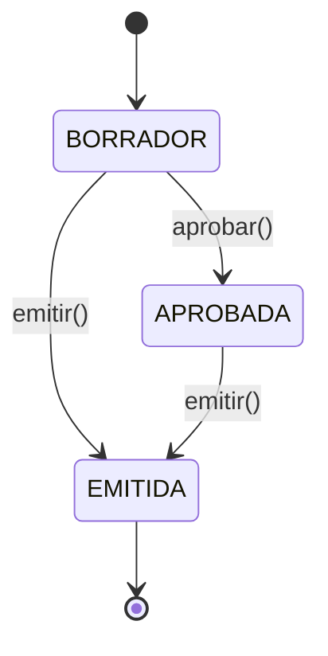
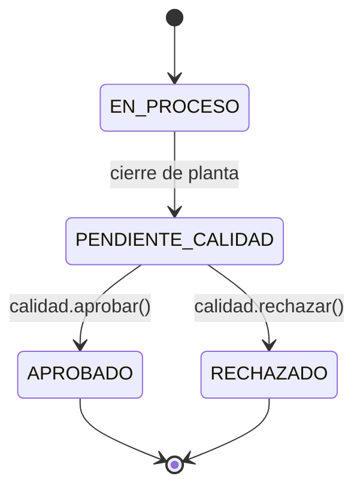

> **ARCHIVO HISTÓRICO.** No usar como política vigente. Consulte el [índice activo](../../../README.md).

# Estados de entidades – Sterinova-Backend

- Fecha: 2026-11-10
- Fuente: enums y transiciones observadas en `src/**` y validaciones de negocio en `cotizaciones.service.ts`, `planta.service.ts`, `calidad.service.ts`.
- Estado: ✅ consolidado por inspección estática.

## 1) Cotización

La entidad `Cotizacion` usa `estado: string` con valores que aparecen en el negocio y en la lógica:

- `Borrador` -> valor por defecto.
- `APROBADA` -> se alcanza en `aprobar()` cuando la cotización estaba en `BORRADOR` y no tenía `fecha_emision`.
- `EMITIDA` -> se liga a `fecha_emision` y al camino de `emitir()`.

Flujo observado:

Regla de negocio observada:

- `update()` y `remove()` bloquean edición/eliminación si `fecha_emision` existe o si el estado no es `BORRADOR`.
- `emitir()` exige que no exista `fecha_emision` previa.

## 2) Orden de servicio

`src/ordenes-servicio/entities/estado-orden.enum.ts` define:

- `PENDIENTE`
- `EN_RUTA`
- `RECOGIDO`
- `EN_PLANTA`
- `PROCESADO`
- `CANCELADO`

La lógica de flujo es coherente con la operación logística: de `PENDIENTE` a `EN_RUTA`/`RECOGIDO`, luego `EN_PLANTA`, y finalmente `PROCESADO` o `CANCELADO`.

## 3) Ciclo de esterilización

`EstadoCicloEsterilizacion` define:

- `EN_PROCESO`
- `PENDIENTE_CALIDAD`
- `APROBADO`
- `RECHAZADO`

Reglas observadas:

- `PlantaService` crea el ciclo en `PENDIENTE_CALIDAD`.
- `CalidadService` revisa ciclos con estado `PENDIENTE_CALIDAD`.
- En aprobación/rechazo, el ciclo pasa a `APROBADO` o `RECHAZADO`.

## 4) Formatos documentales

`EstadoVersionFormato` define:

- `BORRADOR`
- `EN_REVISION`
- `APROBADA`
- `PUBLICADA`
- `OBSOLETA`

El flujo real se hace visible en `format-version-workflow.ts`, con transición de borrador hacia revisión y aprobación según el procedimiento.

## 5) Observación

Las transiciones que no tienen código explícito se dejan como `No documentado en código` para evitar inventar flujos no contrastados. La base del dominio está suficientemente clara para cotizaciones, órdenes y ciclos operativos.
