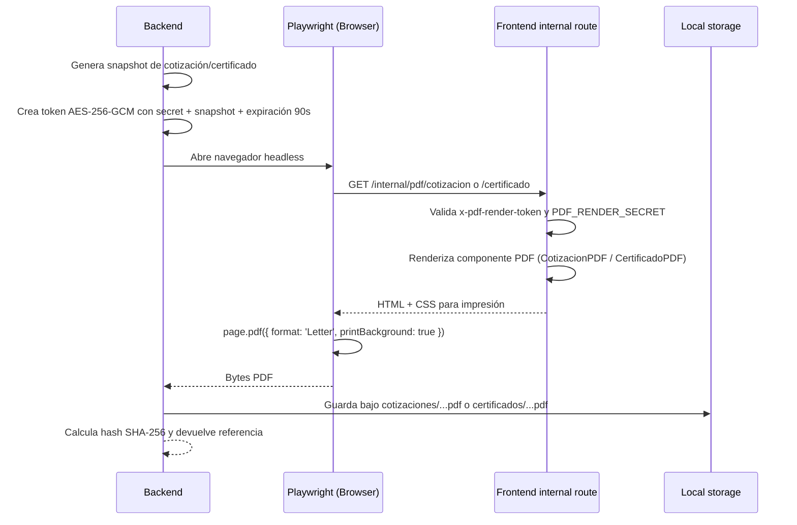

> **ARCHIVO HISTÓRICO.** No usar como política vigente. Consulte el [índice activo](../../../README.md).

# Contrato de render PDF – Sterinova-Backend

- Fecha: 2026-11-10
- Fuente: `src/pdf/pdf-generator.service.ts`, `src/pdf/pdf-render-token.ts`, `src/common/services/storage.service.ts`, `src/app/internal/pdf/**` en frontend.
- Estado: ✅ consolidado por inspección estática.

## Diagrama de secuencia



## Flujo detallado

1. `PdfGeneratorService.generate()` recibe un `snapshot`, un `storageKey` y un `manager` opcional.
2. Resuelve la URL interna del frontend mediante:
   - `PDF_RENDER_BASE_URL`
   - `FRONTEND_INTERNAL_URL`
   - fallback: `http://localhost:3000`
3. Crea el token con `createPdfRenderToken(...)` usando un secreto de 32+ caracteres.
4. El token lleva:
   - `audience: 'sterinova-pdf-render'`
   - `documentType: 'cotizacion' | 'certificado'`
   - `expiresAt: now + 90_000`
   - `snapshot` completo
5. El navegador headless abre la ruta interna del frontend con el token en cabecera `x-pdf-render-token`.
6. El route de Next.js en `/internal/pdf/...` valida el token y renderiza el componente de PDF apropiado.
7. Se espera que el documento esté visible con selector `[data-pdf-document="..."]` y se hace `document.fonts.ready` + validación de imágenes.
8. El PDF se guarda en almacenamiento local por `StorageService`.

## Variables relevantes

- `PDF_RENDER_SECRET` -> obligatorio para firmar/validar el render token.
- `PDF_STORAGE_PATH` -> raíz del almacenamiento local de PDFs; si no existe, cae a `storage/pdfs` relativa al backend.
- `PDF_RENDER_BASE_URL` o `FRONTEND_INTERNAL_URL` -> base del frontend interno.
- `PDF_RENDER_TIMEOUT_MS` -> timeout para cada render (predeterminado 15.000 ms).

## Almacenamiento final

`LocalStorageService` exige que la clave siga este patrón:

```text
(cotizaciones|certificados)/[\w.-]+\.pdf
```

Ejemplos:

- `cotizaciones/2026-11-10-ABC123.pdf`
- `certificados/2026-11-10-XYZ789.pdf`

La ruta final se resuelve dentro de la raíz configurada mediante una comprobación de seguridad para evitar path traversal.

## Manejo de errores

- Si la renderización excede el timeout, se lanza `ServiceUnavailableException` con mensaje de deadline.
- Si la validación del token falla o el documento no está disponible, la ruta responde con `notFound()`.
- Se guarda hash SHA-256 del PDF para verificar integridad al recuperarlo con `getFile(storageKey, expectedHash?)`.
- La retención real no se documenta en código; se requiere revisión del policy de almacenamiento/backup para recuperar el valor exacto.
