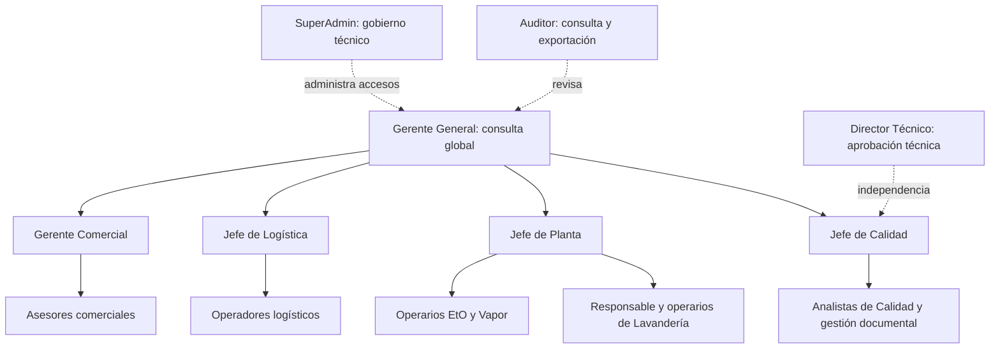

# Arquitectura organizacional y matriz de permisos

> Ampliación técnica backend: [secciones 8–13](#8-contrato-técnico-backend-y-lectura-de-la-matriz). Roadmap asociado: [plan por fases](../superpowers/plans/2026-11-10-rbac-backend.md). La matriz organizacional sigue siendo diseño objetivo; no sustituye las concesiones RBAC efectivamente persistidas.

Fecha: 12 de noviembre de 2026. Estado: diseño organizacional documental; el runtime ya usa permisos y ámbitos, mientras que la migración correctiva de esquema debe aplicarse por separado. Este documento no acredita concesiones de usuarios ni estado de despliegue o conformidad ISO. Fuente funcional: [reglas maestras](../negocio/reglas-maestras.md). Evidencia técnica: [estado implementado](estado-implementado.md).

## 1. Decisión y jerarquía

La jerarquía organizacional asigna responsabilidad; no implica heredar todas las acciones de un subordinado. Separar visibilidad, administración técnica, ejecución, revisión y autorización excepcional. Los códigos siguientes son identificadores propuestos salvo donde se indique existencia actual.



El Director Técnico es una autoridad funcional diferenciada. Su posición laboral exacta respecto de Gerencia no está documentada; el diagrama no inventa esa dependencia. Gerente de Calidad y Jefe/Director de Calidad conservan sus facultades específicas hasta que exista equivalencia formal. No se fusionan por similitud de nombres.

| Perfil objetivo | Ámbito | Responsabilidad y límite |
|---|---|---|
| `gerente_general` | GLOBAL, descendientes explícitos | Consultar todos los módulos y trazabilidad del negocio; aprobar finalmente versiones documentales conforme M8. No administrar plataforma por su cargo. |
| `superadmin` | GLOBAL, clase PLATFORM | Titular técnico único; identidades globales, catálogo de roles, ámbitos, delegación y recuperación técnica. Autoriza captura retroactiva conforme M5. No sustituye firmas profesionales ni elimina evidencias. |
| `admin_comercial` | DEPARTMENT Comercial y equipos delegados | Gerente Comercial; revisar condiciones y aprobar propuestas ajenas; resolver anulaciones y administrar pertenencias del área. |
| `admin_logistica` | DEPARTMENT Logística | Jefe de Logística; operación del área, autorización de reempaque, pertenencias; autorización sin OC solo cuando actúe como jefe de área competente. |
| `admin_planta` | DEPARTMENT Planta, plantas delegadas | Jefe de Planta; supervisión y equipos/calibración. No aprobar calidad de sus ciclos. |
| `admin_calidad` | DEPARTMENT Calidad y procesos delegados | Jefe/Director de Calidad; protocolos, desviaciones, vigencias, propiedad documental y aceptación de pruebas. No recibe automáticamente las facultades del Director Técnico. |
| `gerente_calidad` | Procesos autorizados de Calidad | Autorizar urgencia médica documentada (M4); activación de esta vía bloqueada hasta conciliar M6/M7. Puede acumularse con otro perfil solo por designación expresa. |
| `director_tecnico` | Procesos autorizados de Calidad y documentos | Aprobado del certificado, definición de protocolos y criterios junto con la autoridad del Jefe de Calidad, liberación condicionada/por desviación y aprobación final documental. No puede contar como dos aprobadores. |
| `asesor_comercial` | Comercial: lectura SCOPE; escritura bajo responsabilidad | Clientes compartidos, preparación, envío autorizado, registro de aceptación, emisión posterior y solicitud de anulación motivada. |
| `operador_logistica` | Logística | Recepción, materiales, transporte, diferencias y entrega; no liberar producto. |
| `operario_planta` | PLANT asignada o ámbito operativo explícito | Registrar proceso y evidencia EtO/Vapor, seleccionar materiales trazables; no cambiar método contratado ni liberar su ciclo. |
| `analista_calidad` | Calidad sobre plantas/procesos delegados | Evaluación, verificación, decisión ordinaria por ciclo y primera aprobación de desviaciones/reprocesos; redacción/revisión documental. |
| `gestor_documental` | Documentos bajo Calidad | Redactar y versionar, publicar/retirar solo versiones aprobadas, gestionar sellos/licencias según delegación. No autoatribuir aprobación final. |
| `auditor` | Ámbitos expresamente autorizados, potencialmente global | Lectura de expedientes y auditoría; exportar cotizaciones/certificados a Excel. Sin edición, liberación ni administración. |
| `admin_lavanderia`, `operario_lavanderia` | Rama operativa de Lavandería | Supervisión y ejecución de Recepción → Lavado → Secado → Doblado/Empaque → Liberación; autoridad y documento de liberación aún pendientes. |

Los administradores especializados son composiciones configurables de la función `admin_area` y capacidades de su proceso; no exigen un enum nuevo por cargo. Lavandería se modela inicialmente como rama de Planta, propuesta organizacional que evita inventar un departamento confirmado. Finanzas y gestión de Productos aparecen como dependencias del negocio: no se definen sus roles completos sin reglas de esos dominios.

## 2. Ámbitos y evaluación

- Una raíz GLOBAL representa la empresa. DEPARTMENT representa áreas; TEAM y PLANT solo se crean cuando existan equipos o plantas reales. Una tabla de cierre expresa descendencia, no herencia de roles.
- Cada asignación conserva usuario, rol, ámbito y concesiones activas. Un permiso de una asignación no puede combinarse con el ámbito de otra. Descendientes requieren autorización expresa; hermanos y padres no se incluyen automáticamente.
- Denegar por defecto permisos desconocidos, rutas sin política, recursos sin ámbito y ramas inactivas. El servidor obtiene identidad, responsabilidad y ámbito persistidos; `x-scope-id` solo reduce el contexto.
- OWN significa creador dentro del ámbito autorizado. No basta para una reasignación: el diseño futuro debe representar responsable vigente, motivo, autorizador y historial, sin modificar autoría histórica. Mientras no exista ese modelo, las excepciones no amplían escritura por suposición.
- Decisión documental: lectura comercial compartida dentro de Comercial (SCOPE); no lectura empresarial global del asesor. La expresión «todos» permite elegir clientes compartidos, pero no confirma acceso a otras áreas. Escritura propia/responsable, supervisión por jefe.
- Registrar permisos y filtros en listados, detalle, conteos, exportaciones, archivos y proyecciones. Planta/Logística reciben datos operativos necesarios, sin precios por mera pertenencia a un ciclo multicliente.
- Gerencia y auditoría global requieren asignaciones STANDARD globales. El esquema actual las prohíbe: en una futura fase se deberá habilitar explícitamente esta combinación y restringir sus concesiones. No usar PLATFORM ni duplicar la titularidad técnica para sortearlo.

## 3. Matriz funcional definitiva de referencia

Toda concesión está condicionada por ámbito, estado del expediente y separación de personas. «No» significa que ese perfil no recibe esa acción por defecto. Cualquier acción no enumerada se deniega. Los permisos nuevos de la siguiente sección todavía no existen en el catálogo.

| Módulo / actuación | Ejecuta | Revisa o autoriza | Consulta |
|---|---|---|---|
| M1 Crear/invitar usuario del área y asignar funciones delegadas | Admin del área | Conjunto delegable controlado por SuperAdmin | Admin del área; GG y auditor con datos personales mínimos |
| M1 Desactivar pertenencia del área | Admin del área | No desactivar identidad global ni otras pertenencias | Admin, GG, auditor |
| M1 Identidad global, roles, ámbitos y titularidad | SuperAdmin | Transferencia técnica explícita y auditada; jamás desde un admin de área | SuperAdmin; auditoría autorizada |
| M2 Consultar, crear, editar, importar y activar/inactivar cliente | Asesor y admin Comercial | Revisión cliente por cliente y resolución de conflictos; no se inventa aprobación adicional para toda edición | Comercial compartido; GG y auditor |
| M2 Eliminar cliente | Nadie | Prohibido por trazabilidad M2, aunque exista endpoint legado | Histórico conservado |
| M3 Borrador, ítems, descuentos y seis condiciones | Asesor responsable; admin autorizado | Jefe Comercial valida condiciones; IVA fuera de negociación | Comercial SCOPE; GG y auditor |
| M3 Aprobar propuesta para enviar al cliente | Admin Comercial | Persona distinta del creador, también si este tiene varios roles | Asesor, GG, auditor |
| M3 Enviar, registrar aceptación/alternativa y emitir | Asesor autorizado | Aprobación interna y aceptación precedentes; preservar cada actuación | Comercial; proyección operativa para siguiente área |
| M3 Anulación | Asesor solicita con motivo; admin del área resuelve | No autoaprobar; conservar original y reemplazo | Comercial, GG, auditor |
| M3 Editar emitida | Nadie | Anular/reemplazar mediante procedimiento, sin sobrescribir | Histórico conservado |
| M4 Crear orden y recibir material | Operador/admin Logística | Cotización aceptada; OC o autorización del jefe de área competente | Logística; Planta/Calidad mediante proyección; GG/auditor |
| M4 Rechazar empaque/material y registrar diferencias | Logística, con motivo/evidencia | Reempaque: Jefe Logística o Calidad autorizado; cambio posterior bloqueado: desviación aprobada por Jefe Calidad | Áreas del expediente |
| M4 Despachar y registrar POD | Logística | Liberación y certificado aplicables; procesado no equivale a liberado | Áreas del expediente, GG/auditor |
| M5 Registrar ciclos, parámetros reales, fallos y evidencias | Operario Planta | Equipo habilitado; protocolo seleccionado/aprobado por Calidad; método contratado inalterable | Planta y Calidad, GG/auditor |
| M5 Administrar/reactivar equipo | Jefe Planta o Calidad delegado | Certificado de calibración requerido para reactivar; no basta cargar archivo | Planta/Calidad |
| M5 Registro retroactivo | Operario autorizado captura | SuperAdmin o Calidad autorizado; motivo, fecha real y fecha de registro | Planta/Calidad, GG/auditor |
| M5 Lavandería | Operario Lavandería | Supervisor; liberación y documento pendientes, sin heredar EtO/Vapor | Áreas necesarias, GG/auditor |
| M6 Aprobar/rechazar ciclo y excluir material | Analista Calidad autorizado | Nunca registrador del ciclo; BI aplicable negativo para liberación ordinaria | Calidad, operativo mínimo; GG/auditor |
| M6 Desviación crítica o reproceso | Analista + Jefe/Director Calidad | Dos personas distintas; no duplicar aprobador por multirrol | Calidad, GG/auditor |
| M6 Cambiar NO_CUMPLE, corrección de materiales y vigencia excepcional | Calidad registra; Jefe de Calidad autoriza | Desviación motivada cuando corresponda; conservar medición y versión originales | Calidad, GG/auditor |
| M6 Definir protocolos y criterios | Jefe de Calidad o Director Técnico | Versiones inmutables; Calidad selecciona/aprueba la aplicable | Calidad y Planta según tarea, GG/auditor |
| M6 Liberación condicionada/por desviación | Director Técnico | Autorización formal; análisis de riesgo y marca visible en desviación; doble aprobación adicional cuando aplique | Calidad, GG/auditor |
| M7 Certificado por orden | Planta elabora; analista/coordinador verifica; Director Técnico aprueba | Todos los ciclos incluidos aprobados; no certificar materiales rechazados; no liberar ante fallo PDF | Calidad, GG/auditor; otras áreas solo proyección autorizada |
| M7 Anulación y reemplazo | Rol específico aún no asignado | Autorizador no definido en respuestas: denegado hasta resolver; no se copia autoridad comercial | Calidad, GG/auditor |
| M7 Restauración | Operador técnico autorizado, propuesta de diseño | Snapshot histórico, marca COPIA RESTAURADA, hash propio y auditoría; no reactiva anulado | Calidad y auditoría |
| M8 Crear/revisar formato | Analista/gestor documental | Jefe Calidad propietario; una versión nueva para cualquier cambio | Calidad, GG/auditor |
| M8 Aprobar versión | Director Técnico o Gerente General | Aprobación separada de publicación y fecha de vigencia | Calidad, GG/auditor |
| M8 Publicar/retirar, licencias, sellos y excepción de versión | Calidad delegado | Versión aprobada y vigencia; licencia suspendida bloquea nuevas emisiones; excepción anterior sujeta a resolución | Calidad, GG/auditor |
| Transversal exportar Excel cotizaciones/certificados | Auditor | Mismo filtro que lectura; columnas autorizadas y evento de exportación | Auditor autorizado |

La consulta global de Gerencia abarca el negocio y su trazabilidad; nunca expone contraseñas, hashes de contraseña, secretos o tokens internos. La consulta pública por QR es una proyección separada: estado, cliente, consecutivo y fechas autorizadas; no concede un rol interno ni acceso a materiales o precios.

## 4. Catálogo técnico: existente frente a propuesto

| Familia | Permisos existentes reutilizables | Capacidades nuevas propuestas |
|---|---|---|
| Accesos | usuarios.ver, usuarios.identidad.gestionar, asignaciones.gestionar, roles.gestionar, ambitos.gestionar | usuarios.area.invitar, usuarios.area.restablecimiento.iniciar; delegación acotada y revocación de pertenencia |
| Clientes | clientes.ver/crear/editar/importar | clientes.activar, clientes.inactivar; retirar concesión clientes.eliminar de perfiles objetivo |
| Comercial | cotizaciones.ver/crear/editar/previsualizar/emitir/descargar/aceptar; solicitudes_anulacion.crear/ver/aprobar | cotizaciones.aprobar_interna, cotizaciones.enviar, cotizaciones.reasignar, cotizaciones.exportar |
| Logística | logistica.cotizaciones_disponibles.ver, logistica.ordenes.ver/crear/cambiar_estado | logistica.recepciones.registrar, logistica.reempaque.autorizar, logistica.despacho.ejecutar |
| Planta | planta.ordenes.ver, planta.ciclos.ver/crear | planta.equipos.gestionar/reactivar, planta.retroactividad.autorizar, planta.reprocesos.registrar |
| Lavandería | Ninguna familia específica | lavanderia.ordenes.ver, lavanderia.proceso.registrar; liberar pendiente de autoridad/documento |
| Calidad | calidad.ciclos.ver, calidad.aprobar/rechazar | calidad.protocolos.gestionar, calidad.desviaciones.verificar/aprobar, calidad.liberacion_condicionada.autorizar, calidad.liberacion_desviacion.autorizar |
| Certificados | certificados.ver/descargar | certificados.elaborar/verificar/aprobar/exportar/restaurar; certificados.anular reservado sin asignación hasta definir autoridad |
| Documentos | formatos y versiones; sellos CRUD y desactivar | formatos.versiones.aprobar, formatos.excepcion.autorizar, sellos.licencias.gestionar; separar publicación de aprobación |
| Auditoría | auditoria.ver | exportación auditada y lectura transversal por ámbito |

Los identificadores con barras abrevian acciones distintas; no son comodines ni códigos literales del catálogo. Crear un rol es configuración; agregar una acción requiere capacidad servidor, política, datos y pruebas futuras. is_dynamic no permite ejecutar acciones no implementadas.

## 5. Separación de funciones y auditoría

1. Comparar personas por ID, nunca solo nombres de rol. El creador comercial no aprueba su propuesta; el registrador de Planta no aprueba su ciclo. Una persona no satisface dos aprobaciones independientes.
2. El asesor emite después de aceptación; emitir no aprueba ni prueba aceptación. Descargar una propuesta no inicia operación.
3. Los administradores solo conceden el subconjunto delegable y ámbitos permitidos, sin escalarse, editar roles globales ni asignar PLATFORM. La desactivación local conserva las demás pertenencias.
4. SuperAdmin posee superioridad de administración técnica y la autorización retroactiva expresa del M5; no un bypass de criterios de calidad. El catálogo inicial sí le concede acciones de negocio: esa amplitud deberá revisarse al implementar esta separación.
5. Documentar actor, función ejercida, ámbito, recurso/versión, instante, IP cuando corresponda, motivo, resultado y correlación. Confirmar las firmas según el mecanismo aprobado; jamás guardar la contraseña de confirmación.
6. Conservar originales, snapshots, versiones, evidencia y decisiones. Retención mínima de cinco años es requisito del negocio M7; evento inicial y políticas adicionales pendientes. No atribuir ese plazo a una cláusula ISO sin verificación.
7. Requisito de sesión de diez horas y recuperación de avance no equivalen a sesión vigente indefinidamente ni a confirmar una operación durante una desconexión. Pruebas futuras deben cubrir revocación, repetición e idempotencia.

## 6. Brechas y secuencia futura, sin ejecución en esta fase

| Situación actual | Trabajo documentalmente requerido |
|---|---|
| El runtime ya no usa los cinco roles legacy ni `RolesGuard`; la migración correctiva aún debe aplicarse a las bases existentes | Verificar migración y asignaciones explícitas en el ambiente autorizado; no mapear Admin automáticamente a SuperAdmin o Gerente General |
| superadmin PLATFORM único y admin_area genérico existen | Restringir concesiones técnicas/funcionales y completar gestión delegada; verificar titular en ambiente autorizado |
| No gerente_general; STANDARD no admite GLOBAL | Diseñar cambio controlado del esquema/evaluador para lectura global ordinaria y auditoría global sin usar titularidad de plataforma |
| comercial/emisor_comercial existen; piloto limita a OWN | Reconciliar lectura SCOPE, responsabilidad y separación aprobación/aceptación/emisión; mantener restricción efectiva hasta implementar |
| logistica/planta/calidad existen como plantillas; rutas legacy | Especializar operativos y admins, aplicar filtros de ámbito y separar firmas/autorizaciones; los nuevos códigos de admins deberán conservar una asignación admin_area autorizada o reemplazar explícitamente la restricción por código de la anulación |
| auditor_calidad existe; auditor transversal no | Añadir acceso comercial, exportaciones Excel y filtros; catálogo por sí solo no protege endpoints legacy |
| gestor_documental existe; rol Admin controla formatos/sellos | Separar redacción, aprobación DT/GG, publicación y aceptación Jefe Calidad |
| No roles ni proceso operativo específico Lavandería | Implementar admin/operario y flujo propio; resolver liberación antes de concederla |

Roles nuevos o especializaciones pendientes: gerente_general; admin_comercial, admin_logistica, admin_planta y admin_calidad; director_tecnico; gerente_calidad con autoridad diferenciada; asesor_comercial (especialización de comercial + emisión); operador_logistica; operario_planta; analista_calidad; auditor transversal; admin_lavanderia y operario_lavanderia. Los perfiles operativos genéricos ya existen parcialmente: no se presentan como ausencia total. SuperAdmin, admin_area, emisor_comercial, auditor_calidad y gestor_documental tienen semilla; falta su alineación y/o aplicación integral, no inventar su creación pendiente.

Antes de implementar: resolver autoridad de anulación de certificados, equivalencias de cargos, liberación urgente/condicionada, despacho Lavandería/Insumos, certificados multiciclo, alcance de rollback PDF, responsabilidad tras reasignación y aprobaciones multiservicio. Estos puntos permanecen denegados o con flujo ordinario; no se otorga una excepción por silencio.

Criterios de aceptación de la fase futura: pruebas de acceso cruzado por ID/exportación/archivo; multirrol sin autoaprobación; dos aprobadores con IDs distintos; revocación; inclusión explícita de descendientes; STANDARD global sin privilegios PLATFORM; delegación sin escalación; instantánea y archivos históricos intactos; liberación bloqueada ante evidencia, firma, formato o PDF faltante. No se ejecutaron estas pruebas de implementación en la fase documental.

## 7. Fundamento externo y límites

Consulta web: 10 de noviembre de 2026. Las fuentes respaldan principios; no prescriben los nombres de cargos de Sterinova ni una jerarquía empresarial obligatoria.

- [NIST: modelo RBAC y jerarquías](https://csrc.nist.gov/projects/role-based-access-control/faqs): sustenta asignaciones a roles, jerarquías y restricciones. Aplicación local: separar estructura organizacional de acumulación automática de privilegios.
- [NIST: separación de funciones](https://csrc.nist.gov/glossary/term/separation_of_duty): distingue restricciones estáticas y dinámicas. Aplicación local: independencia por persona y expediente, incluso con múltiples roles.
- [ISO: ISO 13485, sistemas de calidad para dispositivos médicos](https://www.iso.org/iso-13485-medical-devices.html): marco de calidad y requisitos regulatorios. La página pública no permite auditar cláusulas completas; no se afirma certificación ni que ISO exija estos cargos concretos. La correspondencia detallada debe validarse con la norma licenciada y el alcance real del sistema de calidad.
- [CDC: prácticas de esterilización](https://www.cdc.gov/infection-control/hcp/disinfection-sterilization/sterilizing-practices.html): resalta control del proceso, monitoreo y personal preparado. Aplicación local: registrar evidencia y separar procesamiento de liberación según las reglas del negocio.

El diseño combina RBAC por capacidades con condiciones de ámbito, estado y autoría. Los controles particulares de firmas, cinco años, urgencias y Director Técnico proceden de los ocho módulos, no de una supuesta matriz de cargos ISO. CDC es referencia técnica; no se convierte por ello en obligación jurídica colombiana.


## 8. Contrato técnico backend y lectura de la matriz

Inventario revisado contra todos los controladores del backend el 10/11/2026: **64 operaciones HTTP**. Las rutas son las declaradas en Nest; no se agrega un prefijo ficticio. Esta matriz expresa el objetivo, no permisos efectivos de la Fase 1. Cada rol enumerado necesita asignación activa, concesión activa, ámbito autorizado y condiciones de la sección 10. Cualquier rol no enumerado queda denegado para esa operación. Los cargos no heredan capacidades por jerarquía.

La Fase 1 crea perfiles nuevos **inactivos**, sin asignarlos a usuarios. Los permisos futuros se siembran inactivos y no se agregan al catálogo ejecutable. SuperAdmin y gestor_documental ya existen: no se recrean ni se reducen sus concesiones actuales en esta fase. El objetivo de la tabla se aplicará gradualmente en fases posteriores.

## 9. Matriz exhaustiva por endpoint actual

| Método | Ruta actual | Permiso objetivo | Roles objetivo | Estado de autorización |
|---|---|---|---|---|
| GET | `/` | SESION | cualquier usuario activo autenticado | legacy; migrar |
| GET | `/auditoria` | auditoria.ver | gerente_general, auditor, superadmin | legacy; migrar |
| GET | `/auth/me` | SESION | cualquier usuario activo autenticado | sesión/público explícito |
| POST | `/auth/login` | PUBLICO | sin rol interno | sesión/público explícito |
| GET | `/calidad/pendientes` | calidad.ciclos.ver | gerente_general, admin_calidad, analista_calidad, director_tecnico, gerente_calidad, auditor | legacy; migrar |
| GET | `/calidad/ciclos/:id` | calidad.ciclos.ver | gerente_general, admin_calidad, analista_calidad, director_tecnico, gerente_calidad, auditor | legacy; migrar |
| POST | `/calidad/aprobar` | calidad.aprobar | admin_calidad, analista_calidad | legacy; migrar |
| POST | `/calidad/rechazar` | calidad.rechazar | admin_calidad, analista_calidad | legacy; migrar |
| GET | `/certificados` | certificados.ver | gerente_general, admin_calidad, analista_calidad, director_tecnico, gerente_calidad, auditor | legacy; migrar |
| GET | `/certificados/validar/:token` | PUBLICO | sin rol interno | legacy; migrar |
| GET | `/certificados/:id` | certificados.ver | gerente_general, admin_calidad, analista_calidad, director_tecnico, gerente_calidad, auditor | legacy; migrar |
| GET | `/certificados/:id/descargar` | certificados.descargar | gerente_general, admin_calidad, analista_calidad, director_tecnico, gerente_calidad, auditor | legacy; migrar |
| POST | `/clientes` | clientes.crear | admin_comercial, asesor_comercial | legacy; migrar |
| POST | `/clientes/bulk` | clientes.importar | admin_comercial, asesor_comercial | legacy; migrar |
| GET | `/clientes` | clientes.ver | gerente_general, admin_comercial, asesor_comercial, auditor | legacy; migrar |
| GET | `/clientes/:id` | clientes.ver | gerente_general, admin_comercial, asesor_comercial, auditor | legacy; migrar |
| PUT | `/clientes/:id` | clientes.editar | admin_comercial, asesor_comercial | legacy; migrar |
| DELETE | `/clientes/:id` | DENEGADO | ninguno | legacy; migrar |
| POST | `/cotizaciones` | cotizaciones.crear | admin_comercial, asesor_comercial | RBAC actual; revisar condición específica |
| GET | `/cotizaciones` | cotizaciones.ver | gerente_general, admin_comercial, asesor_comercial, auditor | RBAC actual; revisar condición específica |
| GET | `/cotizaciones/iva-vigente` | cotizaciones.crear | admin_comercial, asesor_comercial | RBAC actual; revisar condición específica |
| GET | `/cotizaciones/:id` | cotizaciones.ver | gerente_general, admin_comercial, asesor_comercial, auditor | RBAC actual; revisar condición específica |
| GET | `/cotizaciones/:id/previsualizar` | cotizaciones.previsualizar | gerente_general, admin_comercial, asesor_comercial, auditor | RBAC actual; revisar condición específica |
| POST | `/cotizaciones/:id/emitir` | cotizaciones.emitir | admin_comercial, asesor_comercial | RBAC actual; revisar condición específica |
| GET | `/cotizaciones/:id/descargar` | cotizaciones.descargar | gerente_general, admin_comercial, asesor_comercial, auditor | RBAC actual; revisar condición específica |
| POST | `/cotizaciones/:id/aprobar` | cotizaciones.aprobar_interna | admin_comercial | RBAC actual; revisar condición específica |
| PUT | `/cotizaciones/:id` | cotizaciones.editar | admin_comercial, asesor_comercial | RBAC actual; revisar condición específica |
| DELETE | `/cotizaciones/:id` | DENEGADO | ninguno | RBAC actual; revisar condición específica |
| POST | `/cotizaciones/:id/solicitud-anulacion` | solicitudes_anulacion.crear | admin_comercial, asesor_comercial | RBAC actual; revisar condición específica |
| GET | `/solicitudes-anulacion/pendientes` | solicitudes_anulacion.ver | gerente_general, admin_comercial, asesor_comercial, auditor | RBAC actual; revisar condición específica |
| PATCH | `/solicitudes-anulacion/:id/resolver` | solicitudes_anulacion.aprobar | admin_comercial | RBAC actual; revisar condición específica |
| GET | `/formatos-documentales` | formatos.ver | gerente_general, admin_calidad, analista_calidad, director_tecnico, auditor, gestor_documental | legacy; migrar |
| GET | `/formatos-documentales/:id` | formatos.ver | gerente_general, admin_calidad, analista_calidad, director_tecnico, auditor, gestor_documental | legacy; migrar |
| POST | `/formatos-documentales` | formatos.crear | gestor_documental | legacy; migrar |
| PUT | `/formatos-documentales/:id` | formatos.editar | gestor_documental | legacy; migrar |
| DELETE | `/formatos-documentales/:id` | DENEGADO | ninguno | legacy; migrar |
| POST | `/formatos-documentales/:id/versiones` | formatos.versiones.crear | admin_calidad, analista_calidad, gestor_documental | legacy; migrar |
| PUT | `/formatos-documentales/:id/versiones/:versionId` | formatos.versiones.editar | admin_calidad, analista_calidad, gestor_documental | legacy; migrar |
| POST | `/formatos-documentales/:id/versiones/:versionId/estado` | formatos.versiones.publicar | gestor_documental | legacy; migrar |
| GET | `/health/live` | PUBLICO | sin rol interno | sesión/público explícito |
| GET | `/health/ready` | PUBLICO | sin rol interno | sesión/público explícito |
| POST | `/logistica/ordenes` | logistica.ordenes.crear | admin_logistica, operador_logistica | legacy; migrar |
| PATCH | `/logistica/ordenes/:id/materiales` | logistica.recepciones.registrar | admin_logistica, operador_logistica | legacy; migrar |
| GET | `/logistica/ordenes` | logistica.ordenes.ver | gerente_general, admin_logistica, operador_logistica, auditor | legacy; migrar |
| GET | `/logistica/cotizaciones-aprobadas` | logistica.cotizaciones_disponibles.ver | gerente_general, admin_logistica, operador_logistica, auditor | legacy; migrar |
| GET | `/logistica/ordenes/:id` | logistica.ordenes.ver | gerente_general, admin_logistica, operador_logistica, auditor | legacy; migrar |
| PUT | `/logistica/ordenes/:id/estado` | logistica.ordenes.cambiar_estado | admin_logistica, operador_logistica | legacy; migrar |
| GET | `/planta/protocolos` | planta.protocolos.ver | gerente_general, admin_planta, operario_planta, auditor | legacy; migrar |
| GET | `/planta/ordenes` | planta.ordenes.ver | gerente_general, admin_planta, operario_planta, auditor | legacy; migrar |
| GET | `/planta/ciclos` | planta.ciclos.ver | gerente_general, admin_planta, operario_planta, auditor | legacy; migrar |
| POST | `/planta/ciclos` | planta.ciclos.crear | admin_planta, operario_planta | legacy; migrar |
| GET | `/sellos` | sellos.ver | gerente_general, auditor, gestor_documental | legacy; migrar |
| GET | `/sellos/:id/imagen` | sellos.ver | gerente_general, auditor, gestor_documental | legacy; migrar |
| POST | `/sellos` | sellos.crear | gestor_documental | legacy; migrar |
| PATCH | `/sellos/:id` | sellos.editar | gestor_documental | legacy; migrar |
| DELETE | `/sellos/:id` | sellos.desactivar | gestor_documental | legacy; migrar |
| GET | `/tasas-fiscales/iva` | tasas_fiscales.gestionar | superadmin | RBAC actual; revisar condición específica |
| POST | `/tasas-fiscales/iva` | tasas_fiscales.gestionar | superadmin | RBAC actual; revisar condición específica |
| GET | `/users` | usuarios.ver | gerente_general, admin_comercial, admin_logistica, admin_planta, admin_calidad, auditor, admin_lavanderia, superadmin | legacy; migrar |
| POST | `/users` | usuarios.identidad.gestionar | superadmin | legacy; migrar |
| PATCH | `/users/:id` | usuarios.identidad.gestionar | superadmin | legacy; migrar |
| PATCH | `/users/:id/password` | usuarios.identidad.gestionar | superadmin | legacy; migrar |
| PATCH | `/users/:id/status` | usuarios.identidad.gestionar | superadmin | legacy; migrar |
| DELETE | `/users/:id` | DENEGADO | ninguno | legacy; migrar |

Los permisos técnicos roles.gestionar, ambitos.gestionar y asignaciones.gestionar no implican que exista un CRUD HTTP para ellos. No inventar endpoints actuales. GET / conserva sesión JWT según el guard global; no se declara público por omisión. GET /auth/me devuelve únicamente identidad pública y capacidades propias.

### Capacidades futuras y rutas propuestas, aún inexistentes

| Operación propuesta | Permiso | Roles | Condición |
|---|---|---|---|
| POST /cotizaciones/:id/aceptacion | cotizaciones.aceptar | asesor_comercial OWN, admin_comercial SCOPE | aceptación del cliente con evidencia; no equivale a aprobación interna |
| POST /cotizaciones/:id/enviar | cotizaciones.enviar | asesor_comercial OWN, admin_comercial SCOPE | versión aprobada internamente y no alterada |
| POST /formatos-documentales/:id/versiones/:versionId/aprobar | formatos.versiones.aprobar | director_tecnico, gerente_general | actor distinto del creador; aprobación separada de publicación |
| POST /certificados/:id/verificar | certificados.verificar | analista_calidad, admin_calidad | distinto del elaborador |
| POST /certificados/:id/aprobar | certificados.aprobar | director_tecnico | distinto de elaborador/verificador; ciclos aplicables aprobados |
| POST /users/area/invitaciones | usuarios.area.invitar | administradores de área | pertenencia local; no identidad global ni PLATFORM |
| PATCH /users/:id/asignaciones/:asignacionId/status | asignaciones.gestionar | administrador del área delegada | revoca pertenencia local, nunca identidad completa |

Emisión inicial/elaboración de certificados, exportaciones, reasignación, protocolos, equipos y lavandería requieren contratos propios antes de habilitarse. No reutilizar una operación con semántica distinta para simularlos. La anulación de certificados y liberación de lavandería carecen de autoridad definida: denegadas incluso para SuperAdmin.

## 10. Condiciones de negocio por familia

- Usuarios: POST/PATCH globales solo SuperAdmin; nunca hashes en respuesta. Admin de área usa gestión local futura y un subconjunto delegable, sin escalamiento ni autoconcesión. DELETE de identidad queda sin concesión objetivo; conservar evidencia.
- Clientes: lectura compartida en Comercial; creación/importación en un ámbito autorizado. PUT no cambia ámbito ni autoría por payload. Activación/inactivación necesita capacidad diferenciada, no eliminación física.
- Comercial: PUT solo borrador; aprobación interna usa cotizaciones.aprobar_interna en lugar del actual cotizaciones.editar. Versión aprobada queda vinculada a su decisión; editar invalida aprobación antes de reenviar. Emisión exige aceptación documentada y aprobación vigentes. No hay eliminación objetivo de cotizaciones: conservar/anular según estado. Asesor escribe OWN; responsabilidad delegada futura necesita historial explícito.
- Anulación: solicitud motivada; resolución por persona distinta del solicitante y del creador que no pueda autoautorizar su expediente. Estado y versión se validan atómicamente. Reemplazar la restricción actual por código admin_area/superadmin por capacidad delegada cuando se migre; no conceder esa equivalencia desde la semilla.
- Logística: crear orden exige cotización aceptada y OC o autorización competente; materiales conservan método contratado y evidencia. PUT estado requiere permiso adicional logistica.despacho.ejecutar cuando implique despacho, más liberación/certificado aplicables; cambiar_estado no autoriza saltos arbitrarios. Reempaque requiere autorización propia. Las proyecciones excluyen precios.
- Planta: operador_id deriva de la identidad autenticada. Ámbito de planta explícito, equipo/protocolo habilitados y método contratado. Registrar no libera ni certifica. Retroactividad requiere autorización formal separada; no se habilita solo por la nueva columna scope_id.
- Calidad: registrar mediciones no cambia sus originales; aprobar/rechazar exige ámbito y SoD por operador_id. Desviaciones críticas requieren dos actores distintos. DT autoriza liberaciones excepcionales con evidencia; gerente_calidad no recibe vía de urgencia hasta conciliar reglas.
- Certificados: GET/descarga autorizan expediente y versión antes de acceder al PDF. QR público devuelve proyección mínima. La aprobación actual de ciclo no equivale a firma final DT; separar flujo futuro y preservar certificados históricos. Fallo de PDF no libera producto.
- Documentos: PUT de versión solo borrador; aprobación DT/GG y publicación por gestor delegado son operaciones distintas. POST estado no puede aprobar por el permiso publicar. DELETE formato queda denegado; retiro conserva versiones. Sellos DELETE significa desactivar, nunca borrar evidencia.
- Gerencia/auditor: lectura global requiere asignación STANDARD explícita y descendencia; minimización de datos personales. Auditor exporta con idénticos filtros/columnas autorizadas y evento. SuperAdmin no sustituye firmas profesionales. IVA sigue con autoridad técnica legacy durante Fase 1; revisar autoridad fiscal en fase posterior sin inferirla por cargo comercial.

## 11. Ámbitos por etapa y consultas TypeORM

Decisión aprobada: cada etapa tiene ámbito operativo propio. Cotizacion.scope_id identifica Comercial; OrdenServicio.scope_id Logística; CicloEsterilizacion.scope_id Planta. Calidad recibe concesiones explícitas sobre plantas/procesos autorizados; pertenecer al departamento Calidad no da acceso implícito a todas las plantas. El vínculo ciclo → orden → cotización transporta trazabilidad, no permisos comerciales.

Cliente.scope_id representa su área comercial compartida; versiones documentales tienen ámbito propietario. El certificado se autoriza por ciclo/orden relacionados, sin duplicar scope_id con posibilidad de desincronización. En Fase 1 los campos nuevos son nullable; no se asigna el ámbito comercial a órdenes o ciclos por inferencia. La conciliación futura debe identificar ámbitos reales; registros sin ámbito quedan denegados al migrar su módulo.

Patrón SQL parametrizado, generado desde PermissionContext.policy y con paréntesis Brackets:

```sql
WHERE (r.scope_id IN (:...scopeIds)
   OR (r.scope_id IN (:...ownScopeIds) AND r.creador_id = :userId))
  AND r.id = :id
```

Omitir ramas vacías; si ambas están vacías, denegar sin consultar. No interpolar IDs ni construir IN (). El usuario procede de JWT/BD, no del DTO. Usar operador_id para autoría del ciclo; OWN no se extiende a otro ámbito. No combinar permiso de una asignación y ámbito de otra. x-scope-id reduce las ramas de la política, nunca las amplía. Revisar resourceScopeIds en fase 2 para que la selección también reduzca candidatos de creación.

Para rutas de certificados y Calidad aplicar EXISTS/joins contra ámbitos explícitos del ciclo. Las órdenes disponibles en Planta requieren vínculo de asignación operativa autorizado antes de exponerlas; no basta con la FK comercial ni con asignar el departamento padre. Introducir ese vínculo en la migración del módulo, con su autorización y auditoría. Excluir columnas comerciales en SELECT y DTO; no cargar entidades completas para borrarlas después de responder.

Usar el mismo predicado en detalle, listados, conteos, paginación, archivos, exportaciones y escrituras. Resolver detalle fuera de ámbito como 404; permiso ausente como 403; sesión inválida como 401. Las escrituras incorporan estado/versión y ámbito en la transacción. Catálogos GLOBAL y gestión de identidad usan políticas específicas, no un filtro de pertenencia comercial inventado.

GLOBAL STANDARD queda controlado con roles.global_assignable y asignaciones.role_global_assignable, FK compuesta y CHECK. Solo gerente_general y auditor nuevos se siembran elegibles; ambos permanecen inactivos. Los roles elegibles requieren que cada asignación copie el valor correcto incluso en un ámbito local. Solo migraciones/configuración técnica controlada pueden cambiar elegibilidad. PLATFORM conserva su tabla singleton y no se admite en asignaciones ordinarias.

## 12. SoD, integridad y auditoría

La SoD se ejecutará en servicios, dentro de transacciones: cargar recurso autorizado con bloqueo o validar versión en UPDATE; comparar IDs; validar estado; persistir decisión y evento conjuntamente. Autoaprobación produce ForbiddenException; conflicto concurrente o versión obsoleta produce ConflictException. Ni multirrol, ni cambio de cargo, ni titularidad PLATFORM evitan la comparación de personas.

Campos existentes reutilizados: cotizaciones.creador_id, ciclos.operador_id/revisado_por/revisado_en, solicitudes_anulacion.creador_id/aprobador_id y certificados.aprobador_id/aprobado_at. La aprobación interna comercial agrega aprobador_interno_id y aprobado_internamente_at; aceptación registra actor/instante aparte. No interpretar APROBADA histórico como una firma nueva.

Las FK e índices protegen referencias. No crear triggers de autorización. Los triggers históricos de inmutabilidad existentes permanecen; esta decisión no los elimina. La Fase 1 agrega metadatos, no aplica aún la SoD ni cambia generación de certificados. En fases posteriores registrar función ejercida, ámbito, recurso/versión, motivo, resultado, correlación e IP cuando corresponda; no almacenar contraseñas de confirmación.

| Entidad | Adición Fase 1 | Tratamiento histórico |
|---|---|---|
| roles/asignaciones | elegibilidad GLOBAL controlada | false por defecto; ninguna nueva asignación |
| clientes | scope_id, creador_id | NULL sin inferencias |
| órdenes | scope_id, creador_id | NULL; conciliación por operación |
| ciclos | scope_id | operador/revisor existentes se conservan |
| cotizaciones | aprobador_interno_id, aprobado_internamente_at, aceptacion_registrada_por_id, aceptacion_registrada_at | NULL; no inventar aprobaciones |
| certificados | elaborado_por_id/elaborado_at, verificado_por_id/verificado_at | aprobador existente intacto |
| versiones formato | scope_id, creador_id, aprobador_id/aprobado_at, publicado_por_id/publicado_at | responsable textual conservado |
| auditoría | scope_id | eventos históricos permanecen sin inferencia |

Todas las columnas nuevas de actor/ámbito tienen FK RESTRICT e índice; fechas son DATETIME(6) nullable. Su persistencia por servicios se implementará al migrar el módulo, no ahora. Capturar una nueva transición nunca debe asignar retroactivamente actores a documentos antiguos.

## 13. Validación, transición y límites de activación

Por endpoint escribir primero prueba de denegación que falle por acceso indebido; implementar permiso/filtro/SoD y verificar acceso permitido. Si el comportamiento ya deniega, mantener esa prueba y producir RED sobre la capacidad nueva pendiente. Matriz parametrizada por método, ruta, rol, ámbito, autoría y estado; no afirmar que todo rol antiguo pasa hoy.

Fase 1 valida DDL real, FK/CHECK, metadatos TypeORM, cadena vacía y actualización desde esquema previo, perfiles inactivos, permisos futuros inactivos, cero asignaciones nuevas y conservación de concesiones legacy. No ejecuta migraciones contra base de trabajo. Semilla versionada mediante TypeORM: una segunda ejecución normal no repite inserciones ni restablece configuraciones; invocación directa repetida falla ante colisiones. Rollback destructivo automático bloqueado: usar respaldo o migración correctiva.

Las fases 2–4 implementarán aplicación por rutas, backfill autorizado, nuevas transiciones, proyecciones y cierre legacy. Permanecen pendientes autoridad de anulación de certificados, liberación de lavandería y urgencia médica. Ninguna semilla las habilita. El alcance de certificado por orden exige diseño/migración propia frente al modelo actual por ciclo.
