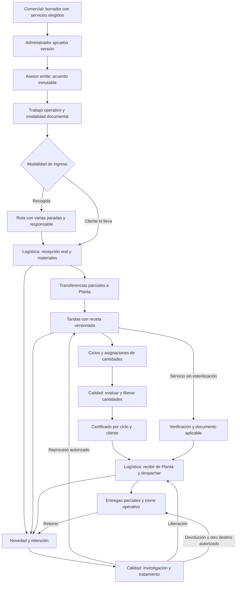
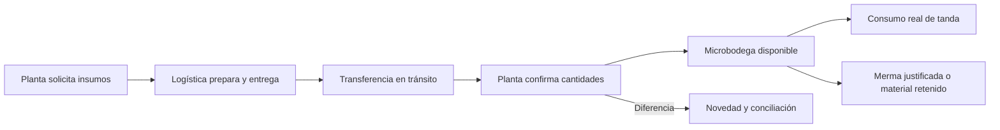
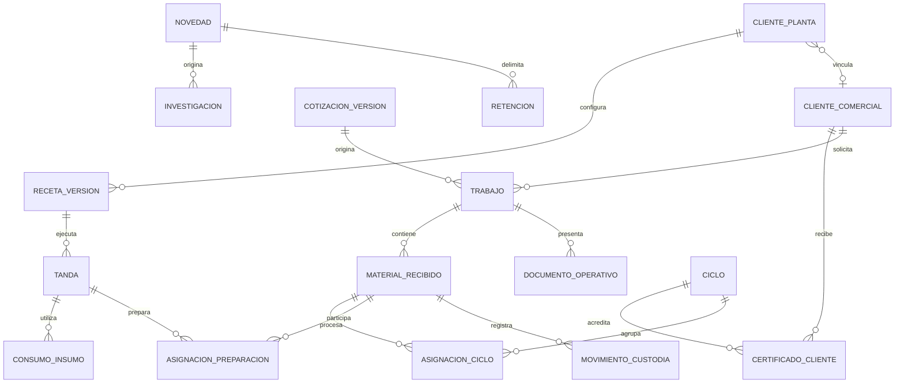

# Hoja de ruta integral de Sterinova

Fecha: 12 de noviembre de 2026. Entrega documental, sin implementación ni ejecución de migraciones. Fuente funcional: conversación con el usuario del 11–12 de noviembre. Las decisiones posteriores de esa conversación prevalecen sobre el análisis inicial y sobre propuestas anteriores incompatibles.

## Lectura y entregables

- Este documento: objetivos, decisiones, relaciones y secuencia común.
- [Plan backend](../superpowers/plans/2026-11-12-backend-trazabilidad.md): diagnóstico del código, contratos propuestos, datos, seguridad, migración y pruebas.
- [Plan frontend](../../../SterinovaFrontend/docs/superpowers/plans/2026-11-12-frontend-trazabilidad.md): navegación, interacción e integración por área.
- [Bocetos operativos](../../../SterinovaFrontend/docs/superpowers/plans/2026-11-12-bocetos-operativos.md): pantallas y recorridos de referencia, no aplicación implementada.

Los contratos y estructuras nuevas son diseño propuesto. Las reglas confirmadas a continuación son requisitos. No confundir ninguno de esos grupos con capacidades ya desplegadas.

## Objetivo y evidencia de éxito

Poder reconstruir para cada material y cantidad: acuerdo comercial, recepción, custodios, ubicaciones, preparaciones, ciclos, consumos, retenciones, decisiones de Calidad, certificado y entrega o devolución. Comercial consulta el avance por trabajo y cantidades, sin que un estado único oculte parciales.

La entrega será aceptable cuando todos los escenarios de la sección de aceptación pasen en entorno aislado; las cantidades concilien; los documentos previos conserven contenido e identificadores; un asesor no pueda aprobar; una retención impida avanzar el material; y dos clientes en un ciclo reciban certificados separados sin datos cruzados.

No se promete una duración antes de dimensionar cada hito. Se trabaja por hitos verificables, no por porcentaje de pantallas terminadas. No se automatiza una decisión técnica que no tenga una regla aprobada por la empresa.

## Registro de decisiones confirmadas

| ID | Regla |
|---|---|
| D01 | Comercial maneja servicios habituales y solicitudes particulares; los formatos de cotización determinan datos de cliente/contacto y condiciones comerciales. |
| D02 | Catálogo de servicios con características estructuradas; asesor digita cantidad y valor unitario. Servicios contratados y materiales físicos son conceptos distintos. |
| D03 | Asesor crea/edita borrador y envía a revisión; administrador de Comercial aprueba; asesor emite y habilita Logística. El asesor no aprueba. |
| D04 | La selección del cliente puede reducir una propuesta de 15 servicios a 8 antes de la aprobación final. La revisión corresponde a una versión concreta. |
| D05 | Los precios e importes emitidos son inmodificables. La operación no recalcula el acuerdo. Comercial decide un documento por diferencia separado cuando corresponda. |
| D06 | El Excel queda obsoleto para operar. Comercial suministra información; Logística captura hechos físicos y materiales reales. No se importa Excel como parte de este recorrido. |
| D07 | Cliente puede usar orden, acta o ambos. Debe existir trazabilidad interna independientemente del documento visible. |
| D08 | Recogida habitual, llegada directa excepcional; rutas con responsable y varios clientes. No simular recogida para llegada directa. |
| D09 | Acta registra producto/lote/unidad, recibido/cajas recibidas, entregado/cajas entregadas y devoluciones. Fecha/hora reales y responsables. Valores provienen de la emisión comercial. |
| D10 | Orden de esterilización registra condiciones contratadas y materiales digitados por Logística; entrega a Planta y retorno con cantidades, fecha/hora, responsables y novedades. Planta puede consultar los valores. |
| D11 | Recepción en Planta, procesamiento y entregas al cliente pueden ser parciales; entrega final exige acuerdo aplicable y liberación/documentos pertinentes. |
| D12 | Un ciclo admite materiales de varias órdenes y clientes si son compatibles y caben. Una orden puede distribuirse en varios ciclos. |
| D13 | Certificado por cliente dentro del ciclo: ciclo mixto produce certificados separados, cada uno con sus materiales y cantidades aprobadas. |
| D14 | Devolución de Sterinova y retorno del cliente son movimientos e investigaciones independientes. Ambos requieren investigación de Calidad. |
| D15 | Logística y Planta retienen preventivamente y reportan. Calidad determina alcance, tratamiento y liberación. El resto continúa cuando se establece que no está afectado. |
| D16 | Novedades conectadas en Logística, Planta y Calidad; Comercial ve efecto en el avance. Una investigación no equivale a un movimiento físico. |
| D17 | Microbodega propia de Planta: solicitud, entrega de Logística, recepción confirmada y consumo; separar insumos propios de material del cliente en custodia. |
| D18 | Jefe de Planta configura recetas reutilizables para clientes/procesos; ficha de Planta independiente de la comercial procedente de Siigo, vinculada para trazabilidad. |
| D19 | Recetas permiten insumos por unidad y fijos por tanda, combinados. Lote del cliente, tanda y ciclo son identificadores diferentes. Cambio de día no crea una tanda automáticamente. |
| D20 | Guardar consumo previsto y real, versiones de receta e historial. Calidad habilita cambios técnicos; jefe de Planta administra recetas. |
| D21 | Retornos no borran entregas ni modifican automáticamente certificados. Reproceso agrega ejecución enlazada; no sustituye el intento original. |
| D22 | Conservar registros existentes. No reiniciar clientes, consecutivos, órdenes, cotizaciones o certificados. |

### Datos comerciales que no deben perderse

Cliente/razón social; identificación NIT/CC/CE/otro; contacto de solicitud, cargo, teléfono, email, dirección y ciudad. Tiempo de despacho, transporte, pago, validez, inclusiones y exclusiones. Capturar direcciones/contactos operativos elegidos, sin asumir que facturación, recogida y entrega comparten dirección. Conservar instantánea al emitir.

## Mapa de procesos

La recepción física del material procesado desde Planta puede preceder la liberación; en ese caso queda retenido/no disponible para despacho. La posición de Calidad en el dibujo no obliga a una ubicación física única. Estado de custodia, procesamiento y liberación deben ser independientes.

## Relaciones objetivo y límites de los módulos

Este esquema es conceptual; los planes técnicos detallan tablas y vínculos. El trabajo interno evita forzar un acta a ser una orden. Los documentos no crean nuevas existencias. Su modalidad se conserva por trabajo aunque cambie la preferencia futura del cliente. Actas se separan por cliente/recepción y las entregas se vinculan; la política institucional de agrupación y numeración debe verificarse antes del hito documental, sin usar el ID de orden como acta.

| Módulo | Responsabilidad propia | Entrega a otros |
|---|---|---|
| Comercial | Catálogo, borrador, aprobación, emisión y decisión de diferencias | Versión inmutable, alcance, tarifas e instrucciones |
| Logística | Rutas, recepción, custodia, documentos operativos y entrega | Materiales identificados, movimientos y novedades |
| Inventario | Bodegas, lotes de insumo, transferencias, consumos/mermas | Disponibilidad comprobable y trazabilidad de insumos |
| Planta | Fichas propias, recetas, tandas, cargas y ejecución | Cantidades procesadas y expediente de evidencias |
| Calidad | Criterios, retenciones, investigaciones, decisión y liberación | Cantidades autorizadas y disposición del material |
| Certificados | Emisión por cliente/ciclo, versiones y consulta | Evidencia documental sin datos de otros clientes |
| Seguimiento | Proyección de eventos, cantidades y pendientes | Consulta compartida; no autoridad para editar hechos |

## Reglas de cantidades y dinero

- Mantener un libro de movimientos por material/lote/unidad, con origen/destino, responsable, fecha real, fecha de captura y documento de soporte. Correcciones mediante contramovimientos autorizados, no borrado.
- Stock en custodia y contadores de proceso son ejes distintos: procesar no hace desaparecer material; certificar no es una salida física. No sumar recibido + procesado + certificado como existencias.
- Un retorno aumenta custodia con vínculo a la entrega original; no crea una nueva compra ni reduce retrospectivamente la entrega.
- Cajas son embalajes, no conversión implícita de producto. No exigir que cajas recibidas coincidan con cajas entregadas tras reempaque.
- Transferir entre ubicaciones conserva el total bajo custodia. Cantidades en tránsito no están disponibles en origen ni destino hasta confirmar según el movimiento.
- Reservas y retenciones deben impedir doble asignación y doble despacho bajo concurrencia. Una misma cantidad retenida por dos novedades no se resta dos veces; los vínculos de cobertura se concilian.
- Reproceso registra un intento nuevo sobre material existente, no unidades adicionales entregables.
- Los importes cotizados se muestran como valores contratados; jamás multiplicar automáticamente cantidades físicas por tarifa y presentar el resultado como nuevo total aprobado.
- Una factura por diferencia queda como decisión/documento de Comercial. Integración fiscal o emisión real en Siigo necesita contrato y autorización específicos; no se presume implementada.

## Hoja de ruta coordinada

Los identificadores detallados B/F de cada plan se subordinan a estos hitos comunes; cada pareja debe cerrar con una prueba integrada.

| Hito común | Entrega de backend y frontend | Puerta de salida |
|---|---|---|
| H0 Contratos y conservación | Inventario de comportamiento actual, matriz permisos, contrato OpenAPI y datos ficticios comunes | Diferencias entre actual/objetivo documentadas; estrategia histórica revisada |
| H1 Comercial | Catálogo, revisión, emisión inmutable e instrucciones a Logística | Asesor sin aprobación; emitir dos veces no duplica trabajo |
| H2 Recepción y custodia | Trabajo, modalidad documental, rutas, recepción directa, materiales y parciales | Recorrido con orden, acta y ambos; documentos sin doble contabilización |
| H3 Novedades y retenciones | Registro compartido, cantidades afectadas, investigaciones separadas | Retención efectiva en backend y visible en todas las áreas |
| H4 Microbodega | Insumos, unidades, transferencias, recepción y conciliación | Enviar 100/recibir 98 deja 2 por conciliar y 98 disponibles |
| H5 Recetas y tandas | Cliente Planta vinculado, versiones, preparación parcial y consumos | Reanudar tanda no duplica insumo fijo; cambio de receta no altera pasado |
| H6 Ciclos y ejecución | Equipos, compatibilidad, reservas, ciclos mixtos y reprocesos | Dos operadores no asignan el mismo saldo; ninguna orden cierra por su primer parcial |
| H7 Calidad y documentos | Evaluación, investigación completa, liberación y certificados por cliente | Dos clientes producen dos certificados; un fallo de PDF no duplica decisión ni número |
| H8 Entrega y validación integral | Retorno de Planta, despacho parcial, devolución/retorno y cierre | Cada cantidad tiene destino; historial previo íntegro; seguimiento Comercial conciliado |

H3 precede ejecución productiva en Planta: las retenciones no se añaden como mejora posterior. Los bocetos pueden revisarse anticipadamente, pero no habilitar operaciones hasta que su contrato y autorización estén implementados.

## Escenarios de aceptación compartidos

1. Propuesta de 15 servicios queda en 8, administrador aprueba, asesor emite. Editar exige nueva revisión; emitida no se altera. Petición directa de aprobar por asesor denegada.
2. Una ruta recoge a dos clientes; dos recepciones separadas. Llegada directa no exige conductor ni ruta ficticia.
3. Cliente con acta únicamente llega a certificado sin inventar una orden visible; cliente con ambos usa una sola fuente de materiales.
4. De 1.000 frascos, 10 quedan retenidos/devueltos y 990 se completan, liberan y certifican. Las 990 avanzan tras decisión sobre alcance.
5. Se entregan 100; cliente retorna 10. Historial sigue mostrando 100 entregados y 10 retornados, ahora bajo investigación; certificado no cambia automáticamente.
6. Transferencia a Planta 600 + 400; primer parcial puede prepararse y procesarse. Comercial ve pendientes por ubicación y proceso.
7. Receta con consumo por unidad y fijo por tanda. Continuar mañana la misma tanda no duplica consumo fijo; segunda tanda independiente sí tiene su previsión propia. Se descuenta únicamente consumo real confirmado.
8. Dos clientes comparten ciclo compatible; dos certificados sin filtración de datos. Compatibilidad desconocida bloquea programación hasta definición.
9. Doble clic/reintento y dos usuarios concurrentes no duplican recepción, consumo, asignación, emisión ni entrega.
10. Retención durante una operación invalida el avance no autorizado. Permiso frontend oculto nunca sustituye control backend.
11. Cantidades decimales válidas por unidad; cajas enteras; sin redondeo monetario aplicado a cantidades. Conversiones explícitas.
12. Equipo no disponible, evidencia pendiente o material retenido impiden el avance correspondiente; datos reales fuera de rango se conservan para investigación.
13. Fallo de conexión conserva borrador recuperable y distingue guardado local de confirmación del servidor. Reenvío no duplica hechos.
14. Documentos históricos mantienen identificadores, hashes/archivos donde existan y acceso autorizado. Datos antiguos incompletos se muestran como desconocidos, no inventados.
15. Servicios sin esterilización cierran con documento aplicable, nunca certificado ficticio. Incidencias operativas no cambian valores emitidos.

## Entradas técnicas necesarias, sin reabrir reglas aceptadas

| Entrada | Responsable | Antes de |
|---|---|---|
| Capacidades, unidades, restricciones y compatibilidad de cargas | Planta + Calidad | H6 |
| Recetas reales, unidades/conversiones y criterios técnicos | Jefe de Planta + Calidad | H5/H6 |
| Evidencias, responsables y criterios de evaluación por proceso | Calidad | H7 |
| Formatos/numeración/agrupación institucional de acta y orden | Logística + responsable documental | H2 |
| Identificador y mecanismo de suministro desde Siigo | Comercial + integración | Sincronización real; se puede diseñar adaptador sin activarla |
| Tratamiento fiscal de diferencias y sistema emisor | Comercial | Emisión real de documentos por diferencia |

No son valores que deba adivinar un desarrollador. Se implementan catálogos y flujos; no se habilita una receta/carga sin su configuración aprobada. La hoja de ruta está completa como secuencia, pero los hitos afectados requieren esos insumos antes de su ejecución técnica final.

## Conservación, despliegue y verificación

Diseñar migraciones aditivas y compatibilidad de lectura; no eliminar restricciones antiguas sin preparar antes sus consumidores. Respaldos y ejecución de migraciones requieren solicitud explícita en su fase. No leer storage/backups durante planificación. Probar con fixtures ficticias y base aislada autorizada; evitar start:dev del backend porque ejecuta migraciones.

Antes de activar cada hito: pruebas focalizadas y contratos; tipos/lint/build pertinentes; recorrido UI con permisos de cada área; accesibilidad de formularios/tablas; conciliación de movimientos; revisión de documentos reales generados con datos ficticios. La reversión deshabilita escrituras nuevas manteniendo lecturas e historial; no borra eventos para regresar a un esquema antiguo.

Indicadores de operación: movimientos sin conciliación, cantidades retenidas y antigüedad, investigaciones abiertas, emisiones fallidas/reintentadas, transferencias pendientes y discrepancias de documentos. No usar datos sensibles del cliente en logs públicos.

## Skills aplicadas y límite del análisis

Planificación: define-goal, create-plan, writing-plans y brainstorming consultadas durante la conversación. Revisión paralela documental: dispatching-parallel-agents. Frontend: ui-ux-pro-max, frontend-design, design-system y accesibilidad según el plan frontend. Verificación: verification-before-completion. Se seleccionan las pertinentes; instalar, desplegar o invocar cientos de skills no aporta evidencia a este alcance.

No se afirma cumplimiento normativo ni validación de procesos de esterilización. Las pruebas aquí descritas son criterios de implementación futura, no resultados ejecutados en esta entrega documental.
