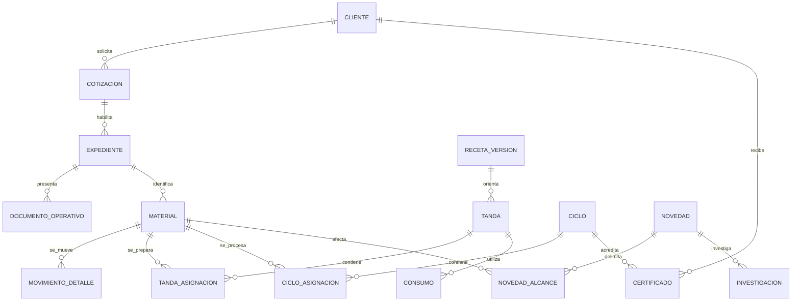

# Plan backend — recorrido operativo y trazabilidad

Fecha: 12 de noviembre de 2026. Entrega documental, sin implementación ni ejecución de migraciones. Fuente funcional: decisiones de esta conversación, que prevalecen sobre propuestas anteriores. Arquitectura técnica propuesta, sujeta a revisión del contrato en B0.

**Objetivo:** reconstruir desde cada entrega y certificado los materiales, cliente, acuerdo comercial, recepción, custodia, preparación, ciclo, consumos, liberaciones y novedades, preservando los documentos existentes.

**Stack existente:** NestJS, TypeORM y MariaDB/MySQL; Vitest y Supertest. Mantener el monolito modular: servicios de dominio y repositorios, sin introducir microservicios. Skills aplicadas: writing-plans para descomposición y aceptación; nestjs-best-practices para módulos, DTO, guards, dependencias y transacciones.

## 1. Reglas que no deben cambiar durante la implementación

- Comercial administra servicios habituales y particulares; un catálogo ofrece conceptos y el asesor digita cantidades/precios. El borrador se ajusta a los servicios elegidos por el cliente. Asesor prepara y solicita revisión; administrador de Comercial aprueba o devuelve; asesor emite. No conceder aprobar al asesor ni permitir autoaprobación por acumular roles.
- Al emitir se habilita Logística, no Planta. La cotización aprobada/emitida conserva valores inmutables. Ningún movimiento, merma, devolución o reproceso recalcula precios ni totales. Comercial decide y registra por separado una eventual factura por diferencia.
- Excel es referencia histórica de campos, no fuente operativa. Cliente, contacto, alcance y valores proceden de Comercial; Logística captura materiales reales y eventos.
- Modalidad documental del cliente: orden, acta o ambos. Un registro interno de trabajo conserva la trazabilidad en las tres modalidades. Orden y acta no duplican cantidades ni generan dos recepciones.
- Una ruta puede recoger varios clientes; recepción directa omite recogida. Actas por cliente, nunca una sola acta que mezcle clientes de una ruta.
- Recibir, trasladar a Planta, procesar, liberar y entregar puede ocurrir parcialmente. Las cajas no son unidades de producto ni tienen una conversión implícita.
- Logística y Planta retienen preventivamente y reportan; Calidad determina alcance, tratamiento y liberación. El resto puede continuar una vez determinado que no está afectado.
- Devolución de Sterinova y retorno del cliente son movimientos diferentes, ambos con investigaciones independientes. Un retorno no borra una entrega ni cambia automáticamente un certificado.
- Recetas de Planta independientes de la ficha comercial, vinculadas explícitamente al cliente del trabajo. Versionadas por cliente/producto/proceso. Insumos por unidad o fijos por tanda; una tanda puede continuar otro día sin duplicar el consumo fijo.
- Inventario propio separado de materiales del cliente en custodia. Solicitar no aumenta existencias; transferir no consume; consumo real confirmado reduce existencias.
- Un ciclo admite materiales de varias órdenes/clientes; una orden admite varios ciclos. Un certificado por cliente y ciclo; ningún certificado expone materiales de otro cliente.

## 2. Código comprobado y brechas

| Evidencia actual | Brecha / intervención |
| --- | --- |
| `src/cotizaciones/cotizaciones.service.ts`: crear, editar, aprobar y emitir; estado de creación configurable y aprobación desde BORRADOR | Formalizar máquina de estados y exigir revisión/aprobación de la misma versión antes de emitir. Revisar emisión actual sin asumir que ya aplica toda la secuencia. |
| `src/cotizaciones/entities/cotizacion-item.entity.ts`: descripción, cantidad, precios; sin servicio/unidad estructurados | Añadir catálogo y snapshot de condiciones por concepto sin destruir líneas manuales históricas. |
| `src/ordenes-servicio/entities/orden-servicio.entity.ts`: `cotizacion_id` único y OneToOne | Evolucionar a cotización con múltiples trabajos/órdenes; separar documento institucional del expediente interno. |
| `src/logistica/logistica.service.ts`: PENDIENTE → EN_RUTA → RECOGIDO → EN_PLANTA; creación exige APROBADA | Sustituir avances manuales globales por eventos de custodia y habilitación tras emisión; admitir recepción directa. |
| `src/ordenes-servicio/entities/orden-servicio-material.entity.ts`: cantidad entera, empaque libre, material ligado a orden | Material canónico del trabajo, cantidades decimales por unidad, movimientos e identificación independiente de documento. |
| `src/planta/planta.service.ts`: consulta EN_PLANTA, protocolo por método; ciclo registra orden | Tandas, etapas, asignaciones parciales y consumo. No declarar toda orden procesada al guardar un ciclo. |
| `src/certificados/entities/certificado-esterilizacion.entity.ts`: OneToOne con ciclo y orden opcional | Colección de certificados por ciclo; identidad cliente explícita y detalle filtrado por asignación. |
| `src/database/entities.ts` y `src/app.module.ts`: registro explícito de entidades/módulos | No hay módulos de bodegas/tandas/investigaciones en la composición revisada. Registrar nuevas unidades en estas entradas. |
| `src/rbac/permission-catalog.ts`, `quote-access.ts` y autorización por ámbitos | Reutilizar permisos/ámbitos; un permiso reconocido no implica grant persistido. Las lecturas mixtas deben verificar todos los registros relacionados. |
| Snapshots, versiones de formato, hash PDF y token público de certificado existentes | Conservar infraestructura documental; ampliar detalle por cliente y emitir documentos auditables sin regenerar silenciosamente originales. |

Inspección estática del checkout con cambios locales preexistentes. No se ejecutaron servicios, pruebas de BD ni consultas de datos. Siigo es origen futuro/externo indicado por el usuario, no integración acreditada por esta inspección.

## 3. Modelo propuesto y límites de módulos

### Núcleo del recorrido

`ExpedienteServicio` identifica un trabajo de un cliente y referencia la cotización emitida; contiene modalidad documental congelada, condiciones e instrucciones de recogida. La cotización puede originar varios expedientes. No usar el nombre del cliente como identificador ni como estado operativo.

`MaterialServicio` registra descripción operativa, referencia, lote del cliente, unidad y origen. `MaterialServicioConcepto` enlaza material con uno o más conceptos contratados: esterilización y empaque pueden ser servicios sobre el mismo material sin duplicarlo físicamente.

`DocumentoOperativo` representa orden/acta, consecutivo, formato, expediente y emisiones. Un expediente admite ambos tipos y nuevas emisiones históricas; las cantidades se leen del mismo registro operativo. Como default técnico, cada recepción abre un acta del cliente/trabajo cuando su modalidad la requiere; recepciones posteriores quedan en el mismo expediente con sus actas vinculadas. Validar esta granularidad institucional en B0 antes de fijar numeración.

`MovimientoCustodia` + `MovimientoCustodiaDetalle` registran origen/destino, cantidad de producto, unidad, cajas, evento real, fecha de captura, emisor/receptor, confirmación y evidencias. Eventos: recepción cliente, traslado a Planta, retorno desde Planta, entrega cliente, devolución sin completar y retorno posterior. Un movimiento confirmado no se edita: corrección autorizada por contramovimiento vinculado.

### Planta e inventario

- `ClientePlanta` vinculado explícitamente a `Cliente` comercial; recetas propias sin editar datos maestros comerciales. Coincidencias ambiguas bloquean asignación, no se unen por nombre automáticamente.
- `Receta` → `RecetaVersion` → etapas e insumos; bases `POR_UNIDAD` y `POR_TANDA`, unidad y factor explícitos. Versión aprobada fija en cada tanda.
- `TandaPreparacion` → asignaciones de materiales/cantidades → ejecuciones de etapa → consumos y evidencias. Lote cliente, tanda y ciclo son identificadores distintos.
- `Insumo`, `UnidadMedida`, conversiones explícitas, `Bodega`, `LoteInsumo`, `SolicitudInsumo`, `TransferenciaInsumo`, `MovimientoInventario`. Reservado, en tránsito y disponible se distinguen. Cada movimiento se contabiliza una sola vez. Merma y devolución utilizable son causas diferentes.
- `Equipo` y reglas/versiones de compatibilidad aprobadas por Calidad. `CicloAsignacion` relaciona ciclo con cantidades de material/tanda y expediente; valida método, capacidad y restricciones antes de iniciar. No inventar capacidad ni compatibilidad por defecto.

### Calidad y cierre

- `Novedad` compartida entre áreas, con tipo, alcance material/cantidad, evidencia y responsables. `Retencion` explícita y activa bloquea uso/traslado/salida del alcance afectado, exceptuando movimientos de tratamiento autorizados.
- `Investigacion` independiente por evento de devolución/retorno; cadena de custodia enlazada, hallazgos, decisiones, acciones y cierre. Un caso puede referenciar otros sin fusionarlos.
- `EvaluacionCalidad` y `LiberacionDetalle` por cantidades y evidencias. No confundir liberación parcial con aprobación de todo el ciclo.
- `Certificado` por ciclo/cliente con detalle de asignaciones liberadas. Revisiones/anulaciones se vinculan al original; unicidad de emisión lógica por ciclo/cliente, con historial de versiones. Decisión pendiente de validación B0: cómo documentar liberaciones sucesivas del mismo cliente/ciclo. No convertir la espera de todo el conjunto en bloqueo obligatorio de entregas parciales ya acordadas. Evaluar certificado con detalle liberado y reemplazo versionado al ampliar el alcance, conservando qué versión acompañó cada entrega; no emitir certificados paralelos ambiguos. Esta política requiere aprobación documental de Calidad antes de implementar B7.
- `Despacho`/`EntregaDetalle` usa únicamente cantidades liberadas disponibles y documentos aplicables. `ReferenciaAjusteComercial` registra decisión y documento externo/interno de diferencia; no implementa facturación fiscal ni envía a Siigo en esta fase.

No usar una sola ecuación sumando estados superpuestos: procesado/liberado son hitos; ubicación y custodia son saldos; retención es una restricción. El retorno incrementa custodia de Sterinova sin reducir la entrega histórica. Cada ingreso conserva su origen para distinguir el retorno de material nuevo.

## 4. Contratos API propuestos

Rutas de recurso relativas al prefijo global existente; nombres propuestos, no endpoints ya disponibles. B0 publicará ejemplos OpenAPI y fixtures compartidas antes de implementar pantallas. Reutilizar las rutas existentes cuando su semántica sea compatible y ofrecer adaptación para los consumidores legados.

| Capacidad | Contrato de comandos/consultas propuesto |
| --- | --- |
| Servicios y comercial | `GET/POST /servicios`; `POST /cotizaciones/:id/solicitar-revision`, `/aprobar`, `/devolver`, `/emitir`; `GET /cotizaciones/:id/expedientes` |
| Seguimiento | `GET /expedientes/:id` y `/trazabilidad`: condiciones, documentos, cantidades por ubicación, hitos, retenciones y acciones permitidas |
| Rutas | `GET/POST /logistica/rutas`; `POST /logistica/rutas/:id/paradas`; `POST /logistica/rutas/:id/iniciar` |
| Recepción/custodia | `POST /expedientes/:id/recepciones`; `POST /expedientes/:id/traslados`; `POST /traslados/:id/confirmar`; diferencias crean novedad |
| Novedades | `POST /novedades`; `POST /novedades/:id/retenciones`; `POST /calidad/investigaciones`; `POST /calidad/investigaciones/:id/decisiones` y `/cerrar` |
| Bodegas | `GET /inventario/existencias`; `POST /inventario/solicitudes`, `/transferencias`; `POST /inventario/transferencias/:id/recibir` |
| Recetas/tandas | `GET/POST /planta/recetas`; `POST /planta/recetas/:id/versiones`; `POST /planta/receta-versiones/:id/habilitar`; `POST /planta/tandas`; `POST /planta/tandas/:id/etapas` y `/consumos` |
| Ciclos | `POST /planta/ciclos/:id/asignaciones`; `POST /planta/ciclos/:id/validar-carga`, `/iniciar`, `/finalizar`; datos reales fuera de criterio se conservan y remiten a Calidad |
| Calidad | `POST /calidad/evaluaciones`; `POST /calidad/liberaciones`; `POST /ciclos/:id/clientes/:clienteId/certificado`; consulta de expediente técnico |
| Entrega y retorno | `POST /expedientes/:id/despachos`; `POST /despachos/:id/entregas`; `POST /entregas/:id/retornos`; `POST /expedientes/:id/devoluciones` |
| Diferencias comerciales | `POST /comercial/ajustes-referenciados`: expediente/novedad, decisión, documento y responsable; sin modificar cotización |

DTO de detalle cuantitativo: identificador del material/asignación, cantidad decimal serializada como string, unidad, cajas separadas; actor desde sesión, no confiado al payload. Eventos reales llevan instante con offset; guardar UTC y mostrar Bogotá. Fecha programada sigue siendo fecha civil. Requerir `version` para edición de borradores y `Idempotency-Key` para confirmaciones/emisiones; la misma clave y payload devuelve el resultado original y una clave reutilizada con otro payload genera conflicto.

Respuestas distinguen validación 400, autorización 403, recurso no visible/no encontrado 404 conforme política existente y conflicto de estado/saldo/versión 409. Listados paginados con filtros de cliente, expediente, área, fecha y retención. Totales monetarios históricos y cantidades operativas se exponen separados; nunca calcular precio por cada material sin una correspondencia comercial aprobada.

## 5. Integridad, permisos y concurrencia

- Transacciones TypeORM por comando; bloqueo de filas de saldo/asignación/retención en orden estable para prevenir sobreasignación y dobles consumos. Restricciones únicas de idempotencia, consecutivos y emisión lógica.
- Reserva de ciclo reduce disponible para asignar, no cantidad recibida. Inicio confirma afectación; cancelación antes de inicio libera reserva mediante movimiento; fallo posterior conserva ejecución y requiere decisión sobre reproceso.
- Evaluar retenciones dentro de la misma transacción del consumo, inicio o despacho. Cambiar el estado en la UI no autoriza un movimiento.
- Eventos de auditoría y mutación de dominio se confirman juntos. Notificaciones pueden implementarse mediante outbox transaccional; fallo de notificación no revierte un movimiento físico ya registrado.
- Generación PDF reintentable desde snapshot inmutable, con estados pendiente/listo/error. Un fallo no repite liberación, consecutivo ni movimiento; no entregar certificado sin emisión válida.
- Mantener permisos por acción y ámbito. Comercial: borrador/revisión/emisión/consulta y ajustes; administrador Comercial: aprobación/devolución; Logística: rutas/custodia/retener; Planta: recepción/preparación/consumos/retener; jefe Planta: recetas; Calidad: habilitación técnica, investigación, tratamiento/liberación y certificados. Valores comerciales visibles a Planta según lo solicitado, con permiso de consulta, no edición.
- Comercial puede ver trazabilidad de su trabajo sin recibir datos de otros clientes que comparten ciclo. Los certificados públicos mantienen su protección y filtran estrictamente el cliente.
- Prohibir ajustes automáticos negativos y mezclas de unidades. Propuesta: cantidades `DECIMAL(18,6)` y precisión permitida por unidad; redondeos y conversiones explícitos en B0, sin reutilizar precisión monetaria.

## 6. Hitos de implementación y aceptación

Cada hito termina con contrato, pruebas focalizadas, build, revisión documental y demostración con datos ficticios. No desplegar el siguiente flujo hasta que sus invariantes funcionen. Entregar en paralelo su hito frontend correspondiente.

### B0 — Contrato del recorrido y compatibilidad

- [ ] Mapear contratos existentes, consumidores PDF y permisos efectivos; conservar diff local ajeno.
- [ ] Fijar OpenAPI vNext, ejemplos de DTO, estados y catálogo de eventos; resolver granularidad de actas y política de certificados parciales descritas arriba con responsables.
- [ ] Definir matriz de datos históricos comprobables y datos desconocidos; fixtures canónicas: 1.000 recibidos/10 devueltos/990 procesados; dos clientes en ciclo; retorno 10 de entrega 100.
- [ ] Aceptación: backend y frontend usan el mismo vocabulario y muestras; ninguna equivalencia histórica presupone recepción o liberación real.

### B1 — Comercial y expediente

- [ ] Añadir catálogo, condiciones estructuradas, snapshots por concepto y modalidad documental; mantener condiciones textuales institucionales.
- [ ] Implementar borrador → revisión → aprobación → emisión; devolución a borrador invalida aprobación previa. Emisión idempotente crea habilitación/expediente para Logística.
- [ ] Aceptación: de 15 conceptos se emiten 8 elegidos; asesor no aprueba incluso llamando API; emitir versión distinta de aprobada falla; cotización emitida no cambia por movimientos posteriores.

### B2 — Logística, rutas, materiales y documentos

- [ ] Añadir rutas multicliente, llegada directa, materiales reales y vínculo a conceptos; emitir orden/acta según modalidad sin duplicar recepción.
- [ ] Implementar traslados parciales con confirmación por receptor, fechas, responsables y diferencias; producir historia de custodia.
- [ ] Aceptación: 600 y 400 se reciben por separado; una ruta no mezcla actas; PGM contratado no se confunde con material observado; cantidades/cajas y precio contratado se muestran separados.

### B3 — Novedades y retenciones transversales

- [ ] Introducir novedad y alcance cuantitativo, retención preventiva, investigación independiente para ambos sentidos de devolución y decisiones de Calidad.
- [ ] Bloquear avance del alcance retenido; mantener visibles los pendientes a Comercial; permitir movimientos de tratamiento solo con decisión explícita.
- [ ] Aceptación: una carrera entre retención y despacho no libera material retenido; 10 de 1.000 quedan afectados y el resto solo continúa tras delimitación autorizada.

### B4 — Microbodega y consumo

- [ ] Incorporar insumos, unidades, lotes, bodegas, solicitudes, transferencias y recepción; saldos iniciales solo desde inventario aprobado, nunca inferidos de Excel.
- [ ] Registrar consumo real, sobrantes y mermas mediante movimientos; no descontar al abrir receta.
- [ ] Aceptación: 100 enviados/98 recibidos deja diferencia 2 sin inventario duplicado; consumo 20 deja 78; reintento de recepción o consumo no duplica y dos consumos concurrentes no producen saldo negativo.

### B5 — Recetas y tandas

- [ ] Incorporar identidad de cliente Planta vinculada, versiones de recetas, etapas e insumos por unidad/tanda; aprobación técnica antes de habilitar.
- [ ] Crear tandas de cantidades parciales y confirmar etapas/evidencias; consumos previstos separados de reales; permitir continuar una tanda al día siguiente.
- [ ] Aceptación: 60 y 40 en dos tandas aplican fijos dos veces; una misma tanda continuada aplica el fijo una vez; cambiar receta no altera trabajos iniciados.

### B6 — Equipos y cargas compartidas

- [ ] Introducir equipo/capacidad y compatibilidad versionada suministradas por responsables; asignaciones N:M de materiales y ciclos con reservas.
- [ ] Registrar inicio/fin, valores reales, evidencias y fallos; reproceso como ejecución vinculada, sin repetir recepción ni sumar cumplimiento doble.
- [ ] Aceptación: X60 + Y40 en un ciclo conserva origen; X40 sigue pendiente; carga incompatible/desconocida o fuera de capacidad no inicia; medición real fuera de rango se conserva para evaluación.

### B7 — Liberación y certificados

- [ ] Evaluar cantidades y evidencias, aplicar independencia de ejecutor/revisor y controles de formato existentes.
- [ ] Sustituir certificado único por ciclo por emisión por cliente/ciclo; filtrar snapshot por asignaciones liberadas; gestionar reemplazos/anulaciones sin sobrescritura.
- [ ] Aceptación: ciclo mixto produce dos certificados sin filtraciones; reproceso conserva origen; retorno no cambia el certificado automáticamente; fallo de PDF se recupera sin duplicar certificados.

### B8 — Entrega, servicios alternos y cierre integral

- [ ] Confirmar retorno de Planta a Logística, novedades de recepción incompleta, despachos/entregas parciales y retornos posteriores vinculados.
- [ ] Aplicar rutas/documentos de cierre de servicios sin esterilización: constancia de conformidad de acondicionado, liberación de lavandería y comprobación de despacho de insumos; criterios específicos suministrados por Calidad.
- [ ] Registrar ajustes comerciales separados y cerrar trabajo cuando todos los saldos tengan destino; investigación y cierre comercial mantienen estados independientes.
- [ ] Aceptación: 990 certificados/entregados + 10 devueltos concilian 1.000; entrega100/retorno10 conserva entrega100 y custodia10; los precios no cambian; operación cerrada puede mantener investigación abierta.

## 7. Pruebas y despliegue por etapas

Pruebas unitarias de políticas de cantidad, permisos, estados, conversión y cálculos. Integración transaccional con MariaDB aislada para bloqueo, idempotencia y restricciones: mocks no acreditan concurrencia. Contrato OpenAPI y E2E Supertest para casos por rol y ámbito. PDF con fixture de ciclo mixto, paginación y verificación de ausencia de otro cliente. Ejecutar `npm test -- <specs-del-hito>` y `npm run build`; integración/E2E solo sobre entorno aislado autorizado. No usar `start:dev` para verificar: su script ejecuta migraciones.

Migración propuesta expandir → conciliar → cambiar lecturas/escrituras → retirar compatibilidad en una entrega posterior:

1. Crear tablas/columnas aditivas y enlaces legados; conservar IDs, consecutivos, snapshots, hashes y archivos emitidos.
2. Preparar backfill idempotente con informe previo. Asociar solo hechos demostrables; una fecha programada no es recepción, PROCESADO no es liberación, cantidad cotizada no es recibida. Datos faltantes quedan pendientes de conciliación y no habilitan operaciones sensibles.
3. Migrar relación orden/cotización y ciclo/certificado tras identificar índices reales; convertir al modelo N:M con enlaces demostrables. No inventar varios clientes en un ciclo legado ni regenerar documentos históricos.
4. Activar por área/conjunto de trabajos en entorno de ensayo; verificar conteos, saldos, documentos y trazabilidad. Mantener lectura de originales y contratos legados durante transición.
5. Retroceso de aplicación desactiva el nuevo flujo sin borrar eventos nuevos; no ejecutar un down destructivo tras aceptar operaciones. Las migraciones y backfills requieren solicitud/autorización explícita separada antes de tocar bases de datos.

Medir tras activación: conflictos de saldo, rechazos por retención, diferencias de transferencias, documentos pendientes/error, trabajos sin vínculo documental y movimientos sin conciliación. Umbral de aceptación funcional: cero doble consumo, cero mezcla de clientes en certificados y cero alteraciones de importes emitidos en las fixtures canónicas.

## 8. Datos que bloquean la habilitación operativa, no la documentación

- Responsables de Planta/Calidad deben proporcionar recetas, etapas, unidades/conversiones, capacidades, compatibilidades y criterios de aceptación. No habilitar valores ficticios en producción.
- B0 debe validar granularidad institucional de acta y numeración, y la regla técnica conservadora de certificado por cliente/ciclo antes de codificar esos contratos.
- Requiere conciliación de permisos y asignaciones existentes; no asumir que nombres de cargo equivalen a grants actuales.
- Origen Siigo: acordar identificador externo y método de intercambio en un alcance posterior; no importar ni sincronizar sin especificación/autorización. La operación inicial usa clientes existentes vinculados explícitamente.
- Factura por diferencia: solo referencia y decisión comercial en este plan; integración fiscal/contable es otro alcance. Ninguna regla aquí autoriza recalcular cotización emitida.

Esta hoja de ruta permite estimar y preparar hitos. Antes de implementar cada uno, convertir sus contratos revisados en tareas de código y pruebas exactas; no presentar los parámetros técnicos aún no suministrados como decisiones del implementador.
